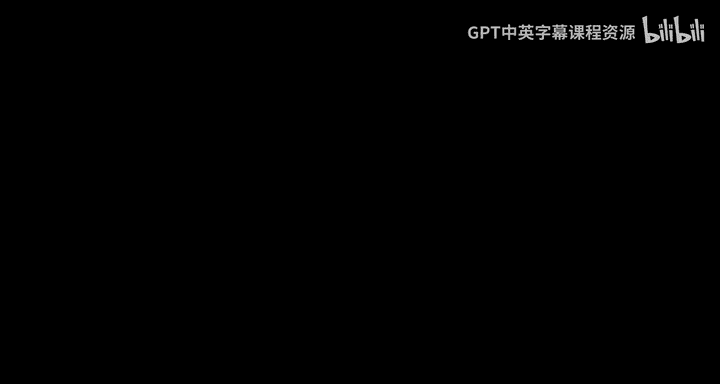

# 密歇根大学《ChatGPT 示教｜ChatGPT Teach-Out》中英字幕 - P22：21_政府监管机制.zh_en - GPT中英字幕课程资源 - BV1Rr421L7BX

I'm not sure how we should think about how the government should regulate technologies like smart AI。

 I think I'm sure there will be discussions of doing just that。

 I worry that we might be too hasty right now， a lot of it just looks like speech and just communication and we should always be wary of giving the government too much reach into silencing speech。

 even speech that we don't like。 And so I think we want to be careful about seeding that kind of control so early。

 There may be circumstances in which we really want to create regulations where we notice a particular kind of problem with these technologies。

 but I don't know where that where that is and where that will be yet。

 You know there's all sorts of challenges right now with smart AI that create deepfi， you know。

 images of people who never existed or images of people who exist。 and and placing。

Images say on a different body or making a person look like they're in a place where they are not。

 This kind of sophisticated technology is ripe for misuse in ways that I think chat EptT is not quite there yet so we want to be careful about those kinds of technologies and I think we will see examples of ways that smart AI can be manipulated by people in order to inspire misconduct of some kind or another。

 and so it won't surprise me if we see some regulation emerging I don't think the sky is falling just yet and we should be careful about being too hasty I'm not sure whether these kinds of smart AI technology can be regulated effectively。

 I just don't know yet I think it's still too early to know people can be regulated and maybe there will be mechanisms in place for us to know a great deal more about who's making what kinds of uses with。

Technologies so a company like Open AI might be able to tell you， yes。

 it was this person who used this language it was this person who inspired the chatt EptT to create this particular paragraph that that may be the case but when when this kind of smart AI is all over the place and people are able to generate it on their own once once we're a lot more comfortable and don't have the accountability that exists with these early adopters or even the identifiability that exists with these early adopters I'm not sure how we'll be able to keep that locked up as well that will be able to know whoses accountable for what we just won't know in the same way that we don't know whether grammarly helped me write a particular essay or whether I went to my next door neighbor asked them to look at it and they gave me comments my neighbor。

know and maybe grammarly will know， but I think there are all kinds of reasons where we might not be able to know and thus hold people accountable。

 which is often what regulation is trying to do， that is to encourage some behavior and discourage other kinds of behavior。

 maybe beyond what we're able to identify， I don't know。

 and I do think when the AI makes the next generation of AI。

 it will become even more difficult for us to know just who's doing what。

