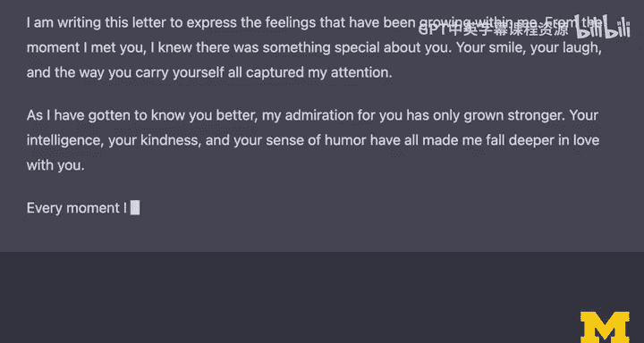

# 密歇根大学《ChatGPT 示教｜ChatGPT Teach-Out》中英字幕 - P34：33_ChatGPT的未来发展.zh_en - GPT中英字幕课程资源 - BV1Rr421L7BX

So chat GT will probably change a lot about the way we both do professional work。

 but also how we interact with everybody， even in informal context。

 I think there's a number of different obvious applications of chat GT one is to help us draft any kind of text that we might write。

 know that could be everything from text that you exchange with your friends and family to emails that you write at work to you know to research papers。

 to newspaper articles， to marketing copy， even poetry。

 possibly it's pretty limitless in terms of what chat GT could do to help draft。 Now， at this point。

 I don't think anybody would necessarily entrust chat GT with you know the whole writing process end to end。

 at least if you're if you're somebody who writes for a professional purpose。

 but it could go a long way towards making that writing much easier。

 So that's one class of possible application。I think there's another one which is actually more about proofreading and providing feedback to writing。

 So for example， as a research scientist， I often end up writing lots of research papers and one of the hardest things is to get meaningful feedback on those was it takes a lot of effort and time and brain power to think about somebody else's writing and to provide meaningful feedback systems like chatt ET who could eventually probably be configured in a way to provide feedback not just at the level of grammar and punctuation。

 but also more substantively in terms of the content。

 does it make sense is it something that's new or is it something that seems to have already been said things like that and then lastly I think one of the probably most interesting possibilities for technologies like chat EptT is where we start using it as a kind of conversational personal digital assistant so right now when you do anything on your phone mostly you're having to hit buttons。

 click on buttons， type text and so on in a very prespecified way。

if you could just talk to your phone and say， hey， I would like to schedule a trip for our family's vacation。

 and here are the rough parameters。 And then a couple seconds later。

 the system comes back and tells you okay well we have these flights available Would you would like to go to this city or this city and you can basically have an ensuing conversation just like you would have with a real travel agent and imagine that kind of system applying to pretty much everything we already do online。

 I can imagine that that's the kind of future that we're looking at with technologies like Chaty PT One of the I think biggest concerns about technologies like Chay PT and AI in general is what it will do to the job market what does it mean for employment。

 and I think there's no doubt that it will impact a range of professions even those that we have traditionally thought were well beyond the realm of machines So you just based on the kinds of things that we can imagine Chay PT doing I would guess that a whole range。

OfJo will find that， you know， on the one hand， certain people with those jobs will be able to use chat ET to further to do their jobs better to do them more efficiently at the same time。

 what that would mean is that organizations have less need for human beings So， for example。

 if the person who's the best writer on your team can do the job of 10 people with chat ET。

 then it's not clear why a company will need to hire the other 9 people right And I think over time willll see not so much that the technology completely does jobs that are currently being done by people end to end but that theyll provide such a amplifier for a small number of people that it will over time affected the job market。

 And I think we're actually already seen we have seen exactly this phenomenon in， for example。

 manufacturing where factories have effectively， this place to some degree human beings in those factories。

 So the negative。act of technologies like chat GPT1 again。

 is potential encouraging into the job market。 I think for the first time in human history。

 white collar workers will begin to fear machines as competitors for their jobs。 And again。

 we're already seeing signs of things like that a couple months ago。

 there was a outcry among illustrators because several magazines had used AI generated illustrations for their magazine articles or even for a magazine cover。

 So that kind of thing is just going to keep happening。 So that's one class。

 I think there's another type of challenge with technologies like chat GPT。

 which is they enable fraud at an unprecedented scale and possibly quality。

 right So already we all receive these emails that are always trying to trick us into clicking on something or giving away our passwords。

 you know， not too far in the future。 we're going to be able to end up with a world in which you。

Think you're getting a Facetime call from your grandma who might be begging you to help her pay a medical bill。

 but it's actually not your grandma。 It could be a computer generated image of somebody who looks a lot like her。

 and saying things in a style that sounds just like her and so on。

 that world is unfortunately not too far away。 So fraud I think there's a third class of challenge。

 which is where AIs might go rogue。 And again， we're already seeing examples of this。

 there was an article just the other day about how know。

 an extended conversation with a new AI enabled being search engine that Microsoft put out。

 you know ended up in a funny conversation where the AI was claiming that it was in love with the with the person on the other end。

 And then even suggesting that they have that their spouse doesn't love them。

 that kind of thing very creepy weird stuff。 And you know right now， we can kind of laugh about it。

 But the challenging thing about that is that even the engineers behind the system。😊。

Fully understand why that happened， right， And so that's an illustration of an AI going rogue in a way that even engineers don't fully understand。

 And I think that could get much worse。 And then finally。

 I think there's a class of challenge where there will be cultural shifts in the way we do work and then in the way that we interact with other people。

 So for example， once you begin to have digital assistants that can have full conversations with you and with other people。

I'm pretty sure we're going to have a situation where friends will be chatting to each other where it's not them talking to each other。

 It's their AIs talking to each other， right， And as things like that happen more and more， you know。

 you can imagine already we're worried about the mental health challenges that a lot of social media provides。

 You know what happens when we're not even talking to our friends。

 but our computer systems think are， they're actually having whole conversations behind our backs。

 it's hard to even imagine what some of those impacts will be， But they don't seem。

 they don't seem great。