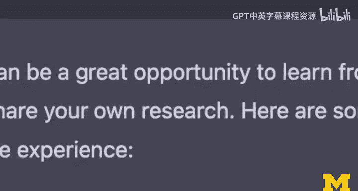

# 密歇根大学《ChatGPT 示教｜ChatGPT Teach-Out》中英字幕 - P35：34_AI在自助建议中的应用.zh_en - GPT中英字幕课程资源 - BV1Rr421L7BX

Yes， I think that with any technology， I think people are really worried。

 especially because they didn't anticipate with things like Facebook and Twitter that it would be as polarizing as it is right and on those platforms because there social platforms people are seeking attention。

 seeking followers and so we tend to be kind of like drawn toward people who take more extreme positions So Phil Tlock wrote this amazing book called expert political judgment and what he essentially found is that people who take extreme positions are actually worse than random in terms of making predictions and and essentially what you get is if you're listening to someone on the far left or the far right。

 you might as well you're better off throwing a dart at a board and just randomly picking it's going going to go down is going stay the same that's a better strategy than watching MSNBC or Fox。

 The interesting thing about chatt G3 is that' you can ask it for a liberal opinion or a conservative opinion。

 but it kind of gives you this middle of the road here's。

Kind of generally what we think there's humans in the loop in this。 So there's been humans sort of。

 checking。And training this algorithm to try and give reasonable responses。The。

 it's really good at kind of like very basic advice。 So， you know， I ask it like。

I'm a second year graduate student。 I'm going to my first academic conference or my first professional meeting。

 What should my strategy be， know， how do I do this？ And the advice came back and said really simple。

 Okay so first off， you know， if you're presenting， make sure that you know。

 you've got your presentation ready， you know， make sure you， you know， you're dressed appropriately。

 make sure you kind of like really you know doing doing a good job when you're kind of on the stage。

 Second thing you want to think about is are there new things you really want to learn and and look out。

 you know， look for those topics and in trying of those sessions。 Third thing is。

 even though you might be meeting famous people in the field。

And you're excited about that。 You don't want to get go up to them and start talking about your research because you're a second year grad student。

 so chill。For thing is is however， this is an opportunity to meet other young people。

 so go to panels。Then need do it and introduce yourself to young people because they're going to be in the same boat as you。

And the last thing it said is don't overschedule， you know。

 maybe only schedule like 60% of your time because you want to be able to adapt because you might find。

 oh， I'm going to go to this panel and also you're just going to be mentally worn out。

And the last thing， the very last thing I said was。Know whether in these situations。

 you get energized or get worn out and adjust your schedule appropriately。 It's a really good answer。

 Its probably a better was a better answer than I probably would have given。 I mean。

 if I'd have SAT down for an hour and thought about it。

 But what's happening is it's scraping from the Web advice that a lot of people have given a lot of time。

 So just getting general advice， It does a， you know， as does Google。

 But the problem like if you go on Google， you find like 40 different articles each one with the take and often with extreme opinions。

 here it， it is has more of a middle of a road， the road effect。So， you know。

 I'm not gonna place a bet on this thing， but my guess is it's gonna be moderating a bit。

 but I don't know the question is will people use it， I mean。

 in the sense of like will people say I'm going to turn to this like weird AI and ask it for advice on buying a car。

 buying a house talking to my children about like the construction of a will。 those sorts of things。

 I don't know， but it's really good at those things。

 you know' like it's it's kind of frightening how good it is。

 but then it's not because what it's doing is it's it's averaging what we a bunch of people have done And again。

 I'm in this field of collective intelligence And the idea is that you know think of ants。

 know ants aren't that smart。 Each one kind like lays little chemical trail that they follow or they have little things on their antenna and they sort of communicate by touching their antenna but a collection of ants can find a food source and then find a route to it really fast。

 because it's aggregating this information。 So if you think of this。

Not as this kind of like super brain， you know， that's got mysterious evil you know。

 goals and instead think of it as just like。An aggregate of what people have thought。

And you approach it from that perspective。 And you think， you know， I'm trying to decide。

 should I retire， I'm trying to decide， you know， should I switch careers， I'm trying to decide。

 should I， you know， move closer to my adult children， I'm trying to decide， you know。

 should I intervene with my child who's taking a year off from college or how do I have that conversation that you could kind of interrogate those。

 Like， you know， tell me more about this first point or I disagree with and。

That I think that can be fun because， again， when we're exposed to ideas， it causes us or knowledge。

 it causes us to think。 And so this is a way to have a conversation with。😊，A very。

 very bright entity， a super knowledgeable entity。 And then from that。

 that having those conversations with that as opposed to just searching。

I think spurs us to think in ways we might not have before， right， And I think that's exciting。

 but I really think。While it's easy to focus on the negative aspects of this。

I would like to think that， you know， when given the light bulb， when given the car or， you know。

 given these new technologies that most people are going to use those。

To try and find ways to make their lives better and not just chat。

 But like so many people have so much fun with Dolly。

 my students serving a lot of fun with the music software， right， It's。

 it's incredible to see how much joy people are getting from this and how much productivity is coming from。

 there's， there's a question I like， you know， if you ask it a really delicate question， sometimes。😊。

It just punts It says， I'm not going get， know， doesn't say I'm not going to go there。

 but it if you were to say to talk to me like a hipster， it would say I'm not going to go there。

 So some questions， it just won't。Go into。 But if you ask it like like someone at a thing I was at the other day said。

 you know， I typed in there， you know， give me some advantages of fossil fuels and it came back and said there are no advantages to fossil fuels and he was upset about this because he said。

 oh， this is this liberal thing and it's taking a position。

And so someone then just typed in what are the advantages and disadvantages of fossil fuels and it gave you know a bunch of reasons like it's very efficient as a store of energy right。

 it's easily stored and it's easily shipped right and then it had negative implications of fossil fuels as well so and and if you pushed it more。

 it talked about how you know even them under the most optimistic plans for。You know。

 reducing carbon output， there's going to be a transition where a fossil fuels will probably remain some part of our energy package。

 And you know， so it took something。 and again， this is this thing about polarization。

You'd have to pull that thing to get it to not be saying somewhat reasonable。You know。

 positions on it。 I think there are a set of questions that for whatever， you know。

 for I don't know what their criteria were that they've just decided they're not， you know。

 it's not going to respond to， right？ Like if you were to ask， you know。

 how do I engage in some sort of illegal activity or something right？

 It's like how what's the best way to chain my taxes。 I'm guessing it tried it。

 but I'm guessing it doesn't give an answer there，But。This is， I think， a really deep question。

 this is a thing where this is a question where I。If I have a lot of concerns。

 but one concern I have is that this is in the hands of a private company that supposedly is like a fixed profit。

 So they're basically saying we're only going to make so much money。

 but they haven't told us how much that's going to be。 Where if this。We're in the hands of。

 let's say， a consortium of universities。 One would imagine。

That you would have a large committee of people in a very public way kind of deciding what gets answered。

 what doesn't get answered， we have some understanding collectively in the hands of a private group that may be opaque what their policies are。

 that's maybe harder to tell and I know they have ethicists you know that they've hired to help them figure out what gets what questions get asked which questions answered which questions don't。

 but I think this is going to be something that's really going to be you know。

Really hard to sort out， but that like Facebook and Twitter in those places aren't responsible for misinformation。

 right， They can't be sued for because they're a platform。 They're not a news source。

 The question is， how will this be treated by。嗯。The government， by the legal system。

 if it gives bad advice， right， So if it gives someone advice to do something。

 even though it's not giving it advice， if you ask it a question， there will be issues of like。

 you know， is there some sort of legal responsibility there And to the extent there is。

 you're going to see them then。Tighten up the set of questions。

But I think personally be a mistake to limit it to questions。 You know， have this is， this software。

 these certain sensor are only used for like chemistry and physics and coding， right or something。

 right， I think we've got a。We've got to monitor it。In a way。

 and we've got to monitor it a lot of ways， I think we've got to monitor it and think about how people are using it and make sure we've got a lot of guardrails in place。

 But right now， I think if anything they've。I think right enough， anything。

 I think they've got pretty narrow guardw。Not that I've not that I've tried。

 but from people I've talked to， you know， they've said if you type in a bunch of stuff。

 you just get sorry， I'm not going to answer that。