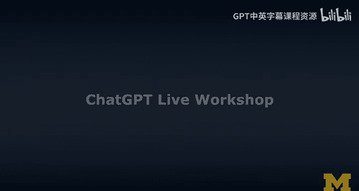
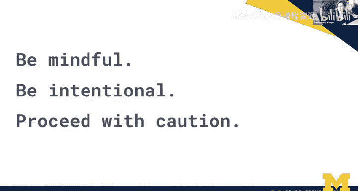
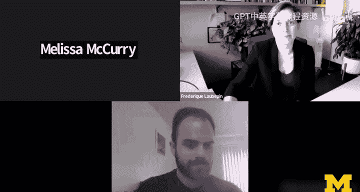
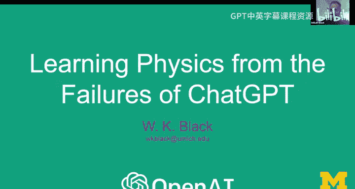
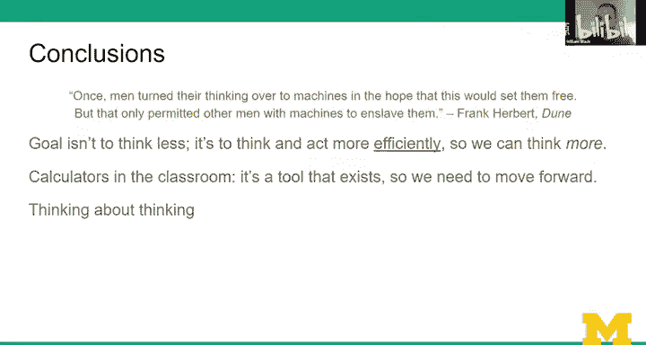

# 密歇根大学《ChatGPT 示教｜ChatGPT Teach-Out》中英字幕 - P37：36_ChatGPT现场研讨会实录.zh_en - GPT中英字幕课程资源 - BV1Rr421L7BX

Hello everyone， welcome to the chat GPT Teach Out Live Work。

My name is Melissa McCurry and I am a learning experience designer at the University of Michigan's Center for Academic Innovation。

I'll be one of your moderators for today's event， in addition to my colleague Nathan。

This live event brings together three unique voices to share examples of how to use chat GBT in the present and the future。

We hope that this workshop inspires you to experiment with chat GPT and think critically about how you can use it in your own life。

The Chad GBT T out is still live on Coursera， so please feel free to jump in and engage with our community of global learners。

You can find the link in the chat now。I want to thank everyone who has already submitted questions in the teach out and in the event registration。

During this live session today， we invite you to submit additional questions for our panelists in the Zoom Q&A section。

 and we'll do our best to answer as many as we can towards the end of this workshop。

Feel free to upvote questions from other participants given our limited time。

 we ask that you keep your questions related to the topic。

As we bring together this diverse community and discussion。

 we ask that you be respectful of our speakers and other learners as you engage with this event and the teach out。

Please note that this event is being recorded and will be uploaded to the Teach Out in Coursera afterward。

😡，I'd also like to point out that the closed captions have been enabled。

 and you may need to press the CC button on the bottom of your Zoom window to view the transcript。😡。

Without further ado， I'm pleased to introduce our presenters for today。First。

 we have Frederick Luepon。The Asistant Director of Instructional Services at the University of Michigan School of Public Health。

She has been leading discussions about chat GT with instructional designers across the University of Michigan campuses。

Next we have William Black， a PhD candidate in physics at the University of Michigan。

He has been exploring how to effectively teach students to use chat GPT as a tool or an assistant。

And finally， we have Cantaro Toyama。The WK Kellogg professorfessor of Community Information at the University of Michigan School of Information。

In his research， Canntro studies social change and international development。

 especially as it is impacted by digital technology。

A big thank you to our presenters for joining us today， let's jump in with our first presenter。

 Frederick。Thank you Melissa it's so wonderful to be here with you all today I'm going to start my presentation right now so as Melissa indicated I'm the assistantant director of Instructural services at the University of Michigan School of public health I would describe my role as helping people do what they do best when it comes to incorporating artificial intelligence into this work there are some guiding questions that I like to keep in mind to make sure that you know I'm using it appropriately some of these questions are you know is this an appropriate use of AI what is gained and what is lost from using AI to accomplish a particular task really you know I'm making sure i'm not letting the tail wag the dog so you know technology is following。

😊，purposeurpose not leading it， how is my use of AI supporting values that I or my institution hold dear and really importantly in the you know in an educational context。

 what is missing when I use AI is that information perspective or voice and this is particularly relevant because as much information as platforms like CdGBT utilize。

 it's still only a partial window into the universe of information。

 some decisions have been made around you know what information is appropriate you know some things have been rolled out and sometimes you come across those boundaries when you give the platform some prompts as we all know CdGPT is biased in several different ways but in one in particular in that it present。

So a very specific cultural perspective so what does this mean for how it gets used in education there's also a danger that it makestrain imagination and creativity its functioning is opaque as we as we all know and it has a tendency sometimes to hallucinate so you know that being said the question before us as a team was。

What role if any does you know can Chad GT have in the work that we do can I enlist its services as an instructional designer on my team one of the you know it's capable of a lot of different things including creating lesson plans and presentations I saw some of you were mentioning some of these uses in in the chat as we were starting this meeting I personally haven't been particularly impressed with the quality of the lesson plans for example that it creates in the sense that you know they're not particularly creative and this is where maybe you know there's a different distinction that we need to keep in mind between information and knowledge and at what point you know there information become knowledge that being said。

There are some things that I think are appropriate uses of JDGPT in an instructional design context and for example。

 if you give ChadGT a lecture transcript you can ask it to derive learning objectives from it it can refine those learning objectives if you ask it to it will give you some suggestions for improving the lecture。

 although I would argue that you know those are not particularly inspired suggestions。

 it can give you ideas for assessments， it can write multiple choice questions for you and provide discussion questions so when we think about the work that we do as instructional designers very rarely do we have the chance to apply an instructional design process ideally you know from start to finish one of the big pain points that we have is time both you know bandwidth on our。

teeam as well as the subject matter experts that we collaborate with and I do think that you know in terms of thinking about how we can leverage our experts you knowledge and expertise best there are some things that maybe Chad GPT can handle to free up their time and their focus on the things that matter the most。

 the takeaways for me in terms of this particular use case is that yes it can be helpful to address some of the major pain points that we experience as instructional designers。

 it is sort of a mediocre boring instructional designer。

 it will not come up with innovative ideas for teaching and learning。

 it is very good at curating information， but there is a little bit of a you know discrepancy between information。

And teaching knowledge and when we think about instruction at an institution like the University of Michigan where we pride ourselves on providing you know exceptional education I would want something that you know goes beyond what CdGT is capable of creating in and of itself there are some interesting explorations that we're looking at our school was already engaged in doing some curriculum revisions and in curriculum mapping and this is particularly time and resource intensive so we're looking at you know whether CGT could help us alleviate some of that some of that work or help with a little bit of that lift and another curriculum related。

Usage is to actually have our faculty run their courses through CheGT and answer the question can AI pass this course and I'd like to use this as a springboard for then a conversation about what needs to happen if the answer is yes then what needs to happen in terms of you know the assessments in that course what needs to happen in terms of you know does what we teach in that course need to change as a result of the answer to that question so that's one use case that I wanted to discuss that I wanted to bring up another one is that we've actually used CheGT to help us with a little bit of research。

EveryEvery year we survey our students and we ask them about their experience with the learning management system that we use here at Canvas and this year we asked ChDGT to summarize the open- endeded responses for us which it did quite well actually right so we asked students about what worked well for them and we asked students about what didn't work so well for them and ChedGT did a pretty good job of summarizing all these open endeded responses。

One interesting thing to note here is that， you know， with the same prompt and the same data。

When I asked the question and when a colleague on my team asked the question。

 ChedGPT provided slightly different summaries and focused on you know picked up on slightly different pieces of information so you know I think there's a really good use case for utilizing something like CGPT to help with tasks like analyzing qualitative data。

 you should always double check its work for the reason I just mentioned that you know it may give you slightly。

Different answers and you would you know always want to double check that it's not hallucinating in its summary what didn't work at all was when we followed up with you know suggestions for how to address the problems that it brought up in its summaries where you know if students were mentioning that a problem was that course sites were not organized TGBT suggestion was that well organize your course sites and you know it's like yes kept an obviousvi but that's actually not the true problem the problem is a skills gap in motivation gap an information gap that we need to address with our faculty so it will do a good job of analyzing things for you not so much at coming up with creative solutions to problems。

A third use case is one that that I did last just last week where I've had forever a big issue with getting on top of my to- do list I've tried every project management system I can think of and nothing's really been working and so last week I had this idea that maybe I could you know create something。

 it involves a spreadsheet and some coding to make it do something that I had in mind now this isn't my area of expertise so it was actually kind of a painful process of trying to describe to shed GPT what I was trying to use because you know I don't know the jargon and so it involved you know a lot of back and forth and then you know I landed in a place where I had a formula but it wasn't working and eventually it occurred to me that I could ask it to debug my formula。

Which it did。My spreadsheet now works in the way that I intended this was an interesting learning experience for me because it really kind of brought to light the importance of the prompt you know this isn't new this isn't specific to artificial intelligence but you know the quality of the question always drives the quality of the answer and if you're like me and you are struggling to articulate your question then you will you know the information you get will be you know less than less than stellar so when we think about education there's definitely a need for us to think about how to teach our students how to utilize the technology properly and how to build prompts that will yield good information the other thing is that we should never mistake the output for the learning outcome so in this case yes I got to the。

I had but did I learn anything in the process not really if I had to do this again I would have to go back to TTBT and have it you know give me the formula again so when we think about teaching and learning that's an important thing to keep in mind and at the end of the day we'll see if the system works any better than the other ones I've tried because I'm still the same human that I was before it so you know I will leave you with these you know pieces of advice which is you know when it comes to artificial intelligence and teaching be mindful。

 be intentional and proceed with caution。

Thank you。

Thank you for sharing your takeaways and your use cases with us today day， Frederick。

 we look forward to connecting with you again at the end of the session to day for questions。😊。

And next I'm excited to present our second panelist， William。开听模式。

So I'll be discussing how we can learn physics or hopefully you all can imagine some ways that this applies to any other field you're interested in。

 but what are some ways that you can really learn from the failures of chatGT and its successes？

。So first off， a big caveat just in general with AI。

 they're a bit like disembodied spirits in that they've never had a body。

 they don't understand a lot of things that anyone who spent 10 seconds in the real world understand so I tried using CheGPT to help me come up with some ideas for a quantum mechanics children's book and one of the examples of superposition that it gave was a tree that is both a solid and de liquidd which makes no sense it's not something you can really visualize。

So in addition to a couple of other bad examples， it actually gave a really good came up with a really good idea of a bird singing two notes at once。

 which is something that actually happens in the real world and is a beautiful example of superposition。

Another example of one of these fundamental failures that if you were if you ever had eyes then you would understand this。

 I asked it to code a star field to code stars passing you by and it did correctly except that it plotted white stars on a white background so any human doing this project would instantly know it has to be against a black background but to the AI it just says。

 oh yes I will plot stars that's what you asked for。There's some other fun examples of this。

Like from an AI generated chapter of Harry Potter， it said that there were leathery sheets of rain。

Rain never feels leathery， anyone who's ever felt rain can know that。

At the recent American Association of Physics Teachers Conference I went to。

 someone gave you the example where it successfully coded a Python mini golf hole。However。

 it had the golf ball rolling halfway into the ground。So。😊，Again， to the AI， it says， yes。

 I've done the task， but to any human， you've fundamentally missed an important aspect of reality that anyone who's had a body would understand。

Another main point that I want you all to take out of this。

 a general point is that AI is really good at getting the gist of things， but it fails on specifics。

So if you kind of avert your eyes from the screen and only look at the screen with your peripheral vision right now。

 then you would immediately say， yes， those are two clocks。However。

 if you start taking a closer look at it， then you notice that four has maybe three or four。

 maybe five strokes before it instead of just one and 10 looks a lot like a five and there are five hands here。

And on the right， when I asked it to make 630， it looks like between '09，16 and 0。4。

 you have it going halfway between 16 and 0。4。So although it does a really good job of getting the general feeling of this。

 it does a really poor job on the specific details。

A more funny example of this is coat with drawing hands。

Where again if if you kind of look away from the screen and just look at this with your peripheral vision。

 then you would then your brain says yeah that's a bunch of people shaking hands。

 but if you look at it for more than half a second directly。

 then you realize wow this is absolutely horrifying and all everything is in the wrong place so again the two main points being it lacks practical wisdom that you would have from actually being a living being instead of just a computer and。

Although it does a really good job of getting a general picture。

 it misses out on these specific details， so these come up in this example of trying to teach CheTPT physics。

If you want go ahead and scan this QR code or use the tiny URL on the left to be able to see the full conversation。

I'm just going to skim over it really quick so don't feel the need to read any of the slides completely。

 but I say it gave it this problem of the atwood machine it's a classical introphysics problem where you have two dip masses that weigh differently pulled across a pulley and the solution it turns out is that they accelerate a little bit slower than gravity produced by this factor relative to the two masses。

So at first， again， it gets the general outline very well。

It correctly identifies that Newton's second law applies here。

It gets that the acceleration for one of the masses needs to be in the opposite direction。

 so it correctly gets that negative sign。And although it correctly says that the forces need to act on the individual masses when it tried to solve for FNE it added the two masses instead of solving for them separately。

 so although it reads like a correct response， like I actually did a double take when when I was reading this like they didn't just secretly do something that I hadn't ever thought of did it。

 but no it fundamentally messed up on one of these core details of this and ends up getting an incorrect answer。

So then I went back to it and I said， as if I was talking to a student in a physics help room。

 here' are some things that you got wrong， here's some things you got right。

 here's how you need to change your answers。Notice it dropped the negative sign here。

 but then it correctly solved for M1 and M2 separately。Finally。

 I gave it a couple more suggestions about how to better solve the problem。

 to have it be less messy and reminded it about that negative sign and finally it got the correct answer。

So there are a couple of lessons that we can learn from this。First off。

 it gets the right sorts of ideas like it just the general feel of this， correct。

 the right concepts equations and outline of how to solve the problem， however。

 it fails in several particulars。And because of that。

 errors propagate through and it gets to an incorrect answer。But it can learn。

Or at least it can get the answer correct。Bullet point4 is something that I didn't show here。

 but after I asked some follow up questions it led to more incorrect answers so it hadn't learned correctly yet。

 but it had gotten the correct answer after enough prompting。

So how can we use this to help students teach physics or any other topic。

 although the exact application will have to change？

First off is to make corrections to bad chat GPT output so like with my example。

 you could students to you could ask students to ask chatGT to write an essay on something。

And then critique that output of chat UT。Similarly， you could ask Chatputti to define entropy。

 and then compare Wikipedia， compare the textbook， and write a short synopsis of well how well Chattputti did and how well Wikipedia did or how these descriptions of entropy change in between these different methods。

Both of those in and of themselves teach you just as much about ChaTBT as they can about the physics or whatever other topic you're asking it to explain for you。

😡，The last example。Is to work through problems together with ChatCPT as a sort of copilot。

 which is really how I've begun to view ChaCPT， not so much as being able to solve problems for me。

 but to be able to kind of help copilot get over writer's block or come up with with ideas that give an outline for how I want to do something。

So。If you if students are working through problems with ChatyP。

 then they're getting their own teaching experience because then they can tell they can tell ChatyBT what it did wrong and that will help them to be able to catch their own incorrect thinking teaching something is one of the best ways to learn so this will help students not only be able to learn the material better but also think critically about chattyBT output realize where it gets things right and where it gets things wrong or where it's likely to mess up。

Finally。Is this idea of framing answers？CCPT works better when you first prime it with something。

 so if you say for example。Answer this question as if you are so and so or tell me about the principles of a good argument and then produce an argument about something。

 then it gives better output than if you just ask it the question point blank。

So this priming here would be for a physics problem so you would ask what are some relevant principles in solving this problem。

 what's a general outline of how to solve the problem， what's the first step。

 and then as you go through the steps then you can iteratively ask is that step correct and continue iterating until you get to a correct end that both the user of chatttyBT and ChattyBT believes is correct。

In closing， I want to leave a few thoughts。First off。

 I was recently reading Dunne and this line jumped out at me because I had just barely started using ChatyBT。

The quote says，Once men turned their thinking over to machines in the hope that this would set them free。

 but that only permitted other men with machines to enslave them。So。

As we use ChatyPT other and other tools in life， we need to make sure that we aren't letting the algorithms enslave us。

 that is we shouldn't give up our thinking for ChatchiBT or other tools。

 but we should only use it to aid our thinking to think more effectively。

More efficiently so that we can think more。Another point I want to bring up is that this is a tool that exists now。

 so trying to ban it from the classroom I think is generally counter for productive。

Real life engineers don't do long addition or other calculations by hand very often usually they would use a calculator。

So you should teach students how to use the calculator。Similarly。

 Chaching PT is a tool that exists if Cha PT can do the job already。

 then why are you asking a student to do it， you should probably try to rethink of about the assignment and come up with a way to do that assignment in a way that is useful going forward。

Finally， chatGBT is a great tool to be able to think about thinking being able to see where it gets things right and where it gets things wrong is really useful to be able to understand。

To be able to analyze your own thinking process to think about where you might also get things wrong and where Chaty Butti is likely to get things wrong。

And that is it for me， thank you very much。Thank you William for sharing your exciting work。

 exploring how to use Cha EBT for physics education。Our final presenter today is Cantaro。 Cantaro。

 take it away。Thanks Melissa so I wanted to focus on some of the potential future applications of ChayP and similar technologies and before I do that I do want to say that these technologies are so powerful and versatile that their trajectories are actually very very difficult to predict so for example Id guess that many of the current problems that ChatyPT has that Frederick and William pointed out will probably be addressed within a few years if not a few months but it's also possible that these problems turn out to be very difficult to address technically and that will' be stuck with this level of hallucinating you know slightly seemingly accurate but actually incorrect types of responses。

 but in any case I'm going to proceed on the basis that these technologies will just get better and better and what I'm going to do is think about a few applications of chattyP and similar technologies that I think we'll see very soon。

So the most obvious use is as aids to writing and other textbased tasks such as computer programming。

 in fact the during the introduction I saw a bunch of people on chat who are in this webinar indicate what they were doing with chat GPT already and most of those responses seem to be along those lines to help draft texts to get ideas for poetry to write the tedious parts of computer programs and so on。

 some of those things have actually already been happening in professional context even before chat GPD。

 so for example， some news articles especially the more formulaic ones about let's say the weather or results of sports events are already sometimes being written by AI。

 some legal documents are put together mostly by computer and so on。

I guess that all of that will just accelerate， in fact we'll all start using chatt G to draft things you know we already get those little indications in email where there's a very simple response that you might want to give to certain kinds of emails well imagine having you drafted responses to you that are complete and that you just have to edit a little bit before sending out as Frederick mentioned instructors might rely on chattt to help develop course materials and lectures。

 journalists might use Chatt to accelerate the writing process and I remember just a few weeks ago there was a controversy at Vanderbilt University where an office had sent out a consoling message about a shooting event that was written by chattGPT and of course readers were very disturbed that this office had sent out a automatically generated message but the entire message was effectively written by Chat GPT。

The consequence of this kind of use I think is of course that is number one it's a threat to jobs。

 it doesn't require AI to do all of the work for a job end to end for jobs to start disappearing all it takes is for the technology to be able to take some work off of the hands of human workers so that basically one person can do the work of many people and we've seen exactly this happen already with automation and manufacturing。

 at least in the United States where factories are now run by a very small number of people the rest is robots and I think the interesting thing about chat GptT and other AI is that it will start doing that with white collar work as well。

The second potential application that I foresee with chatttP is what you might call conversational user interfaces and not just for some things but pretty much for everything we do digitally you can imagine setting alarms ordering things online scheduling very complicated travel itineraries all being done in a conversation that you have with a computer either text where you're typing but more and more spoken speech recognition and speech production are getting good so you might just be able to talk to your computer it's a little bit like what happens in Star Trek and you can see the way that online search is evolving is already one aspect of this so you can now ask search engines by Microsoft and Google questions in a number of languages and chatttP or Google's case barred will respond in regular language most of that will probably make our lives easier so it will be one of the ways that I think we'll experience chattt in a positive way。

Uh hopefully with very few negatives， although again， if the bugs aren't all worked out。

 some of this might have dire consequences in some cases where might ask something you might ask a computer to do something for you。

 expect it to be done well， and it turns out it makes a lot of mistakes。

And then my third example is that over time I think we'll all begin to have intelligent digital butlers where we have systems that basically act like personal servants who do our bidding based on instructions we give them in regular language so for example。

 you know I'm a faculty member at the University of Michigan I anticipate not too far away that my students will have systems where if they're late to say submit an assignment and an automated email will be sent to me asking for an extension with rationale tailored to the situation and the students themselves will be barely aware that such an email is even being sent and then of course I'll have my own system that reads that email in response you know that's going to happen and pretty soon you know the interesting thing is that our devices will be having entire conversations with each other which maybe we'll be getting some results maybe we'll ignore hopefully the dark side of that。

Scenario is very clear， you know I think we could have runaway conversations and interactions where people agree to things that they don't even know about and so on。

 but I think that's one of the more interesting things to think about with technologies like AI it's where entire relationships are built on on these technologies I recently heard that there is a company out there that provides kind of automated texts that respond to people that you don't necessarily want to interact with and one of the examples apparently is like maybe you have a parent that that you don't want to have to keep responding to because they keep reaching out to you too often well hopefully we won't go in a direction where those are the basis of the basis of our relationships。

Finally， I'll end with a note that the full potential of AI in general。

 not just GPT but other AI technologies too is tremendous and it's tremendous both for good and for bad。

 especially in an age when we all carry supercomputers in our pockets， it's akin to nuclear power。

 I do think that these technologies need to be tightly and carefully regulated。

 both at national and international levels。And I will end there， thank you so much。

Thank you， Cantaro for sharing your insights with us today。

 and thank you all again for joining us today for our live workshop。

 I'd like to introduce my colleague Nathan， who will be moderating today's Q& A section。😊。

Thank you Melissa and thank you everybody else for your wonderful presentations we've received a number of learners submitted questions from the actual teachout so let's go ahead and jump into those and while we do that please also feel free to continue upvoing and participating in the Q&A and we'll transition to those questions after a few from the previously submitted ones。

😊，So let's start with a question for William， we received a number of different questions about chat GPT in an educational context and you've mentioned some great examples of how students can practically interact with chat GPT in the classroom。

 whether it's correcting bad output or using it as a problem solving co-pilot。

But people are also wondering how they can prepare students to use chat ET ethically and critically。

 so how can we get students to start thinking about that thinking that you described？嗯。

So first off thinking about thinking is I so as after you asked ChaPt to generate something。

 then you know there's the saying trust but verify I would lean heavily towards the second half of that and assume that it is false until you are sure that it is otherwise I answer this in one of the Q andA questions。

 but the。Although it's very good at， for example， I asked it to draft an email for me politely declining something and it did an excellent job after I gave it some specifics about who I was and what the job was and what was going on。

嗯。So although it's very good at drafting an email like that。

 when I asked it to solve more specific problems or give recent information。

 I asked it for some help in writing a galaxy paper that I've been working on and although I got the right feel of the information。

 all of the specifics were wrong。So。How can we start using it ethically and thinking about thinking？

First off， if you use it， then you should cite it as if you're citing any other tool that you're using。

 like if you're using the NumbPa library or MaP Lib Lib and Python。

 then you should cite it and say thanks to those people similarly。

 if you use ChattBT when you're writing something， then you should say text。

Who written by or some of the text was generated by Cha EBT？

So that's more on the ethical side and just always be critical of anything that it generates and by critical I。

Just always try to verify anything that it actually writes and assume that it's going to make some flaw this is you know it's read more stack overflow questions by undergrads i'm not sure about physics than it has read textbooks written by master physicists so this is one of the problems in the training set of the data。

Thanks， Nathan。Excellent， thank you so much William next I have a question for Kennttao。

 you mentioned Cha UBT's potential to start impacting white collar jobs in addition to blue collar ones and other people have been wondering you know similarly。

 if you could expand on that a little bit and what sort of jobs you know might be impacted by AI either you know being created or just altered in terms of you know what what the tasks look like。

Yeah I think one way to think about it is that any kind of work that is largely based on you know thinking and processing information is potentially up for being automated I mean you know one thing I don't subscribe to is I don't think that we can keep pretending that computers aren't going to eventually become as smart as human in almost all the ways that we think of people being intelligent and that includes things like creativity and so on you know there's all kinds of discussions about is this really creative is this computer really understanding to me those are actually theyre philosophical questions to be sure but I think they're kind of irrelevant in asking the question of will they replace jobs because if a system can do a task at the same level as a human being or better companies will quickly start using the computers because they're cheaper and they can work 24 hours a day。

I think one of the questions that's unknown is to what extent human beings will be happy knowing that computers are doing certain kinds of jobs right so like for example there's a big question as to whether we would want medical diagnoses done by a computer and one of the interesting things is that we've had AI already for a long time that is actually better objectively at doing things like reading certain kinds of images for doing diagnostics but so far the medical industry has been resistance to moving in that direction and it might be because patients are uncomfortable having diagnoses done by computer and in a similar way。

 you know I'm not convinced that I think there's some some tasks like teaching which are really not about the knowledge like we often think of instruction as being about providing the right kind of knowledge at the right time or putting the right kind of cues but education is really a social process where you inspire the student to do mental calisthenics basically。

knowWhether that's by scolding them or whether that's by inspiring them or that's by motivating them in some other way and so one thing that's not clear is you know how good the artificial system has to be before people actually feel like they're being inspired I mean you know I have a son who's eight years old in and he's not fooled when we put like fun educational you games in front of him he knows they're meant to be somehow educational and he's like no no no I don't want to do this and so I think we'll see that kind of situation with you certain areas so yeah it's unclear I do think the whole of what we consider thinking and information processing and creativity and so on can eventually be done well by computer if not today but whether that will necessarily lead to you know replacements in all jobs is unclear I certainly do think many jobs will experience some。

Some some threats remain me。Thank you so much。And next I'll turn to Frederick during your presentation。

 you mentioned that systems are only as good as the humans who are operating them and a couple folks have asked you know。

are wondering， since it's difficult sometimes to get the kind of response you're looking for on that first try。

 do you have other recommendations for refining a prompt in order to get a better answer？I mean。

 I think as William mentioned， you know， making sure that you provide as much information as much detail as possible。

 I think turns out to be the way to get closer to the answer you are looking for so there there is a whole learning process that we all need to go through because you the technology is new and having to think about asking questions in this way is also new。

 to all of us， but really going far beyond the you know what is the answer to this question and expect a good answer。

 but really go much deeper in providing context in suggesting that the machine acts as a person in a certain position having to accomplish a very specific。

Task under very specific circumstances is you know， for the most part。

 the way to get closer to the answer that you are really looking for。

And that's something that you know， we all need to learn and we are going to have to you know。

 it's part of the。Also part of the process of you know building metacognition with our students as well right where it's thinking about our thinking。

 including in how we ask question and this was you know this was always something that was needed it's not new to the arrival of AI but it brings a new light on this particular issue。

Excellent， thank you so much。So those are just a few of the many great questions that we receive from the teacheachout itself on Coursera that we brought over into the live event and we're going to shift over now to questions that have been coming in through the Q&A but before we get into that I just want to again emphasize that you we've received a lot of really great questions about everything ranging from legal implications and ownership。

 authorship， data privacy and many more topics and a lot of those are actually also discussed in the teacheachout and so we hope that if you haven't already have the opportunity please do take the time to go check that out on Coursera。

So。Kicking things off from the live Q&A questions， we have a foundational one that just kind of wants to clarify whether we've been talking about chat EBT versus chat EBT4 as there's a big difference there in capability。

That's open to anybody。I'll just chime in to say that in my case。

 we're still mostly talking about Chad GPT， you know。

 not so much GPT4 with the understanding the GPT4。Is already vastly improving on the capabilities of ChadGBT and that whatever is coming next GT5 or whatever things will end up being called will you leave ChadGPT in the dust as well as some of the other tools that I think coming down the pipeline like Microsoft copit。

 I think I saw a question somewhere about sort of like the analysis of quantitative data。

 you know my understanding is that copilot will have this ability to analyze data in Excel spreadsheets it's not something we've been able to experiment with yet。

 but you know obviously this is a field as Kenara mentioned that is going to be in constant flux and evolving very。

 very rapidly， but for now the main tool we've been using is ChaGPT。Thank you very much。

Next I have an application related question， someone asked。

 how can we as educators navigate this new reality that AI tools are here to stay。

 how does our mindset need to shift or change？I think one good rule of thumb is if you give an assignment to a student。

 then one of the first， well， before you give it to the student。

 the first thing you should probably do is type in those questions from that assignment into chatt UB and see how it answers and then ask yourself。

If the student can do that themselves what is the purpose in giving this assignment because if 10 years down the line。

 for example， they want to know the answer to some simple question。

 then they can ask chattB the question and if chattBt gives a correct answer then what's the point in having them do it there's sure some use in like being able to get the information once but like。

Anyway， the I think that's a good rule of thumb to reanalyze what types of questions you're asking your students。

 what type of assignments you're giving your students and。

I think it'll be a lot more reform on the teacher' part than it will be on on the students part I can chime in as well。

 so I think one of the interesting things about you know the threat that technology like chat t poses for instruction is。

Is actually a threat that we've experienced already as instructors for a long time and the main thing that it changes is like the scale at which these things might happen so for example you know even without chatttP students can you cheat in a number of ways you know they can go online there already systems like Cgg and Cohero where you whole problem sets and their solutions are already put out online there websites where you can pay to have essays written up for you and so on and the situation for the instructor is the same I mean we can't tell whether it's the students work or somebody else's work and that' we're trying to understand assess what the student can do I will say I differ a little bit with what William said during this presentation about you know how we want to deal with these technologies like it is inevitable that they will be out there and that students will have access to them but I don't think it's inevitable that we necessarily allow students to have access to them。

They're learning and in fact he you know he mentioned the analogy with calculators I mean yes。

 we all have calculators now， but we also still want everybody to learn how to do the multiplication tables and when they do that we you you know we teach them without the calculators in exactly ways calculators as an example there。

Yeah so you know， I think what that tells you is that there are moments in instruction where we need to do the instruction without the tool so that the student can learn those basics first and then I agree with William that eventually we want to help students learn with the tool as well so that they can make the most use of that tool but you know the foundation needs to be there and the foundation often is really very difficult to teach if students have a mechanism to get the answers you know right away。

嗯。So I think the thread has been there， I do think that the scale at which this changes things is definitely an issue and that we probably need to develop you know clever ways to kind of engage students where using technology like Chaty PT doesn't。

 isn't what solves the main part of the assignment for them or even possibly go back to the era of handwritten blue book exams where students have to basically do things on their own without a computer。

If I may add to this， I think the impact that this will have hopefully on education is not just of a reexamination of you know how do I do my assessments。

 but what am I actually what is important for the students to learn right because you know presumably there is some value in learning how to you know do multiplication or you know do some of these things that yes can be handled by tools but we still deem really important to building you know people who can be you know functioning in modern society and there can be some other things that we teach that maybe we don't need to teach anymore because you know maybe that's not the right thing to be teaching and you know to get back to you know circle back to Canara's point about the impact that this will have on jobs。

 I think it's going to be really important for。You know higher education to really take a good look at you know how we are preparing our students for a world where you know jobs will be impacted and what are the what are the the literacies。

 what are the skills， what are the competencies that our students need to have and and that we need to we need to be teaching them so I think the impact on education is probably going to be pretty broad and deep deep in that sense and go you know well beyond sort of like how do I do assessments in my course。

Thank you， yes from this conversation and the presentations it's clear that there are going to be boundless benefits to people using technology like chat GBT。

 but some people are also wondering what are how might this technology be benefiting from the people using it。

 what privacy or security concerns are there that people should be aware of when they're using this sort of technology。

Are there specific considerations that each of you make when you're interacting with chat EptT？

Regarding security or privacy。I will say not too much at this point but I do think in the future that's more and more of an issue。

 in fact I have heard that many companies are a little bit reluctant to use technologies like chattEptT for their own internal purposes because they're worried that the information that they effectively have to provide to chattET to get it to do the work that they want it's not clear who ends up with that data and it's also not clear how chatt EptT might incorporate that information in the future like you know the last thing a company wants is some crucial information that they have to run their business ending up as a response to arrival asking a question and exactly because you know a lot of these technologies are very difficult to understand in terms of how they absorb information and recreateated at least at this point some companies are reluctant and I think that's a reasonable thing I think there are ways for chattE。

To remain clear of those things， but it's it's it's still a little bit murky I feel like we're in this generation of the days when everybody was still a little bit worried about whether to put their credit card information online today we all think that's perfectly okay but there was a couple of years there where it wasn't clear that e-commerce would work because people worried about privacy and security。

I'll turn now to a more specific question for William regarding quantitative data analysis。

 is that something that you've experimented with withGT and your work and how has that gone if so？

Yeah， so the problem with so this is a text prediction machine and。It's。Let me just put it this way。

If I ask it to do some simple arithmetic， like 10 to the power of 7。62 or something like that。

You know， that's something that probably no one has ever Googled before as long as they give it enough digits。

So there's no predictive text that will be able to complete that。

 so unless ChattBT were're also paired with a calculator function where it' said turn off the auto text generation hand it over to a different program that purely does arithmetic than it will then it has for me and will for other people have a struggle doing anything more than basic arithmetic。

So that's something that could exist in the future but at this point， no。

 I've had a lot more use with it， like Frederris said using it。

For qualitative data assimilation so I fed in like some 60 different comments from various student reviews of my teaching and then said summarize main strengths and weaknesses that students perceive of this instructor and then write a teaching statement as if you were that instructor so and you know it it does a relatively good job。

So right now， I think it does a lot better at qualitative data than quantitative data assessment。

I used it to try to do more technical work， this is I guess tangentially related。

 but I asked it to try to write a couple paragraphs about different galaxy populations for an upcoming paper of mine。

 and it did okay even though it was a very specific subfield talking about the red and blue populations of galaxies。

However， it was only like parR it didn't give great citations and I would probably give it like B plus or so when you know if you're writing your own research then you really want it to be top notch material so although right now chatt UPT doesn't seem to do very well with quantitative data analysis it does do well in qualitative data analysis and there's definitely a doorway that could be passed through that if chattUPT learns how to hand off quantitative assessment to a different program then it could be really useful in quantitative data assessment。

Fantastic， thank you so much， unfortunately that takes us to the end of our live event here today。

 but thank you all so much for your participation and your wonderful thoughts。

 We really appreciate all of your time and expertise If you haven't already。

 please be sure to go and check out the chat GT teach out now live on Coursera and also note that we have over 40 other teahouses archived on Michigan online that you can check out as well。

😊，Our content is available under a Creative Commons license and can be reused and shared with credit。

We hope to see you join in the conversation there Thank you again so much for engaging in the discussion today take care everybody。

😊。