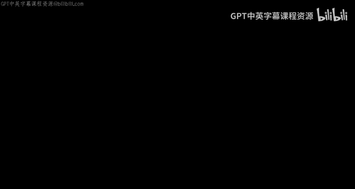
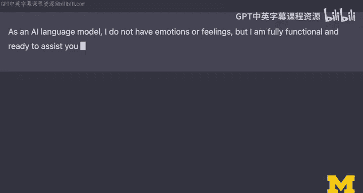

# 密歇根大学《ChatGPT 示教｜ChatGPT Teach-Out》中英字幕 - P4：3_ChatGPT的感知准确性.zh_en - GPT中英字幕课程资源 - BV1Rr421L7BX

I'm Michael Wellman， I'm professor and chair of Comp science and engineering at the University of Michigan I'm a researcher in artificial intelligence have been for many years。

 my work studies the intersection of economics and AI。

 both how AI can use economic principles as well as understanding the use of AI and economic context and the economic impacts of AI We're all primed to assess the。

Quality of a knowledge product to document， some text based on how professionally it is prepared。

 how。Smooth and fluent， it is if it's the language， how coherent， how on point to the context。

Because Chat GPT3 has provided a apparent leap in the ability of automatic AI generation of text to achieve those achieve very good coherence and fluency。

 we are likely to perceive it as accurate and reliable based on these our standard way of making those judgments。

 those ways of making judgments have been sound in a world where。

Creation of coherence and fluent and educated text requires big investments in time in education。

 in research。When it can be done cheaply by an AI， however， that equation is upended， and we may not。

 We may no longer have that correlation between the apparent smoothness， and fluency， et cetera。

 of text and its reliability and accuracy。 Businesses， organizations。

 individuals that have a reputation that they're trying to protect may be wary of。

Putting out lots of material using chat EptT or similar technologies that they cannot be sure of the accuracy or quality of it。

In fact， reputation I think is one of the best mechanisms we have for keeping abuses in check what we have to worry about more is entities that don't have reputations。

 anonymous attackers， trolls， third parties that are that don't。

That we're not really sure where the material came from。 They don't have any reputation to lose。

 and they're more likely to。Try to avail themselves of these。Methods to achieve their aims。

 What this， I think also means is that we may need to invest more in technology infrastructure for tracking the provenance certify the sources of materials so that we can be sure that it's tied to an entity that has a reputation that as a stake in maintaining that reputation and not one just representing that the source came from something that they're claiming is。

 is credible。 Well， I think these days， one has to be really careful and wary of any。

Information that one meets out on the Internet or from any source that you're not sure where it came from。

 because may it may be artificially created either maliciously in order to mislead or just by methods that are not reliable not reliably accurate。

 either one can have bad consequences and so it does mean you need to take things with a grain of salt。

 and we have to all adjust our filters a little bit。

