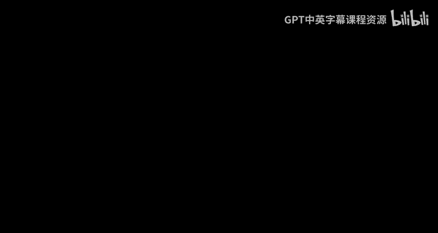

# 密歇根大学《ChatGPT 示教｜ChatGPT Teach-Out》中英字幕 - P5：4_ChatGPT类人输出的影响.zh_en - GPT中英字幕课程资源 - BV1Rr421L7BX

I'm Rad Mihalcha， I'm a professor of computer science and also director of the Artific intelligencetel Lab here at the University of Michigan。

 Im work in natural language processing， which is an area in artificial intelligence and I've been working in this field for about 25 years the technology behind RGPT is。

😊，Technology that has been in use in natural language processing since pretty much the beginning of the field and by this I mean language models which are some of the core models in an LP and so I'm familiar with the technology behind chargeGPT including language models which I judge mentioned also supervised learning using humanlike instruction with IGPT itself。

 my familiarities since about December， which is pretty much everyone else's familiarity。😊。

In terms of。How chargeGBT produces output。This is a big leap forward compared to previous technologies。

 the fact that it consistently produces。Text that is very coherent and looks very much like。

Human produced text。 And so that means many different things in terms of applicability。

 It opened the doors to a lot of applications that could use。Humanlike language。

 which can spend different disciplines in education， for instance， in healthcare。

 in many social interactions， so a lot of different applications where we use language we could think of now using this AI generated text。

😊，And so there is a lot of different applications that we could now consider as possible。😊。

I believe the other implication is also in terms of sort of the other side of the coin。

 the fact that it does look so much like human， well now start wondering whether some piece of text that has been produced by a human or by an AI。

😊，And I think this also has a number of implications。

 the fact that we now are not sure anymore what's the source and whether it's human vetted or they are multiple maybe groups of humans that have are behind particular piece of information or its AI produced and I can also talk more at length about the factuality or lack of factuality which is still very much a characteristic of this AI language Well。

 I think this in terms of，😊，Being aware that tragedygPT is。Ultimatelyumly just a system。There are。

Multiple angles to it， one is the users themselves。

 I think it's our responsibility ultimately to remind ourselves that this is not a human both in terms of capabilities and what it can do。

 but also in terms of how we interact with such tools。😊，Then there is also， I think。

 a responsibility in terms of institutions that make available such tools。

 also in terms of governments。😊，I believe regulation is now very important with respect to what can and cannot be done with these tools。

I would think even very simple things， like a disclaimer， I would say that。For instance。

 this site uses an automatic system to interact with people。Or the fact that。

An article has been written with support from something like chargeGPT or other similar systems。

This kind of transparency is very important because otherwise I could see how there will be a lot of information they will be shared online that we would not know the source necessarily and so that will start being misleading and people will very quickly lose trust in what information they see and generally trust is hard to regain so it's。

😊，To make this short， it's both on terms of users， just reminding ourselves that we interact with a system ultimately and also those who make this available institutions and higher level governments alike。

 There is truth bias， which is something that's human nature to。

Primarily tend to believe what we hear。Without speculating too much， it is a part of survival。

 So we need this in order to navigate the world。 Now we've seen that misinformation can， in fact。

 affect truth bias。 So just with the human produced misinformation that we currently see online。

 there is a lot of。Lack of trust in what we see like myself。

 I wonder wherever I see or hear a new piece， whether it's really true or not。And。

I believe without having correct boundaries in place。

 that could be really increasing or with this AI generated。Whether it's language or images。

And so it goes back to what I was saying before， that both reminding ourselves that even if it looks very confident and it looks very human like。

It doesn't necessarily mean correct。And also for those who make available such tools， I think it's。

People's responsibility， if you put out a piece of text。

 whether you wrote it or something else wrote it like an AI to make sure that you check what's in in that text。

 Now， at some point， this may be wishful thinking。 So I think。

Continuing to be very critical of what we see rather than believing what we see。

 and even if it's embedded in something that looks very coherent。

 so there might be an entire article， which all looks correct。And it looks again very confident。

 which is the style of this AI generated language。Still thinking that maybe down the page。

 there is one sentence， which is completely incorrect， which currently is possible。

 So there are many such statements where maybe 90% is correct， but there is a 10%， which is not。

 So being critical of the entire piece， as opposed to just。Taking a look， looks good。 And then。

Just go with it。