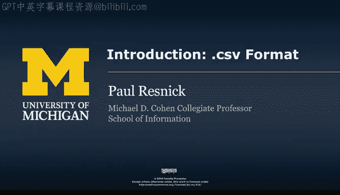
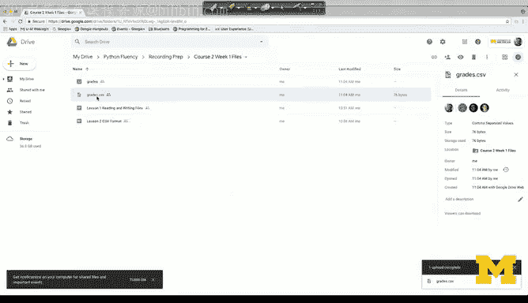
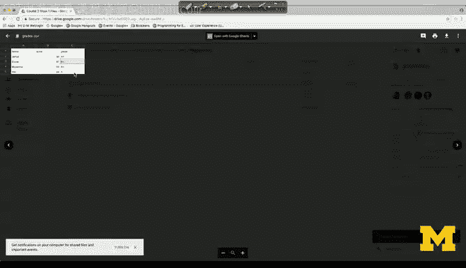
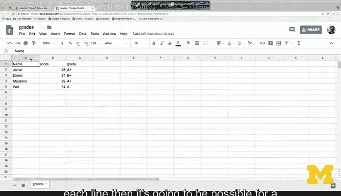

# 密歇根大学《Python3编程（课程1、2）》｜Python 3 Programming（Python for everyone进阶）（中英字幕） - P100：12_01_01_CSV格式导论.zh_en - GPT中英字幕课程资源 - BV1CM411Z72u

Welcome back。This lesson introduces the CSV format。 CSV is an acronym。

 and stands for comma separated values， CSV。A file in CSV format is just a text file that follows certain conventions。

The CS SV format says that values are going to be separated by commas。

And it says that every line of the file will have the same structure。So for example， we've got。

Two kas。On every line， one，2， one，2。And so we've got room for three things on each line before the first comma。

Between the first and second and after the second one。Usually。

 you'll have the first line be special to give column names。And then afterwards。

 all the rest of the lines are similar to each other。 They each have values。

The first value on line2 is a name， the second value90 age is a score， a plus is a grade。

The reason this format is nice is that by having this standard format。

 you can have it read into lots of different programs。So I've chosen to name this file grades。csv。

And it's saved on this computer。It saved in this folder。On a Mac。

 when you have a file name that ends in dot CSV。Unless you've configured your Mac some other way when you try to open it。

It defaults to thinking that you want to try to open it into an Excel spreadsheet。

And so here it's taken that instead of showing it to me as a text file。

 it's chopped it up and actually put the first values into column A and the second values into column B。

 third values into column C。The same CSV format can be read not just by Excel。

 but by all kinds of statistics， programs， Sta R。SPSS and so on。

 and you can also open it in Google Sheets。So here's my Google Drive folder where I have some of my notes for these recordings。

 and I've put that grades that same grades CSV file here。

When I double click on it， it gives me a little preview of what it would look like。

 and it gives me an option to open it with Google Sheets， which is just another spreadsheet program。

And it's doing its little conversion。And now we see it again in columns。

So the CSV format is kind of an interchange format， it's just a text file。

 but if you follow the conventions and have the same number of commas on each line。

 then it can be possible for a file to be read by any of these programs。

At the end of this lesson， you'll be able to read a text file whose contents are in CSV format and parse the lines by using the dot split method。

And you'll be able to write a text file whose contents are in CSV format。

 using either the dot format method with a string template or the dot join method。

See you at the end of the lesson。When I'll explain the difference between a cat and a comma。

