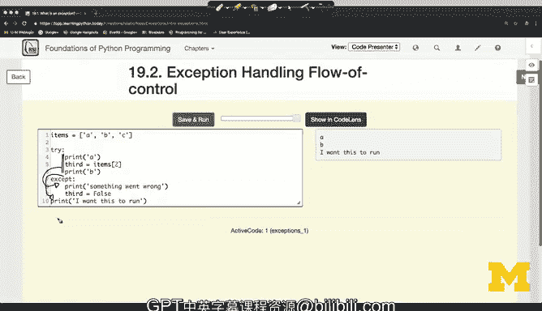

# 密歇根大学《Python3编程（课程3、4、5）》｜Python 3 Programming（Python for everyone进阶）（中英字幕） - P100：43_04_02_异常处理控制流.zh_en - GPT中英字幕课程资源 - BV1gj41177yd

Welcome back。 Now， remember that there are three main kinds of errors that we can get when writing Python code。

 There are syntactic errors。That's when Python doesn't understand how to read the instructions in your program。

 So for example， if I forget a bracket or parentheses and I try to run my program。

 then I get a syntax error saying that Python didn't understand the instructions that I gave it。

Beyond syntactic errors， there are also runtime errors。

Runtime errors occur when Python understood the instructions that I gave it。

 but something went wrong when Python tried to run those instructions， so for example。

 if I run my code right now，I get a runtime error or more specifically an index error。

 because even though Python understands that I'm creating a list and assigning that list to items。

 and then I'm assigning third to be the third item in items。 because item only has two items A and B。

 When I tried to fetch index 2， then I get an index error， which is the kind of runtime error。

 So in other words， Python understood what I wanted to do。

 but something went wrong as Python was trying to execute my code。 And then finally。

 there a semantic errors。And a semantic error is when Python successfully ran the code。

 it just wasn't exactly what I wanted it to do。 So， for example。

 if I wrote a function to add two numbers and that function actually divided two numbers。

 Python isn't going to give me an error， but I'm also not going to be happy when my code divides the numbers that I wanted to add。

So when we have a syntactic air， Python doesn't run our code at all when we have a runtime error。

 Python runs our code until it encounters the runtime error and when we have a semantic air。

 Python runs our code， but it just doesn't end up being what we wanted it to be。No。

 usually when we encounter a runtime error， then Python is going to stop running our code as soon as we encounter the runtime error。

 So， for example， this code again gives us an index error。 So let's suppose that I modified my code。

And I had something like print。This is not going to be reached。Now， if I save and run my code。

 you'll notice that this line 3 doesn't print out because this expression results in a runtime error。

So again， when you get a runtime error right here。Then our program just stops running and throws in this case。

 in index air。If I had a print statement before this line。This is。printeded。

Then this would successfully execute。So in this lesson， we're going to learn about try accept。

 What try accept does is it allows us to handle runtime errors and to tell Python what to do when it encounters a runtime error so that it doesn't suddenly stop running your program every time it encounters one。

So let's say that I wanted to run the code after assigning third。

 so let's suppose that again I have a print， I want this to run statement。

And I want this line to print out， even if I encounter a runtime error on line， too。

The way that I can do that is by putting that into a try except block。

 So the simplest way to write a try accept block is just by saying try。And then， colon。

And then could inside of the try block。And then I can write except。Colon。

And then code that I want to run if some runtime error happens。

 So let's suppose that if I get a runtime error while running line 4。

 let's suppose that I want to assign third to be false。 So I'll say except third。Equals。Faluse。Now。

 when I run my code。It's not going to。Show us a runtime error anymore。 but instead。

 I actually am able to reach this print statement， even though I get a runtime error right here。

So to see what's happening， I'm going to add a few more print statements。 So inside of this except。

 I'm going to print。Something went wrong。And I'm going to add print a。On line  for， and after。

Assigning third， I'm going to print out。B。Okay， when I run my code。

 you'll notice that I have print a。Print a executes。 Then when I set third equal to items 2。

 this gives us a runtime error。And as a result of this runtime error， print B。

 you'll see never executes。 So what happens is as soon as I get a runtime error for any line in this try block。

 Then Python jumps right to the accept block and starts running what's in the except block。

 So you'll see that something went wrong。Gets executed。 And then here we assign third to be false。

 And then I want this to run。Gets executed after that。Now。

 let's suppose that we didn't actually have a runtime error， so I'm going to clear my output。

And I'm going to make it so that items actually does have three items。Now， if I run my code。

 then what happens is I never get a runtime error when assigning third。

 because I actually have a third item here。 So a gets printed。 third gets assigned to C。

And then B gets printed。 And then we completely skipped the accept block because nothing went wrong。

 And then we print out， I want this to run。So in brief。

 what try except does is it says try to run the code inside of this try block。

 and if something goes wrong while you're running that code。

 rather than stopping execution of the whole program。

 just jump and run whatever is inside of the accept block。If nothing goes wrong。

 then we just skip the accept block entirely and run what's after the try accept。That's all for now。

 until next time。

