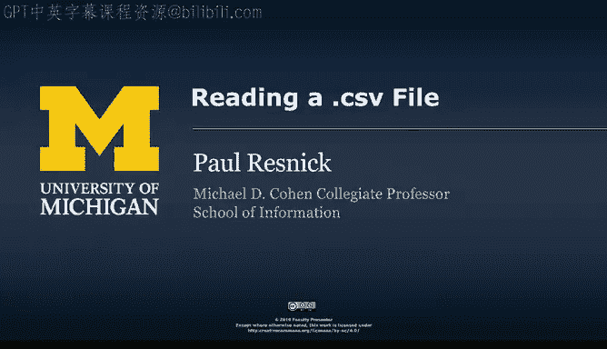

# 密歇根大学《Python3编程（课程1、2）》｜Python 3 Programming（Python for everyone进阶）（中英字幕） - P101：13_01_02_CSV文件读取.zh_en - GPT中英字幕课程资源 - BV1CM411Z72u

Welcome back。Since CV is just a special format， you can read it like any other file。😊，In fact。

 we've been reading a file that was in CSV format already。 The Olympics file。

 It didn't follow the conventions of using dot CSV as the ending for the file name。

 But the actual contents were in C SV format。The advantage when we know that something's in CSV format is that it's easy to parse it。

We can just chop up each line into its individual components by looking for where the commas are。

For example， take a look at this code On lines1 through 4。

 I'm just reminding you of what the contents of this file are。So you can see the first line。

Is a header。And then， I'm printing out。More lines up to line 6。

 Each line has somebody's name and the other values they separated by commas。

I want to show you how easy it is to process this， this contents。

 because we can just use the dot split method looking for commas。So on line 6 of our code。

We're looking just at the headerline， that's this one。And we're saying， well， first of all。

 get rid of the new line character at the end of that line。And then， split。

And split wherever you see a comma。So where there's a comma。

 we're going to chop up the text and we're going to get。Well。

 actually we can see the output here because on line  eight， we're printing it out。So。

We have name is the first。Value， it's the characters that occur before the first comma。

And our next value is the string sex， and then we have the string H。

All of these are coming from this one line of text， but we've chopped it up to make a list。

And that's what the dot split command does for us。We're doing something pretty similar with the rest of the lines。

We're looping through all of them。 And for each of them。

 we're chopping it up wherever you find a comma on the line。Now， once we take a line like a Lemusi。

 M23， China， Judo and A。And we split it up into a list。 We can now use indexing。

 I can ask for the value that's in。Index 5， the sixth element。From that line， and we can check。

 is its value N A。Well， sure enough， it is。 its value is N。 and we do one thing。 if it's N。

 we do something else if it's not in this case。If it's not NA A。

 then we're going to print something out， so we're going to print out something only for the people who actually won a medal。

 we're going to skip the people who didn't win a medal。You can see that output that comes down here。

 so only people who want a gold， a bronze or a silver will show up in our output。

And we're choosing here to not print the whole line。 We're printing three elements from that line。

 The three curly braces， and we're printing out v square bracket 0。That's the name。

 It's the string that comes before the first comma。

 and we're getting the thing from the position 4 and from position 5。

 So that's the name and the event and the medal that they won。Now。

 note that we have to split on commas。I think before， when we've seen the split command。

 we've tend to just split。Without specifying a value。 and when you don't specify a value， it splits。

Wherever it finds any white space。A space or a tab or a new line。If we do that。

 we're going to see that we get something different。 We're not going to get。This nice list here。

 we're going to get a different list。And sure enough。What we get。Is a list。

With only one element in it， it's one big string。All of its commas and everything。

 It hasn't split it up into7 different elements or six different elements。

 It's just given us one big thing。 And the reason is。It was looking for white space。

 and in this whole string。There are no spaces， no tabs， no carriage returns。 So we just get one item。

 If we had split on something else。Let's say the letter， E。It would split， wherever。There was an E。

 and we'll get some weird thing。Oops。😔，I have to split on the character。 not the variable name E。

And we're just waiting for it to finish， and sure enough。Our first value is nam。

 And then there was an E。 And after that， there's a comma and a capital S。

And then there was another E and cell on。So split will split on whatever you tell it to split on。

In our case， we want to split on commas。Because the commerce separated value format says。

Comamaas are the things that separate the values， by the way。

There is another more advanced version of the CSV format。That separates with commas。

 but encloses all of the values ins。Let's see what that looks like。

Here you can see in this file format。You can see that some events have commas in them。

 while others don't。For example， we have speed skating 1500 m。Where is for tugovore or basketball。

There was no comment in it。That's going to make it harder to parse。Because when there's a comma。

 we don't know whether it's part of a value or separating values。If we were to just split on comma。

Like we did before， valves。Equals。Row dot split。And comma。And then， we said， vowels。Square bracket 5。

 like we did before。The fifth element or the index 5， the sixth element。Of this row will be an A。

But the fifth element of this row will be。The 1500 M。Zou。😔。

Life gets more complicated when we want to parse this more advanced comma separated values format that also has quotes around each of the values。

It actually is still possible to unambiguously chop up the lines。

 but that's a harder programming challenge。 I don't recommend trying it yourself。 Instead。

 when you encounter something in this format， you would use Python' CSV module to parse the lines for you。

We're not going to learn that module right now。I found that it's good for students to learn how to parse simple CSVs using the dot split method at this point for understanding what's really going on Later。

 you can learn to use the CSV module for harder formats。In summary。When we have a simple CV format。

With comma separating and no quotes around all the values， parsing is easy。

 You just read in the file a line at a time， and you use the split method specifying comma as the thing to split on。

That gives you a list of the individual values or the individual field names on the headerline。

We'll see you next time。