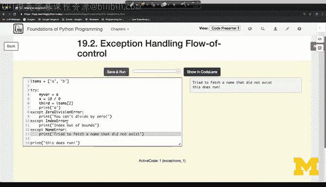

# 密歇根大学《Python3编程（课程3、4、5）》｜Python 3 Programming（Python for everyone进阶）（中英字幕） - P101：44_04_03_处理不同类型异常.zh_en - GPT中英字幕课程资源 - BV1gj41177yd

Welcome back。 So last time we learned that we can handle runtime errors through try accept box。

 So this code， for example， creates a list that has two items， and then we try to get the third item。

 which results in an index error。 And as soon as we try to get that third item， which again。

 produces an index error。Then our program stops running。 And so we never won line 4。

 which prints out this doesn't run。No， we can handle this by saying try to run this code。

 so I'll say try。And then inside of my try block， I have the code that I want to try running。

 and then I'll say if I get an exception。So if something goes wrong when I'm trying to run that code。

 then let's suppose that I assign third。To be false。Okay， now if I save and run my code。

 then I'll see that line 7 finally does run。Because I'm handling the runtime exception from line4。

So I can print out something went wrong。Assigning to you false。

And you'll see that as soon as my code encounters a runtime error here on line 4。

 then we jump to the accept block。Now， the way that I wrote this try accept block。

 this accept block handles any kind of exception that my code might throw。 So for example。

 if I say something like x equals 10 divided by 0。So normally， this would give me a0 division error。

 but when I run my code， my code still works because as soon as I encounter line 4。

 then Python jumps to the except block。One thing to note。

If I print out a after assigning x on line 4。Then this code doesn't run on line 5。

 because as soon as I encounter an exception by dividing 10 by 0， as soon as that occurs。

 then I jump to the accept block and I skip what's in the rest of the try block。Now。

 you can see the kind of exception that I would get if I put this code outside of my try except。

 So if I say x equals 10 divided by 0。And run my code。

 then I'll see that this gives me a zero division error， specifically。Okay。

 so the way that I wrote my try accept block， the accept block is going to handle any kind of error that my try block throws at it。

 So this handles zero division errors。 This handles index out of bound errors。

 It handles any kind of runtime exception that might happen。Now。

 let's suppose that I wanted to be a little more specific。

 so let's suppose that I wanted to do one thing if I got a zero division error and another thing if I got an index error。

So the way that I can get more specific is I can actually add a kind of exception after this statement accept。

So the most general kind of exception that I might have is an exception。 So it's capital E。Exception。

 an exception is going to handle either kind of runtime error。So， you'll see that。

If I get an index error before is your division error。

 then I still execute what's in the success block。Now I can be a little bit more specific about what kind of errors that I wanted to handle。

 so let's suppose that I wanted to do one thing when I get a zero division error。And another thing。

 when I get an index air。The way that I can do that is I can say except。

 and then I can say I want this except block to handle a0 division error。 So I'll say except0。

Division， air。And I'm going to say print。You can't divide。You can't divide。By0。

And I want to do something else when I get an index error。 so I'll say accept index error。

And now when I get an index error。I'm going to say。Index out of bounds。Okay， now when I run my code。

 I'm going to get an index error。On line 4， and you'll notice that as soon as I got this index error。

Then， Python jumped down。To this index air， except block and ran that。

If I changed the order of my code so that I got a zero division error first。And I ran my code。

You'll see that Python jumped to the code， saying you're a divisionre。Now。

 let's suppose that I have a different kind of exception in my code。

So let's suppose that I assign the variable my Var。To be the value of a variable that doesn't exist。

 So my var equals a， and I have no such variable a。Now， when I run my code。I'm going to get a naair。

 which is a different kind of runtime error。So I can handle that by saying， except。I can say。

 except exception。And this is going to handle any kind of error that I might have。 So if I say print。

Something else went wrong。And run my code， you'll see that something else went wrong gets printed。

If I wanted to specifically handle a name error rather than handling just the exception。

 I can say accept name error。And I'm going to say。Tried to fetch a name。 that did not exist。Now。

 when I run my code， you'll see that because I'm getting a name error on line 4。

 then I jump directly down to the exception handler on line 12。

That's all for now， until next time。