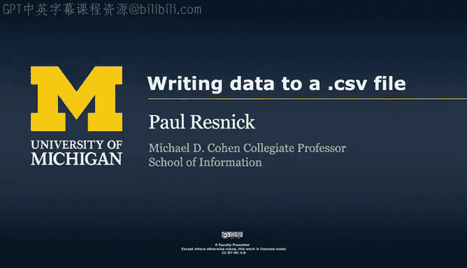
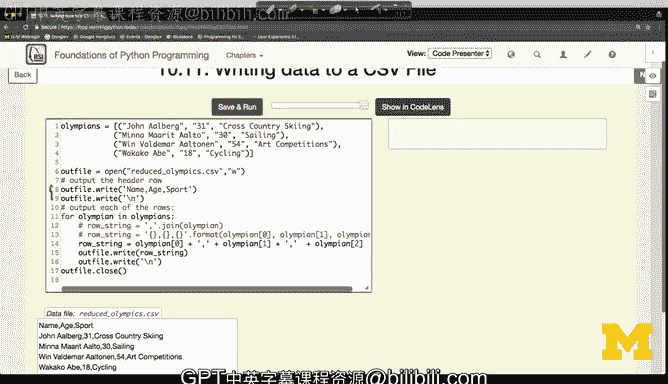

# 密歇根大学《Python3编程（课程1、2）》｜Python 3 Programming（Python for everyone进阶）（中英字幕） - P102：14_01_03_CSV数据写入.zh_en - GPT中英字幕课程资源 - BV1CM411Z72u

Welcome back。To write a CSV file， you just need to write text strings that follow the comma separated values format。

Here we have the basic structure。You write a header line with field names separated by commas。

You iterate through your list of objects and for each one， you generate a line of output。

What I've got here is just going to print the output to the output window。But it's in the CSV format。

 as you can see。We have one header row。With the three headers name， age and sport。

And then each line has the same structure。There' is somebody's name and then a comma。

There's an age and then another comma and then a sport。Now。

 if we want to change this instead of printing to the output window， we want to write to a file。

We'll do our usual transformation where instead of print we'll use dot right and we'll have to open the file and close it。

So I've actually already got that code written out， and I'm going to switch to it。5。😔。

Open the file for writing。I have assigned the file object to this variable name out file。

And then I'm writing the header on lines 8 and 9。And with the row strings instead of printing them out。

I'm doing outfil that right and because。When writing to a file。

 we have to explicitly put in the line breaks that we want。

Instead of putting it in the output window。It's now in this data file which is available until we reload the page。

Again， the key to outputting CSV format is just generating a string that contains one line。

Where that line has commas that are separating either of the field names。Or the values。

There are two options that work well for generating align line with the commas separating the values。

 and a third one that I don't really recommend。Sn here， we're using the first method that I do like。

 actually the one I like the best， which is to use a format string。

It's easy to see with this format string。Then we're going to have three values because we have three pairs of curly braces。

 one， two， three。And it's easy to see that we've got a comma separating each of them。

And then the values are just going to get substituted in。The first element。John Eberg。

The second element goes there， that's the 31。And cross country skiing being the third element。

A second possibility is to use the dot join method。

You may recall the dot split method for chopping up a string into component parts。

 its counterpart going the other way is the dot join method。And。I would write something like this。

 row stringing equals。Coma dot join。Have some values。

And those values are going to be these same values that we used here。So I can use this instead。

I'll comment out the old version。I always find this a little confusing and I think many students do too。

 you might think that the natural thing is to call a join method and pass comma as a parameter。

 like we did with dot split， passing comma as a parameter， but here。

We're saying join is an operation that we do on the comma object。And we have to pass in as values。

The things that are going to be joined together。You just have to remember that that's of the opposite order of what you might expect。

 so it's comm join。There's a couple other tricky things。About the join operator。

 and I'll show them to you here first I'm going to get rid of our markings。When I run this。

I'm going to get an error。It's actually two problems， the first problem。

Is that join is expecting two arguments and I've given it four。So it really wants a list of things。

Not a bunch of different values。So I have to give it a list。

 I can put all of these values into a list。Yeah。One other tricky part about it is that join。

Wants to have a list of strings。A sequence of strings， an Olympian square bracket 1 is the number 31。

 it isn't a string， it's an integer。So we get an error that it expected a string。

 but it actually got something different。Sequence item1， that's Ta Olympian Square bracket1。

But if I turn it into a string。I'll finally have something that works。Yeah。

Now I get the same output that I was getting before。

So this looks pretty complicated and you're probably thinking， why would anyone ever want to do this？

Well， if。My values were all strings。Then I might be tempted to do it。

So now I don't need to say STR of Olympian。I can just say。Olympian Square bracket one there。

 and it'll work。And the thing that really makes this attractive in this situation。

Is that I can just refer to Olympian？Which is already a sequence of strings。

 It's a tuple with three strings in it。 I can call that join in past that templeple of strings。

 And I still get this lovely。😊，Compact code and the same output。So if you have a list of strings。

Then this dot join method might be pretty attractive。If not。

 and you're going to have to do any kind of converting integers to strings or things like that。

 then I think you're going to want the version on line 13 that uses the format string。

A third possibility is to just use string concatenation， but it gets really kind of hard to read it。

And it also is still going to require us to convert the number to a string。

So we're going to have something like this。And I think I'm pretty unlikely to get it right the first time。

That I'll have row string。Yeah。Equals。Olympian。Square bracket0 plus a comma。Plus。

 Olympian square bracket1。Plus， another comma。Plus， Olympian square bracket 2。To summarize。

 the overall structure for writing a CSV file is to write the headerline。

That's what we did on lines eight and nine。Then iterate through all of your objects and for each of them you're going to write one line into the CSV file。

We'll see you next time。

