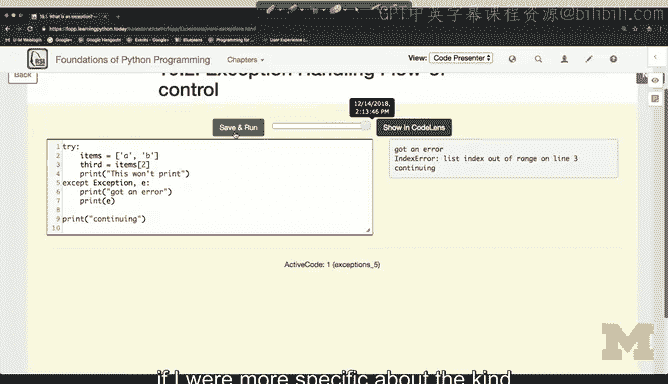

# 密歇根大学《Python3编程（课程3、4、5）》｜Python 3 Programming（Python for everyone进阶）（中英字幕） - P102：45_04_04_异常实例.zh_en - GPT中英字幕课程资源 - BV1gj41177yd

Welcome back。So recall that when we want to catch our handle a runtime exception。

 we can add try and put the code that we think might throw an exception into the try block。

 then we can say except， and we can optionally specify the kind of exception that we want to handle。

Now， every kind of exception inherits from this class exception， so we have exception。

And then we have other specific kinds of exceptions like index error。Zero division error。Namai。Yeah。

And so on。So here， let's suppose that rather than just catching a general exception。

 I wanted to catch an index here。So if I run my code。

 you'll see that my exception is properly handled， or at least it's handled according to what I specified in my code。

 so I print out got an error， and then I print out continuing。Now。

 let's suppose that I wanted to be a little more specific about the error that I'm actually getting。

 So suppose that I don't want to halt execution of my code。

 but I do want to print out just a little bit more information about what kind of error I'm getting。

So if I took this code and put it outside of a tribe block。Like so。If I ran my code。

You see that I get an index error list index out of range on line 2。 So in this case。

 I'm getting all of the information about the error。 I'm getting things like the line number。

 the specific kind of error that I'm getting。 But of course。

 the rest of my code doesn't run after line 2， where I get that index error。

 So I skip this print and everything after。Now， let's suppose that I didn't want to halt execution of my code。

 but I did want to print out information about the runtime error that I'm actually getting。

So I can do that with try Ac。The way that I do that is in addition to specifying the class of air that I want to handle after except。

 I can also add comma。And then I can give the error that I'm actually getting a name。

 so I'm going to give it the name E。Now， if I wanted to be more specific than just I got an error。

 if I wanted to print out more information about that error， like I do。

 if I didn't have the try accept block， then I can print out what is the value of E。

 Because E is the actual instance of the index error that I'm getting。So if I print out。E in my code。

And save and run my code。 Then what you'll see is that we tried to run this code。 But on line 3。

 we got an index error， and we jumped on to the accept block。

AndThen we can see that this handles an index error。

 And we give the specific index error that we got the name E。

 And so our code prints out got an error。 But now when I print out E， which again。

 is the specific error instance， Then I get that information about the error。

 So I see that it's an index error。 I can see that it's list index out of range on line 3。

 And so now I'm not sacrificing the amount of information that I actually get。

 I'm able to print out the actual error。 But now my code still runs。

 So you'll see that continuing print out。 unlike if I didn't put this into a try except block。😊。

So again， if I want the specific error instance that I'm getting， then I can have comma。

And then I can give the error instance a name。So this would work even if I had handled a general exception。

Or if I were more specific about the kind of exception that I wanted to handle。

That's all for now， until next time。

