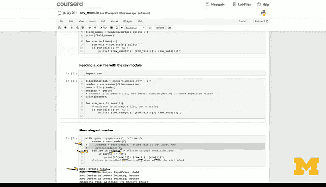

# 密歇根大学《Python3编程（课程1、2）》｜Python 3 Programming（Python for everyone进阶）（中英字幕） - P103：15_01_04_csv模块文件读取.zh_en - GPT中英字幕课程资源 - BV1CM411Z72u

Welcome back。Now that you understand conceptually how to read and write CSv files。

You're ready for the magic of the Python CSD module， which makes it even easier。

As with other modules， you'll need an import statement。Like this。They'll just say import CSV。

After that。Your code will be able to make calls to create a CSv。 readerer or a CSv。 writer object。

The advantage of using the CSV module over just reading and writing lines of text is that it handles the parsing of comma separated strings and converting them into lists when you're reading files。

And the reverse when you're writing files， we can just pass a list of values and it handles converting them into commona separated text strings。

By the way， this page that I'm showing you is the official documentation page for the CSD module。

Eventually， you'll get to the point where you can read documentation pages like this。

There's a lot of terminology used on this page that's beyond things that we've covered so far。

 so it might be hard for you to decode all of it at this point in your learning trajectory。

But it's a good idea to start familiarizing yourself with what these documentation pages can look like。

 For example， you can at least get a sense from this what the functions are that are defined in the modules。

CSB。 reader function， and there's a writer function， and you could try reading this documentation。

 maybe after you've listened to this exposition。The CSV module isn't available in the Runestone environment。

 but it is available in our Jupiter notebook， so I'll be demonstrating with that。

You've previously seen something like this code in the first cell for reading data from a CSV file and extracting and printing a few fields from some of the rows。

The only change I made from the code in the textbook is that I used an F string instead of dot format on line 11。

So recall that an F string is another way of generating a string with interpolation。

OfVable values at certain points in the string。I think in this case。

 an F string is really easy to read。We'll just print out the athlete's name。And then the event。

 which is Roval's square bracket 4。 and then the medal that was earned。

She's rowval's square bracket five。But note how we had to parse the camerara separated strings on line 9。

Yeah。In order to extract the fields for each row。It's cleaner if we let the CSD module do that conversion of each line of text into a list of fields。

So I'm just going to run that to remind you of what it produces。

We're getting the field names from line 6， that's this。 and then for each of the rows。

We're printing out the name。The event and the medal。

It's cleaner if we let the CSD module do that conversion of each line of text into a list of fields。

Below that cell， I have an alternative version， and just to make it easier to see the correspondence。

 I'm going to hide the output from the first cell。So now I've got two versions。Up here and down here。

 they both do the same thing， but the second one uses the CSD module。And then the second one。

 I'm going to call it rows rather than lines。I'm doing that because I just want to emphasize that the thing that we get from the reader is a collection of rows that have already been parsed in some way。

Each row will be a list of strings rather than being a long comma separated straight。

So that means I don't have to do any parsing。Online 10。Whereas。In the old version。

 I had to take the string， strip out any bases， and then split it on commas。In my new version。

 it's already a list， the CSB module has done the parsing for me。

Now that's not a big deal here where the parsing was pretty simple。

 but we're going to see a more complicated one where the parsing is hard and the CSD module just takes care of it for us。

Otherwise， these two versions are exactly the same。And， in fact， they。Produce the same output。

 so if I run these two cells。I'll get the same thing。对。Let me also show you a little more elegant。

 more Pythonic version of the same thing。 This is the kind of code that you're likely to see in documentation or code samples from professional Python programmers。

 so it's probably worth getting familiar with it。I hit the output and I'm going to scroll down。

So that we can see。The more elegant version as well。 And there's two differences。First。

 we use a width block。So with openofolympics。csv as F。Then in the indented code below it。

 I can use the。The variable F， it'll be bound to the file object。

 And when I get down to the end and I have some outdented code。F will be gone。

 It automatically takes care of closing the file for us， just makes the code a little more readable。

 it's easy to tell。That the only places we're going to use F。Are in this indented code block。

The second difference is that。In our previous version， I read all of the rows into a list。

So it created the reader object， and then I converted the reader object into a list。

 which took all of those。This iterable sequence of rows and turned it into an actual list object。

In the new version， I'm going to consume the rows as we go。So， there's。です。Next function。

Which works on iterables， which gives you the first element of the iterable。

A file object or a CSB reader object， they're both iterables。

So I can get the first element of it by asking for next。And then， I can。Iterate through the rest。

Of the reader object， so I'll get the rest of the rows。When I execute this。I get。

To print the headers， that gave me the first row。And then I iterated through the reader object。

 But I didn't get all of the roads。 I only got the rest of the rows。 I could。

 And just to illustrate this for you。If I were to comment out。The two lines。

 the line that calls the next and the printing of the headers。And now I reexecute this。

We're going to see that it comes out a little different。Because the very first row。

 which we were printing out， just the list of。Of fields， instead。

 it's going to get handled in the iteration， and we're only going to print out the square bracket for0 square bracket 4 and square bracket 5。

So let's see that。Now you'll see。That the first row of output changed。

 and it's following the same format as all of the。All of the event winners。

It wasn't consumed because we can't。 We commented out this line they called next。 And so therefore。

 when we iterated through the reader， we got all the rose。

In the version when I didn't comment it out。That first line had already been consumed。

I'll see you next time。