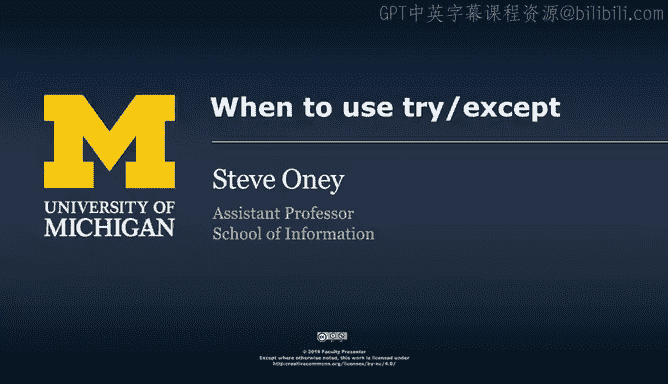
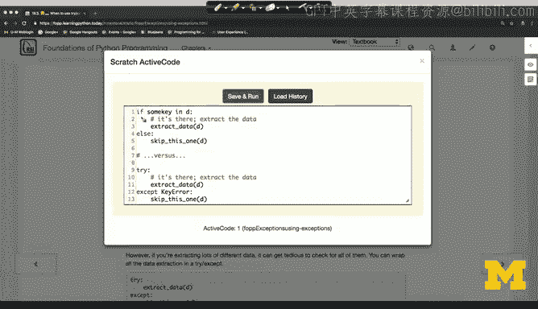
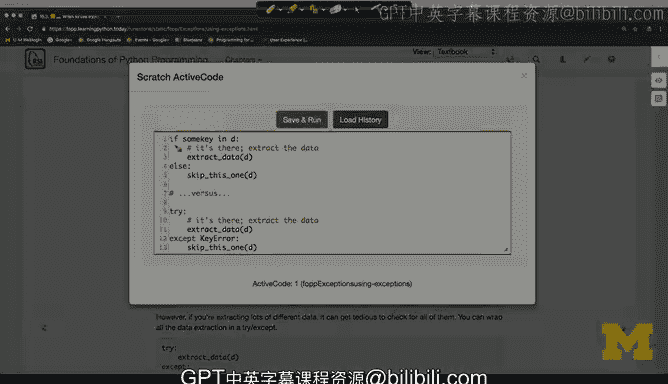

# 密歇根大学《Python3编程（课程3、4、5）》｜Python 3 Programming（Python for everyone进阶）（中英字幕） - P103：46_04_05_try-except使用场景.zh_en - GPT中英字幕课程资源 - BV1gj41177yd

Welcome back。So in some of the examples that we've gone over using T accept。

 you might have noticed that it would be possible to do that same example using if and else。

So let's suppose that we were extracting data from some dictionary D that we got using some internet API and we need to handle the case where some key might be missing from D。

So we might write that by saying if that key is in D。

 then we extract the data properly if that key isn't in D， so else， otherwise we skip that one。

An an alternative way of doing that is we can say try。 so try extracting the data from D。

 and then presumably if some key isn't actually in the dictionary D。

 then we would get some runtime exception in this case， let's suppose that we get a key。

And then if we get a key here， then we skip that particular item。Now。

 these are two ways of doing the exact same thing。 One using if and else。

 the other using try and accept。 So when is it right to use one versus the other。 Well， the answer。

 unfortunately， really depends。So if you have just a few kinds of errors that you're going to easily be able to anticipate。

 then it's probably better to use than if and an else。

 because if else is more specific to whatever kind of error you're expecting。 So in this case。

 I am expecting that some key might not be in my dictionary。

 that's more specific than saying if I get any key error。

If I can't anticipate what might not be there and I just need to handle you know something going wrong。

 so in other words， I can't anticipate what might go wrong， but I know that something might go wrong。

 then it's better to use a try and accept。So in general。

 when using a try accept or deciding whether to use an FLs。

 it's better to be as specific as possible。 So if it's one particular key that you know is either going to be there or not there。

 I'd use in FLs。If I don't know what might go wrong， but I know that something might go wrong。

 So a dictionary might be in a different format than I'm expecting， then I might use a try except。

There are some exceptions to that rule。 So， for example， let's suppose that I need to have an if。

 and then I have a whole bunch of checks。 So let's say rather than having just some key。

 let's say that I have 10 different keys that I might want to check if those 10 different keys are in my dictionary。

 Then I might choose to just use a try except just because it's a little more concise。

 rather than checking on all 10 of those keys。So really it comes down to how much can you anticipate。

 how tedious is it to write out all the conditions that you might have to handle exceptions for。

 and really it comes down to more of an art rather than a science。

That's all for now， until next time。

