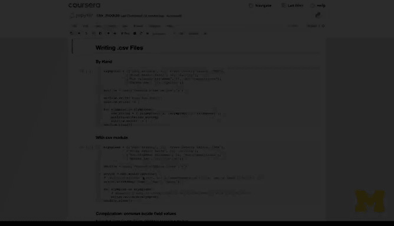
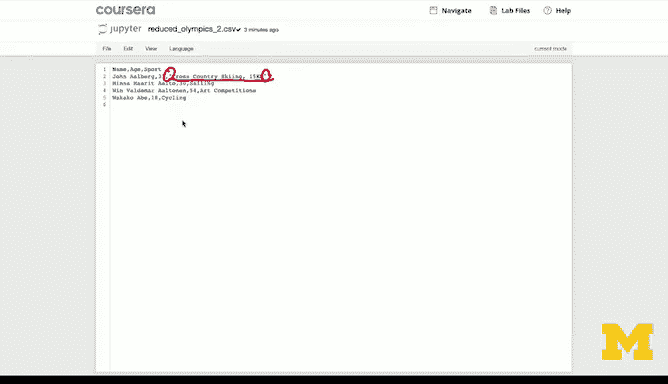

# 密歇根大学《Python3编程（课程1、2）》｜Python 3 Programming（Python for everyone进阶）（中英字幕） - P104：16_01_05_csv模块文件写入.zh_en - GPT中英字幕课程资源 - BV1CM411Z72u

Welcome back， a CSV writer object does the reverse of what a reader does。

It takes his input a list of values and write strings that are comma separated to a file。For example。

 you've seen pretty much this code before。We have a list of tuples。We're opening a file。

Were writing the headers to the file。And then we're going through each of the Olympians。

And we're writing。Some information about that Olympian。

 We take the Olympian and make a string out of it。 The one difference from the code you've seen in the textbook is that I used an F string。

Instead of。The dot right method。I'm going to run that cell。And in Jupiter。

 you can actually see the contents of the file system。First， so I do file open。

And you can see my notebook that currently running the CSV module that IPYNB is here。

And the file that we just wrote was called reducedolilympics。csv。And there it is with a headerline。

Name age and sport， and then those four rose for the four Olympians。

So that's the code we've already seen。Where where。Writing it by hand。

 now I want to show you the comparable code using the CSD module。So the first six lines are the same。

But then， I。Called the CSV。t Write function， which produces one of these writer objects。

I'm saving that。To a variable called writer。And when we call right row。

As a method on that writer object， it's sort of like calling。Rightrite on the file object。

But different， because instead of passing in a string。It's expecting a list。

It's going to turn it into a string， adding the commas and actually adding the new line。

 we don't have to bother doing that。And it takes care of that for us。

Then when I iterate through the Olympians。HereHere the CSV module really shines。

 I just call writerer dotright row an Olympian。I don't have to do the step of turning it into a string and calling。

Right。And then I also don have to do the new line。you see this gets a little simpler with the CSP module to do the writing。

Of CSB files。Now， if you pay really close attention。

 you'll see that this is a case where it turns out。Not only is it a little cleaner in the code。

 but it actually is more correct。Using the CSE module。

Turns out that our formatting wasn't quite right when we did it by hand。Notice our data。

For the first event。Cross country skiing，15 k。It has a comma in it。And in our comma separated values。

 we're using commas to indicate a separation between fields。

 but here we've got a comma inside a field。So let me run this second version and then we'll compare the two files and see the subtle difference in what they output。

Oops， I tried to run the second one， and I hadn't run the cell from earlier in the in the notebook that imports the CSV module。

 So it says CSB is not defined。and it says that on line8。

 the first time I'm referring to something in the CSB module， that kind of thing might happen to you。

And when you see something like name CSD is not defined， it probably means you didn't。

Import the CSV module。So I'm just going to put that code in here or I could have gone back to the earlier cell in the notebook that just has the import CSV command。

 either one works fine。So now I've run both of them， and I'm going to go look at those two files。

All right， so I've got reduced Olympics and I've got reduced Olympics2。

 so first let's look at reduced Olympics。This is the one that was produced by hand。

 and it's got a little problem in it。Notice that。We have。A name， and then a comma。A number。

 and then a comma， and then an event。Well， that worked fine on lines three， four and five。

 but on line two。Our event name also has a comma in it。And when we try to read this in as a CSB file。

 it's going to try to read that as。Four values。So it's going to make a list of four things。

But for row 3， it's only going to make a list of three things。

 so that's a problematic version we'd like to not really have that。

 Let's see what the CSB module did for us instead。With the CSVA module。

 I called the file reduceuce Olympics 2。And what did it do，oo， it did something strange。

For that problematic value that had a comma in it。It put it inside double quotes。

The CSB module did that automatically behind the scenes and it did that because the contents of the field。

Needed to be delimited some way， not by commas。And the beauty of this is that the CSD reader module。

 when it encounters something like this， it will automatically reparse it and treat that whole cross country ski income of 15 km as one value and it'll get rid of those double quotes as it's reading in the row。

If you're dealing with very simple CSV files that don't have commas as part of the field values。

 you can choose to either use the CSV module or not bother and just parse the text strings by hand。

But as soon as you get to anything more complicated。

 you'll probably want to make use of the CSD module it handles a lot of the complications for you。

I'll see you next time。