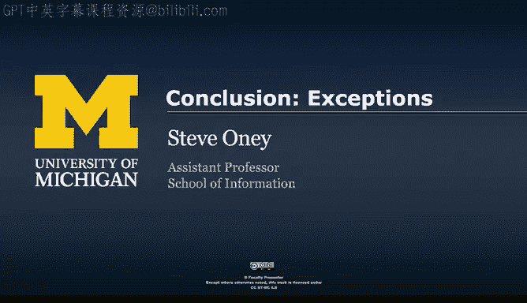

# 密歇根大学《Python3编程（课程3、4、5）》｜Python 3 Programming（Python for everyone进阶）（中英字幕） - P104：47_04_06_小结：异常处理.zh_en - GPT中英字幕课程资源 - BV1gj41177yd

So in this lesson we learned about exceptions。Exceptions allow us to better control how our code gets executed by specifying what to do when certain types of runtime errors occur。

But when we use exceptions， we want to try to apply them as selectively and specifically as possible。

In other words， don't just throw all of your code in a try accept block so that you don't see the red error messages anymore。

 only put them around the parts of code that might throw exceptions so that we can handle them in a way that's going to be appropriate for a specific exception type。

nNow， I'll conclude with a short joke for Star Wars fans and please bear with me if you're not。

Yda might be a Jedi master， but Yoda actually writes terrible code that always crashes。Why。

 because there is no try。 only do or do not。

See you next time。