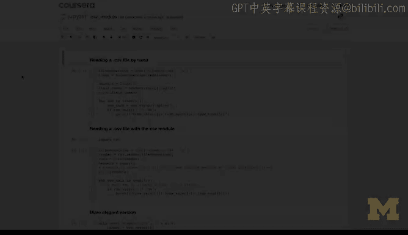
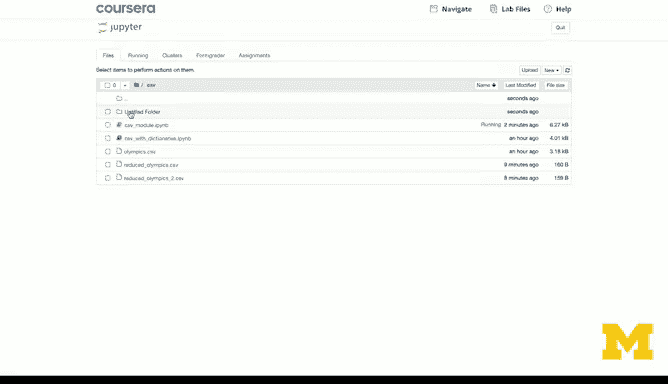
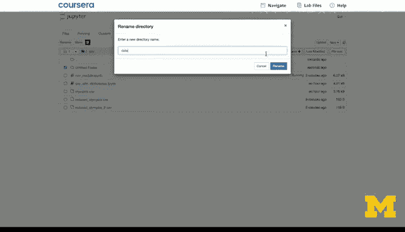
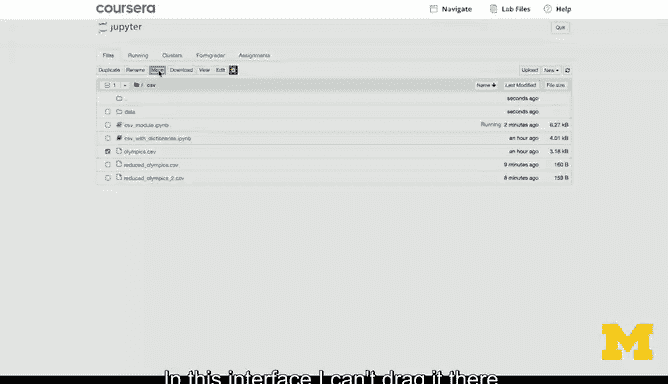
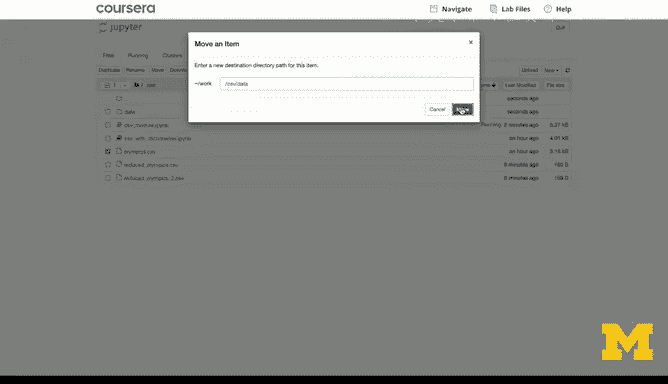
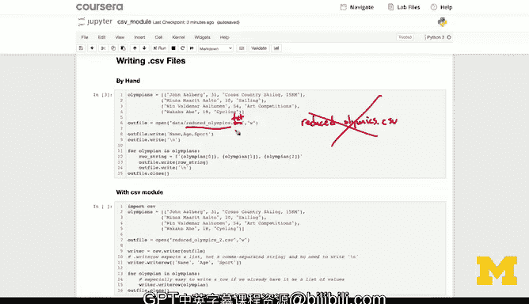

# 密歇根大学《Python3编程（课程1、2）》｜Python 3 Programming（Python for everyone进阶）（中英字幕） - P105：17_01_06_文件命名规范建议.zh_en - GPT中英字幕课程资源 - BV1CM411Z72u

Welcome back for a few tips on file names。Some older computer operating systems place a lot of restrictions on file names。

For example， MSDs。A precursor of windows only allowed eight characters before the period and three after the period。

Modern computer operating systems have fewer restrictions on your file names。Still。

It's a good idea for maximum portability of your files between computers to place a few restrictions on yourself。

Here's my suggestions。First of all。Don't use commas in a file name。Don't say Olympics come a winter。

Don't make that be a file name， even if your operating system allows it。Second。

 don't use more than one period like text。3。csv， don't do that。

Don't use a forward slash or a backward slash in your file name。No Olympic slash winter。

The reason is that the slashes are usually the convention for making subdirecties。

Let me show you what I mean by subdirecties。If I click on fileile open in Jupiter。

I get a listing of all the files in the directory where this notebook lives。

And I'm actually going to make a subdirecty here。

I'm going to call it。😔，AndRename it。To be called data。

And I'm going to put the os。csv file in that directory。啊。In this interface。

 I can't drag it there I actually have to。

Explicitly move it。

So now in the data directory。The data folder I've got。Olympics sta CSV。

If I go back to my Python code。I was opening up。The file Olympics。csv。

 that's going to fail now because Olympics。csv is not in that top level directory。

No such file or directory olympics。csv。But。If I say data slash olypics。csb， you don'll find it。

No problem。The slash as part of the string is interpreted as meaning a subdirecty。

 and it finds the file Olympics。cv in the subdirecty。By the way， I can also do that for writing。So。

 instead of。Reduced Olympics。I can put it in。The data folder。If I run that。

It will have written reducedolympics。csb into that data folder， let's go check。

I'm going to go to the data folder。And reduced Olympics that CSB was written just seconds ago。

That's why you don't want to have a slash in your file name or a backslash in your file name if you're on Windows。

There will be confusion about whether it means a subdirecty or it's just a part of your file name。

Also， I recommend not using spaces in your file names。

 even though most operating systems will permit that now。Reduced space Olympics is not a good idea。

 Instead， do something like。Reduced， underscore Olympics。I'm recommending that。Rather than。Reduced。

Space， Olympics。That CSv。I recommend that you do follow some conventions for what happens after the period。

Dot Txt。Should be for plain text。pY， if you've got to file this Python code。IPynb。

 if it's a Jupiter notebook。csv。If you've got text that's in the comma separated values format。

So in the textbook， we actually this code。Instead of dot CSV， we were saying dot TxT。

 that wasn't very good。And so in this notebook， I am following a better convention and calling it opics。

csv。The reason for following these conventions about what goes after the period is that computer operating systems will usually look at that extension。

 the do TxT or the docsv or the dopyy， if you just double click on a file。

 it figures out which program to use to open that file， so if it's a dot PY file。

 they'll try to open it in a text editor or they'll try to execute it as a Python program。

If you have a dot XlS， it's going to try to open Microsoft Excel and so on。That's all for now。

 just a few words on naming conventions for your files， I'll see you next time。

