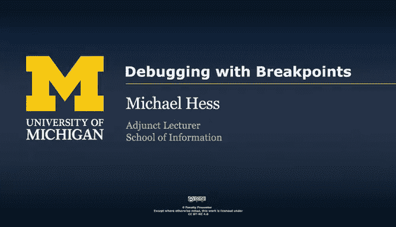
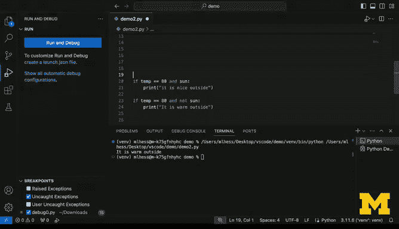

# 密歇根大学《Python3编程（课程3、4、5）》｜Python 3 Programming（Python for everyone进阶）（中英字幕） - P105：48_04_01_断点调试.zh_en - GPT中英字幕课程资源 - BV1gj41177yd

Good afternoon， good morning， good evening， welcome to debugging Now I love to debug problems This is like my favorite part of programming。

It's really easy to write code that works， but none of us write code that works the first time。

We often write code that has syntax errors in it。And so let's take an example here。

 let's assume that you are working with a web API， you are getting data from the internet。

 and one of the variables that you are setting is C and C is equal to high。

And you don't necessarily see how this works， maybe what you're really doing is like C equals request。

get URL/data。 Json， however you're getting the value of C for the sake of conversation。

You don't get to see that c equals high， but what you do get to do is write your code if C equals equals high。

Print。C equals high。And let's assume that C doesn't actually equal high， but you think it does。

 and you run your code and I'll go ahead and run my code here。And you'll notice it doesn't work。

And so I can run that again。Notice it's not working now， how would you debug this problem？

Most people would come here and do a print， see。And you'd run this code and you'd say， oh。

 C is equal to hello。Not high， and then you might go try to figure out why you got that incorrect。

And that works like that is one way to solve this problem。

But it's not really the what's considered the professional way to solve this problem putting print statements in your code is a really good debugging exercise。

 but sometimes you leave those print statements in sometimes the data you're actually trying to inspect is enormous what if C is actually some really long dictionary that you have set or it's a list of dictionaries and so what you're able to do in VS code and pie charm and other IDEs is sets what are known as breakpoints。

And with a break point， you basically tell Python hey stop running and let me peek around you know for the most part when we run Python code it's a little bit like it's opaque to us。

 you know we press that run button， it does a bunch of things and then it outputs whatever it's going output and what a breakpoint does is it says run a bunch of things stop when you hit this break point and let me look around。

And so I'm going to go ahead and set a breakpoint right at line 5 and you'll see that when I come here and I click over here。

 it comes in and says， hey， click to add a breakpoint and you'll now see that I've got this red light next to line5 and what that's saying is when the code interpreter hits line5。

 stop。And rather than just pressing run， I'm going to press this little drop down arrow。

 and I'm going to say。Python debugger， we're going to open up that debugger。

And you're going to notice that things look a little bit different now。 First of all。

 this is not outputting what it normally outputs down here and everything over here is a little bit different。

And you're going to see。That actually I can see that c is equal to hello。

 it's showing me the defined variables。You'll see that this is stopped here and it's highlighted。

 and if I want to say， hey， you can continue， I can just press this continue button and it will keep running the code Now let me do this again。

 but let me define some more variables。So now I've got more variables defined。

 we'll go ahead and run this in the debugger again。

And you'll see this has got all those variables defined。

Now let's do another fun example where you can actually use the debugger to help you once again。

 I'm simplifying this by saying， you know， imagine these are coming from some type of API。

And let's just assume for a second that we have some different variables。

 We have a variable called temp， and it equals 80。And we have a variable called sun。

No sun equal to one。Actually， we'll just call it sun that makes more sense， so the sun is out。

And let's just make this true。And so we can come down here and say。

 if temp equals equals a0 and sun is true， Actually， we can just write and sun。Print。

 it is nice outside。If temp equals equals 80 and not sun。It is warm。Outside。

And so we have two conditions here。😡，Basically only when temp is 80 and it's sunny we get。

 is it nice outside and if temp is 80 and it's not sunny it's warm outside because you know you don't want to go outside if you don't get that sunlight。

 so if we run this code regularly，We're going to see that it's nice outside。

 Why are we getting it nice outside， temp is equal to 80 and sun is true。

 let us if we set this to false。We can run this code like normal。

 let me clear this out to make it a little easier to see。And you'll see that it's warm outside。

But what if we were getting this from an API？And for the sake of this conversation。

All the code you see is this。And you want to debug this， is this code working。

 you want to be able to say yes， I am convinced my if statements are accurate。😡。

And so one of the ways to do that is you could just say print temp。Print。Prince son。

And that's one way to go about this， the other way is to turn on that debugger。

So if I come click here and I enable that break point and I say， hey， let's debug this code。

 you can see that sun is false and temp is 80， meaning that this condition here will run。

But where this gets to be really fun。 And you can see we got our， it is warm outside as our output。

 where this gets to be fun as the debugger lets you do some other magical things。 Watch this。 Well。

 Ron our debugger。😊，And I can actually click inside of this and change tempemp from being 80 to temp being 10。

At this point， none of these conditions should run。So we'll say continue。

And you'll see no conditions ran。It collapselld that， but you can see what's going on there。

 and we can actually change variables inside our debugger。 So we'll say sun is true。

Now we've changed sun to be true so when this runs。

 we will have it is nice outside and if we say continue we get or is it nice outside using the debugger is a really good way to get a really solid understanding of your code and the variables and how they interact with each other Thank you。

