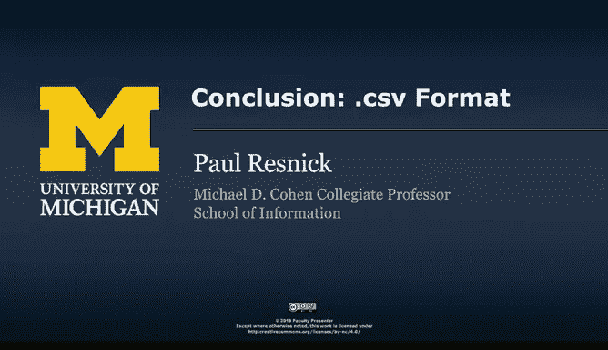

# 密歇根大学《Python3编程（课程1、2）》｜Python 3 Programming（Python for everyone进阶）（中英字幕） - P106：18_01_07_CSV格式总结.zh_en - GPT中英字幕课程资源 - BV1CM411Z72u

Welcome back。You should now be able to write a program that reads a text file in CSV format。

 you might get it as a dump from a spreadsheet or a stats program。

And you should be able to write a text file whose contents are in CSV format。

 You can then import it into a spreadsheet， or a stats program。C， SV comma separated values。

 So a joke about commas。What is the difference between a cat and a comma。Well。

 a cat has claws at the end of its paws。And a comma is a pause at the end of a clause。

Which reminds me of another one in the same vein。What's the difference between a prince。

 a bald headeded man， a monkey， and an orphan？Right， what's the difference between a prince。

 a bald headeded man， a monkey and an orphan。Well， the first is an heir apparent。

The second has no apparent hair。The third has a hairy parent， and the last has nary a parent。

See you next time。