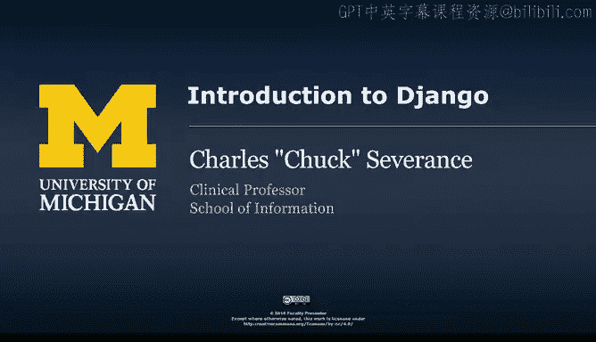
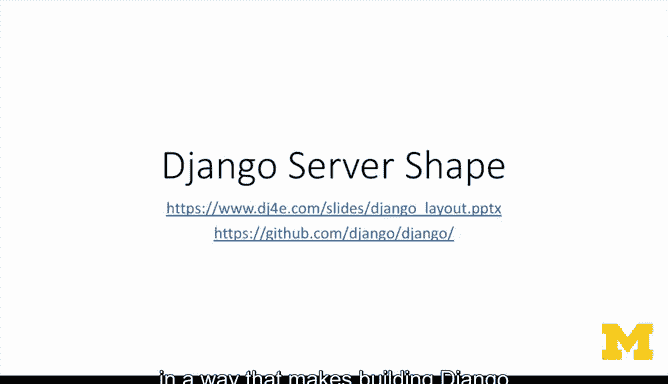
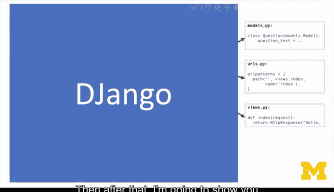
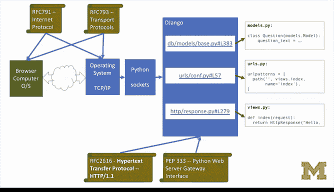

# 密歇根大学《Python3编程（课程3、4、5）》｜Python 3 Programming（Python for everyone进阶）（中英字幕） - P106：49_04_02_Django框架入门.zh_en - GPT中英字幕课程资源 - BV1gj41177yd

Hello and welcome to this edition to the way the programmer。My my name is Charles Severance。

 I teach Python courses。 I teach web development courses。

 And so I was tasked with giving you a real world example of object orientation。 And this is。

 it's a little difficult for me because in the real world， little tiny programs tend to。

Not cause us as programmers to build or even use objects in a sophisticated way。

 And so I've decided in this that I'm going to。Try to take you into a lot more complex world and give you a sense of what's going on behind the scenes and how object orientation is essential。

 And so I'm going to actually use django， which django is a web development framework。

 And this is less about writing django than it is about looking at how Django uses objects to interact with you is a programmer who's going to write Django。

 So if you really want to you know go crazy on this。 go to my website DJ for E do co。

 which is under construction。 I'm not really teaching this course until a couple of months from now。

 but this will be eventually by the time you're watching this。

 maybe this will be far more sophisticated。 The thing I'm working through is what's called the Django tutorial。

 and this comes from the django community and this is where a lot of initial django developers。

 they just say， hey， you want to get started， go ahead and get started。

 And so we're going to go through like the first one and2。 but I've already done that。Again。

 this is not about django， this is about object orientation。

 so I'm going to play with these things and show you some of the source code so it might be good if I showed you the eventual source code that I'm trying to weave a narrative that we get to so let's take a look at that source code。

So if I go into polls2。This is a little application。 it doesn't do much right now。

 it just prints out hello， oh， I got to start the server H on。Did do you managech。O。😔，CD dot dot。

So I have the server running。This is little application。Oh， I got to go up a directory。

Now it's running。Okay， so this is an application that is only at the second step of the tutorial and the only thing that it does is print something out。

And as such， it's not a very sophisticated application。

And I'm going to talk to you about three files。 The first file is a file called the URLs file。

And the URLs file is very simple and that it basically says for this particular path。

 which is the path that has nothing here after that slash。

 run this code from the file views with a method named index。 So if I look at views。

This is the view code and it basically is saying return an HttP response because its part of the request response cycle。

 hellello world and that prints this thing out and it's calling a bunch of things。

 believe me and I'll show you a little bit of how tough this would be if we didn't have django doing all this work and so this is the code that we have to write。

 and then there's the other thing that we're not going to cover too much about is how to create database tables。

 And here's this models file and this class basically says let's make a question model which is also then a table in the database。

 and then it is extending an object that comes from Django called models do model。

 And if you look down， this is the code that I've got to do and it creates fields in the database and all these other things if I took a look at what this database is。

 it ends up with all this other stuff and has all these files that are created for me。

 there's data in these files and I mean there's。Structure in these files， et cetera， et cetera。

 and all I did was。Created this。 And so there's a sort of a very small amount of work that I had to do to sort of get Django to do a whole bunch of work for me。

 And I do that by extending an object that I'm handed。

 This model dot model object is something that I'm extending。So。At the end of the day。

 what I want to do is I want to look at what it takes to take a URL and have a piece of code that responds to that URL。

So here's some URLs。 I want to show you how Django works and what Django gives you in a way that makes building Django code。

Way more easier than it could be so。

If I was to build a web server， and I've written here， and I'll show you this code in a second。

 I I've written sort of the simplest raw Python web server that I could， could write and basically。

At some point， a browser is going to type a URL。 It's going to send a request over the Internet to your computer。

 And in that computer， there is like an operating system。

 whether it's a Mac or Windows or Linux and it has networking capability， TC P I。

 and there are documents that if you really wanted to。 You learn how to build those things。

 you can type into Google RF 791 or RFc 793。 And then you can go get a sense of like how hard that really would be。

 And I don't know if you played with sockets or not。 But there is some socket。

 a socket library inside of Python。 And then we're going to create a very simple web server。

 that's going to sort of receive this request from the browser。

 And then send back a really tiny little HM L bit。That's going to be sent back to that browser。

 Very tiny H T M L， little body tag， Hello world slash body slash H T M L。 and all of this stuff。

 I'll cover all this stuff， how we create this server。 And this just gives you and this。

 this isn't even real Web server。 It's not reading files or anything else。

 It responds to every request with Hello world over and over and over again。

And then the next thing we're going to show after that is we're going to show how those three files that I showed you models do py URLs。

 py and views。 py。 we write 25 lines of code， and then we've created this application that's very sophisticated and it's very capable and then after that。

 I'm going to show you sort of the detail of how within Django Django creates objects that then you extend to communicate with Django。

 how you want your application to work。 So we're going to start with a very very low levell concept of how a Python program would talk directly to a web browser and so let's go take a look at first。

 let's take a look at this server code。

嗯。Let me start a new。Browser， let me actually can get rid of， well， the Django server can stay there。

 C dot do CD dot do。And you can download this from。DJfr。 co。

Let me make this a little smaller so we can see it all。Okay， so if you were。

 here's some stack overflows that I used and some Python documentation that I used to figure all this stuff out。

 This is not particularly an object。 This is a socket library that's built into Python already。

 And then if we take a look。One more line。I have to put a try accept around all that stuff。So。

We're going it we're going to print。 Here's how you get this thing。

 We're going call this to create server function and server socket。

 we're telling it to start a socket。 a socket is a little different than a file。

 It's kind of like a file handle， except that it's two way thing which you can both read and write to the same thing。

 you could write to a file because it's like two sides if you have one application。

 and they're both connected by a socket。 one side can write， and then the other side can read。

 And then the other side can write and it comes back。

 And so it's like it's almost like two connection。 A socket is a bidirectional or a two way connection。

 So we're starting a socket。 This is the server side because in jjanangle。

 you're building the server side， not a browser。 browser is， the client side。

 This is the server side。And we wrapped this whole thing and it a try and accept because I need to close these sockets if there's。

 if you're writing this code， took me about an hour to write this code。

 even after I found it on stack overflow。 So you don't really want to write this。

 And I'm glad it worked。 You can look at it。 You can play with it。 But all it really。

 its whole goal of this code is to prove to you that you don't want to write this code。

 And so I'll just walk through it。 What we're doing is we're gonna to be a server。

 which means we are waiting for connections。 And that's what server socket dot bind says wait for connection on port 9000。

 server socket dot listen 5。 That means up to five connections。

 And then this while loop basically says。Except a socket。 if a socket has arrived。

 so it'll actually stop here be until a socket connection happens。

 So when a browser makes a connection till your server， it sits here。 Well。

 it sits here until the browser makes a connection。

 and then it drives out and it gets these two pieces of data， which are a tuple。

 but this is just an assignment statement， right， client socket address。

 the address of where what the browsers coming from and the socket object。 So this is now an object。

 So client socket is an object that's populated。By the statement。

So if you were to read the HtTP protocol， you would realize that the first thing the browser is going to do is send us a command like get or post with a URL that it's interested in。

 And so we're going to read the first 5000 characters from the browser and then we're going decode it。

 I'll split it based on new lines because it's actually a series of lines。

 both the HP command and then a series of header values and we're going print the very first line which we're going see how this works in a second。

 And then we know at the HP protocol is。 So we're going to just send back this simplest of H pages。

 which is a 200 okay， which says this is a valid document Here you are。

 We're going to send back UTF8 Hm。 and then a blank line So here's the blank line right here and then we're going to send the body with two new lines at the end And of course because we're sending it outside of our world we're going to do a data dot and code so that the UTF8 is properly sent。

 So we're going receive UTF8。 That's where this decode came in。 the get request that comes into us。

 is going to be UTF8 and then we're going to send back。A document that's also UTF8。

That's also why I told it it's UTF 8 and then encode is what converts the Unicode inside of Python into UTF 8。

 and then we have to kind of shut it down， which the shutdown sort of sends all the data。

 make sure the data gets received and then takes the socket and then we go back up to the top and we wait for the next socket。

 So that's each one of the URLs that gets retrieved is going to be handled。

 And so if keyboard is if I you hit control C or control Z and it shuts down。

 which closes the socket。 turns out it takes like a minute or two to be able to start it back up again unless you do it。

 Or if like you type and change in this and you make a mistake。

 you probably generaterate yourself an exception。 and we still want to close the socket。

 if if we made a mistake inside here。That was really helpful for me because it took me a long time to get this code work。

 and it blew up a lot。 And so now。It's not blowing up。So now let's run this。

OkayAnd I can say Python 3。Server dot py。And now we have the world's simplest Python server。

And so if I go into my browser and I grow to local hostst。

Loho 9000 adds the ports like an extension on a phone system。

 So Lolo colonlog 9000 says connect Lohot， which is the same computer that I'm on。

 this is not really leaving to the Internet。 That would be a normal domain name。

Colon 9000 says on 9000 and my Django was running on 8000。

 and my little mini Python server is running on 9000。 so I'm going to copy that。

I'm going to go into Googlerome。 I'm going to turn on developer console。

And then I am going to turn and watch the network， and then I'm going to type in that URL。

That's just junk。 so we don't want that。 I don't know what that's doing。 so I'm going to hit enter。

F goes well。Yeah。So it says hello world。 See that。 Prety awesome。 After all that work。

 So what happens is if you go on here， you can see that where is this， I don't want to see Yeah。

 I don't want to see that。 So we sent a request to the local host on port 9000， We did a get200 okay。

 Remember our application said 200 okay wherever that was。 See this little 200 right there。

2000 was the status that our browser got back from our application。 The response headers。

The response headers said that， oh， this is a HTML document with a character set of UTF 8。 Oh。

 look lucky， lucky， where you did that。 We， we said that in our， in our Python server Py code。

And the request headers。This is all that stuff。This is the browser telling us what kind of browser is。

 et cetera， et cetera。 And where that shows up is remember I did this split by only showing pieces sub0。

 I'm not showing you any of those things。 but if you just were to print out this RD variable in your version of it。

You would actually see all of those headers， and that's the HTTP request response cycle。

 that's like the simplest diversion of the HTP Re response cycle。Now if we take a look at this。

We'll see that this is also retrieving the document Fvocon because it's trying to return the icon。

 the icon that would show up right here。And our。Our。

 web server is not smart enough to give back icons。

 It only says hellello world to every single request， because it it went around twice。

 It did this for the， for local host slash， and then favicon。 It did it again。

 And it simply sent back a document。 Now， after a while， we could say， oh。

 this cha type is image Jpeg。 And then we would have different body。

 And then we could send favicons back and forth。And if you'll notice it prints out at this print statement right here。

This print statement right here prints out the the get request。

 which is this is the first request that corresponds to that local host。

 This is the second request that correspondres to that fbicon。Okay。

And so we got two requests and now I'm going to blow this up and that's when it's going to hit the keyboard interrupt and then it's going to shut down and then it's going to finish that。

That ser up P Y was。How a web application works。 But this is like such a tiny fraction。

 If you really wanted to build a real live web application that had multiple files and Cs and images and all that stuff。

 it gets harder and harder。 And then receiving data。 There's parsing of the incoming data and。

If you Google。Like the RFs。C for HtTP。RSD stands for Request for Com。 You will find RF 2616。

 the Hypertext transfer protocol that gives you some subset of how much information you need to know to write a web server and to write a web browser。

 and so I'll just start to skim down。 We got hundreds of pages。That was just a table of contents。

 goes down to 176。 and this is one of many documents that describes how that works。

 So it turns out that code that I wrote is not entirely compliant。

 It's just barely good enough to do those most crude and simple version of this。

 so that you can look at it。 And you could play with that。 You could add print statements， et cetera。

 et cetera， et cetera。So if you were going to want to write an entire browser。

 you have to figure all these things out right in Django。

 like the 2616 hypertex transport protocol Trans protocol， you'd have to write all this。

 There's all these other rules。 And so I think what I'll do is I'll stop now and then coming back。

 I'm going to show you how Django implements that exact same thing。

 but then how your code hooks into Django in a way where you're using object orient programming to hook the code into Django in the right places so that the amount of code that you have to write is really small and the amount of documentation that you have to read is extremely small and then someone inside Django had to read lots in lots of things about how to make this stuff work。

 So when we come back， we'll talk a lot more about your relationship between the Django code and your code and how that relationship is done through object orient programming。

