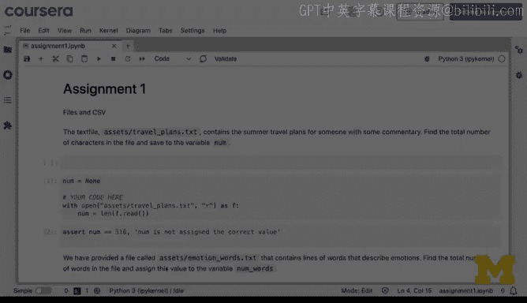
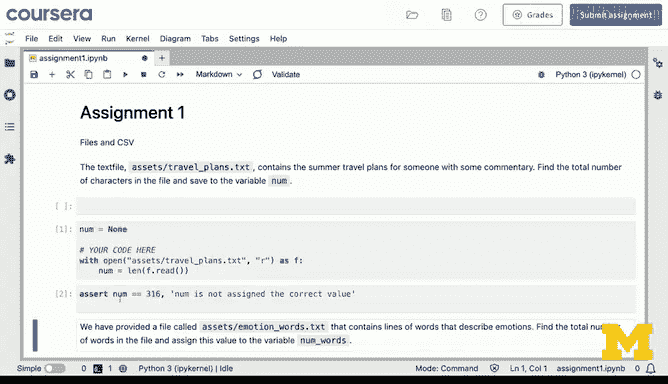
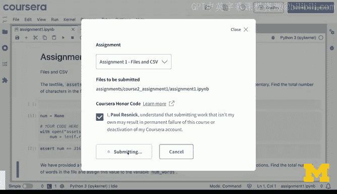
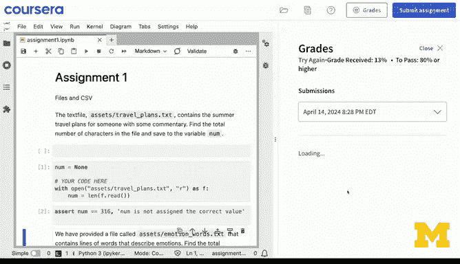

# 密歇根大学《Python3编程（课程1、2）》｜Python 3 Programming（Python for everyone进阶）（中英字幕） - P107：19_01_08_作业提交指南.zh_en - GPT中英字幕课程资源 - BV1CM411Z72u

You'll be submitting your assignments as Jupiter notebooks here's the first assignment which you're at this point ready to take and it's got a bunch of cells in it。

And there are some cells where we have these。Notation saying your code here。

 and so I've actually already answered this first question， the instructions are above it。

We're supposed to find out the total number of characters in a file and save it to the variable nu。

I'm actually revealing the answer to you for this first question。

 but you would have gotten it anyway， so I'm not too worried。

 and so I've put this in here if I run this cell，Then there's another cell where there's an assert statement。

And if I run that， you can see that it passes。Now， there may be some hidden assert statements in these cellsve and those hidden ones will only run when you submit the assignment to be graded。

 Subting the assignment can take a little while， so I really encourage you to do your best to make sure you've got it right before you bother to submit if I submit this assignment。

I have to click on the honor code， I submit the assignment。

And then I would have to wait。So I can ask to view grades。But actually。

 it shows that the grding is in progress。And I would have to wait some time。

 so this is not a very efficient way to get feedback you're much better off doing the work yourself and only submitting when you think you've got it right。

Here's the first submission that I made。 I only got the first question right。

 I got the rest of them wrong。 It tells me I got a 13 per cent。

I need。Something else， it's actually going to be 100% that we require to pass in this course and。

I can see some feedback。In this case。I got the question right。 and so there's not any feedback。

The next one I got wrong in the comment is there was no response。Here's another one。

Where there's an assertion error， so you get kinds you get various feedback。Like this。

And we don't usually show you the trace back， but we'll tell you what's wrong。

That nu words is not assigned the correct value。You can submit as many times as you want。

 as I suggested， you're really much better off making your own tests。Figuring out。

What's going on and then only submit when you're pretty sure you've got it right。Good luck。

 and have fun。