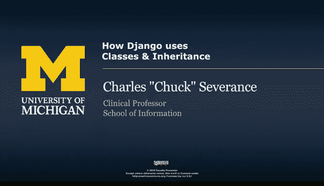
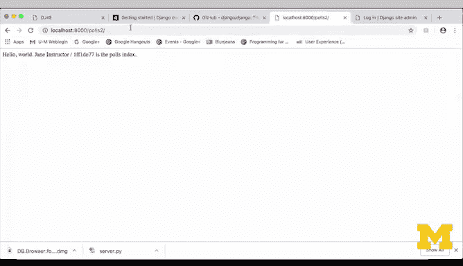
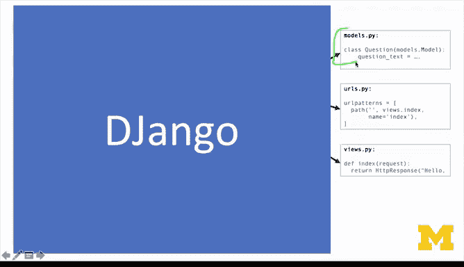
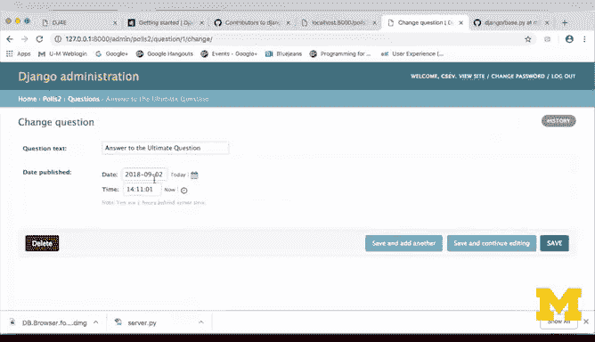
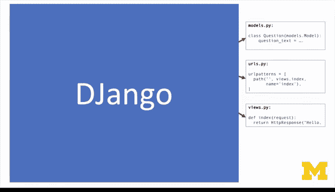
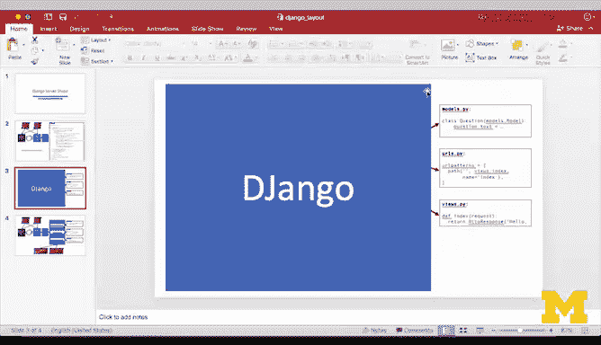
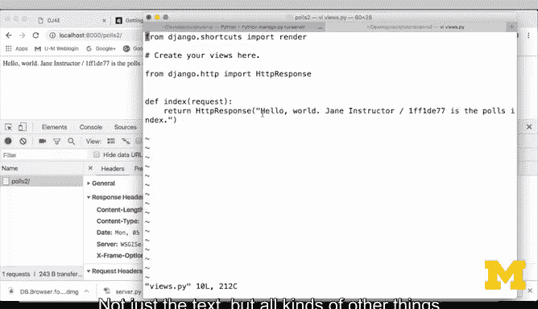
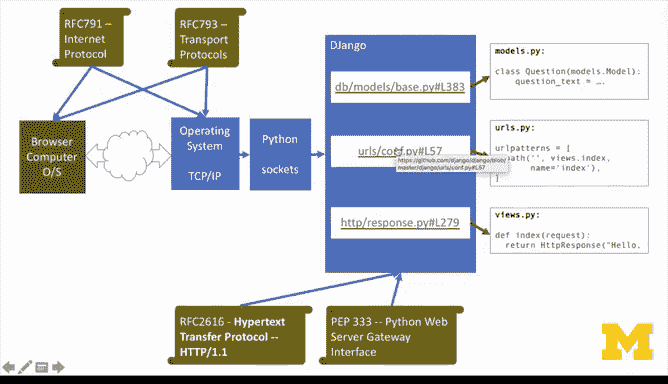
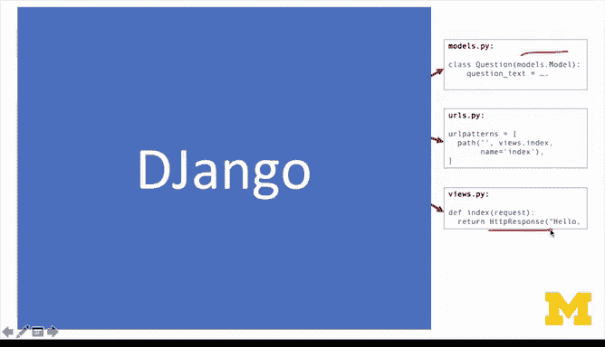

# 密歇根大学《Python3编程（课程3、4、5）》｜Python 3 Programming（Python for everyone进阶）（中英字幕） - P107：50_04_03_Django如何运用类与继承.zh_en - GPT中英字幕课程资源 - BV1gj41177yd

So welcome back。 Now what I want to do is I want to dig into a little bit about how you as a developer of a Dngo application。

 interact with Django itself。With objects。 So just recall， if you're looking for the downloads。

 DJfr dot com is the place to go。 We are working through the Django tutorial。

 and I'm pretty much no further than part 2 in this particular one because I' really not worried about building the Dngo app。

 I'm really interested in how objects work。 So one of the things that you can do because Django is really cool。

 open source is we're actually going to look at the source code to Django。

 Django is open source and has 26000 different separate modifications。 almost 1700 contributors。

 and it's a lot of source code。 It's probably a million lines of code。

 And so this is real enterprise software。 it， it's very exciting stuff。

 And open source is really cool because we can look inside Django。

 Djago is not a magical thing that we can't see。 And we can learn from it and understand it。

 So what I'm going to try to do is I'm going to take you inside Django。😊。

And our application that we write is going to be really simple。

 It's this polls application that just prints out Hello world， because this isn't a Django class。

 This is really kind of how objector works inside Django。 So what we're doing here is。

If you read the Django documentation and you read the Django tutorial， what you find is that， oh。

 okay， there's this big thing called Django。 and you got to write these files。

 this file URLs that routes things and models that creates database tables and allows you to read and write data from those database tables and the views that shows what the user interface of this is。

 And so you're supposed to create these files。 So I'm going to focus mostly on the models file。

 and talk a little bit about。

What's going on inside a Django and how Django in effect creates classes and then you create classes that derive from the Django classes。

 and then you can create objects that are based on your classes and then use those objects。

 And so we're going to dig in to the source code to Django and so this particular one。

 let's take a look at this based up Py。 let me show you the models file that's our code。

So here's our models file and if you read the documentation injago it says well if you want to create a database table。

 it's called a model in the Model view controller， we're going to make a database table has question text。

 publication date and then have some methods inside of it like how to print this particular object out as a string and then this was published recently as something that they're going to use in and then we're going have another table called choice。

 and it's going to have a question column and a text column and we can see this there's this thing called migrations that reads this and creates tables and so in here we have polls to choice question polls to choice which。

Has those columns and it's created this database table for us All we did is we took this This thing not only allows us during runtime to read and write from the database。

 but it also at setup time， it creates things for us。

 And so these two database tables that I've got sitting in my database here were created from this object because it runs one process to read through your objects。

 then create database tables， it's another process while it's doing request response cycles。

 then it actually reads and writes the data in the database， but。So that's one nice thing。

 And so models dot model is a class。 And if you just look at this。

 we're creating a new class that's questioned。 It's our class。

 and we're extending the models dot model class。 And we're doing this to inherit lots and lots and lots of functionality。

 And then the definition of this is just， you know， variables， models do char field。 that's。

 you know， that's a variable a constant constant with some stuff。 And these are objects。

 And all this stuff is kind of sitting there for us to sort of you know what creates a。😊。

It's almost like a dialect of Python that is specifically to define these database models。Okay。

So if you know that this is a class and that it's extending another class。

 let's go find the source code to that class。So now what we're going to do is we're going to go into the Python GitHub repository and here on line 383。

In the base dot Py， this big long thing， if you're looking for it。

 it's linked here from this slide right here。And now this is Django code。

 This is the code that was written by the Django project。 And so they made this model。

And if you look at this， I mean， you've made simple classes。

This is not that different than the classes you made， right？ So you have in an underscore。

 underscore knit method in the first parameter self。 No， that should look familiar to you。

 And then you have a couple of arguments。 And then we got a whole bunch of code。 And so if we look。

 start looking down here， This is just， this is just the constructor。

 So part of the goal of object or programming is。You get to write a little bit of code that leverages hundreds and hundreds of lines of code that somebody else。

 Some other really sharp people like， let's see if we can find the contributors。

 So this is a list of all the people that built this。 These people。No a lot。 right。

 There's a whole bunch of people。 and we can see their work and what they're doing and how long they've been working。

 and they're doing things like reading all these documents like the Hypertext transport protocol and this and that and knowing how to talk to databases and knowing how to talk to EQite database。

 And I talk to my SQl database and a Postgres database and Oracal database。

You literally don't need to know anything。 And so what they're doing is they're building a really large。

Object or class that then you can extend。 And you don't have to write all this code。

 This is very general purpose code。 part of the goal of writing an object is to hide this from you。

 Now， we can look at it。 You shouldn't have to look at it。

 You should be able to look at the documentation， I。e。 the documentation on these tutorials。

 I'm just trying to give you the sense that here we go。 And so this is still the constructor。

 This is the initialization。 the constructor。Right， so now we now have a method。 Okay。

 And so these are other methods like the and these are things that you'll sort of recognize the double underscore string underscore。

 That's what happens when we convert a model object to a string。 underscore underscore。

 So this is no different than if you convert a dictionary to a string。

 There's a little method inside of Python that's double underscore string， double underscore。

 E Q that's comparing equality hashing has to do with how dictionaries work get state set state and all these things are just the kind of things that if I am the djago developer。

 I have to do this because that lets me mount my class into django the right way。

And these are these are methods that would be documented like serializable value。Save。

And there's another like whole bunch of stuff。See how much work at Save B？

If you'd probably be looking at the Django documentation to see all this stuff。 Save parents。

 We're still in。The model object。next prepare database save， clean， validate， unique。

And so these is just code that was written by。These people， where are they。

all these people wrote all this code and read all the documentation and tested the heck out of it。

 and you just right。This code right here， and you extend， and you inherit all that stuff。

 And that does things like。Creates all the tables， which I showed you。

 It actually hooks into an administrator interface。 Let me see if I can show you that。

So this is an administration interface。And so this user interface。

 this part of your Django application that came from Django。 That's the admin tool。

 the admin panel within Django， and your model is now in there。Right。

 and so you've got some question text and date published， et cetera， et cetera， et cetera。

 So all you did was。

Created one little file。Right， Janjangos this magical thing， administrator interface。

 database creation， table creation， et cetera， et cetera。 You created this little file。

And away you go。Okay， so then I'll show you one more thing。

 just the pattern you'll see is kind of the same is in this views dot py file。

So this is returning a response when you go here into the polls 2 application， right。

 It returns this response。 But if you were to look at this at the developer console。Under network。

You would see that there is a whole bunch of stuff that you've got to do to do H T T P。

 We sort of saw that in the first video， like the response headers， all these things。

 what the content like is， what the type is， the date， these things。

 And there's many other these things that might be necessary。

 So you could learn how to write all these things。Or you could basically say， you know what？

I'm just going to inherit the obvious things。 And I am going to return。

 read the documentation on H T TP response。 So this is an object。

 This is the constructor to that object。 and we're going to send in a string to the constructor。

 So so this HP response we could create it。 We could set headers。

 we could do all kinds of things in it。 not just the text。

 but all kinds of other things that have to do with the H TTP protocol。

 And so somewhere inside of Django， they have defined this object that's the H TTP response。

 And so I can show us that one as well。

Take a look at the H response。And we're using it in a very simple way。 But if you look inside Django。

 you see there's a lot to it。 So here we go is content is a set of bytes in this case。

And that's the under， that's the constructor。 right， Then there's serialization。Et cetera。

 And so all these things。All those things are part of that object an HB response base。

 if we go find that one， which I think is just up here。去。So even within。This file。

 they're using one class HB response base。Conent type。

 that's the thing about its text s HTML status that was the 200 OK， et cetera， et cetera， Careset。

 UTF8， So we're setting that thing up， that's a constructor here。

 And if you were looking at the documentation， you would see that。The char setting the cha set。

Setting a cookie， a cookie has to do with this little bit of data that goes back and forth between the server and the browser。

You don't have to know how to do that， you could go read that， you could go into RFC 2616， RF 2616。

See if I got that， look at 2616。And then we could search for cookie。Whoops。

 how come I don't see that。嗯。H。R F，26 RF。H2DP cookie， Which one is it。

 Maybe it's got its own document。Yeah there we go， RC 6265。 So if you want to set a cookie。

 which is how we log in and out of applications， you got to go read this one and how many pages is this。

It's only 37 pages， but it turns out that thankfully， somebody in the jngle project， where are we。

Has a little come。Has a method called set cookie for us。

 And so if you were to go look at the documentation。

 if this H T P response wanted to set a cookie back in the browser instead of reading all this stuff。

 some kind person who helped write Django wrote all this down and gave you a method called set cookie。

So。I'll stop there。 I'm not really trying to get you to sort of be a wizard in any of this stuff。

 I'm trying to give you little tiny places where you can jump in and learn more。

 The basic idea is there's lots of complexity to this。 lots of documentation。

 lots of rules about how to comply to this stuff。 And Django has made it so that that's all hidden behind this abstraction boundary。

 You have objects。 You make those objects So we played with the models object。

 and then we played with the HB response object， and we can use as much or as little。

 we didn't have to use the cookie and the response object。

 We can use as much or as little of that stuff as we want。

 and that's the beauty is that all that complicated detail is hidden inside Django with the convenience of we can use as little or as much of it as we want。

So I hope you didn't try to like write Django because of this。

 I just wanted to make a little connection with how you work with large frameworks or large libraries and how object or programmings and the patterns of abstraction and hiding and inheritance can be put to good use。

 both by building libraries and then by using those libraries。 I hope you find it useful Ches。

