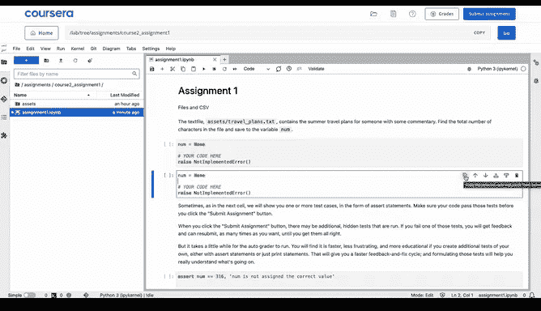
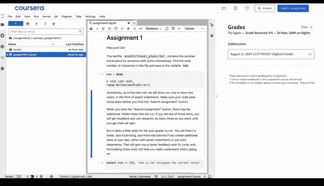
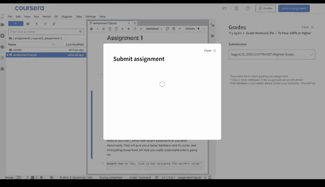
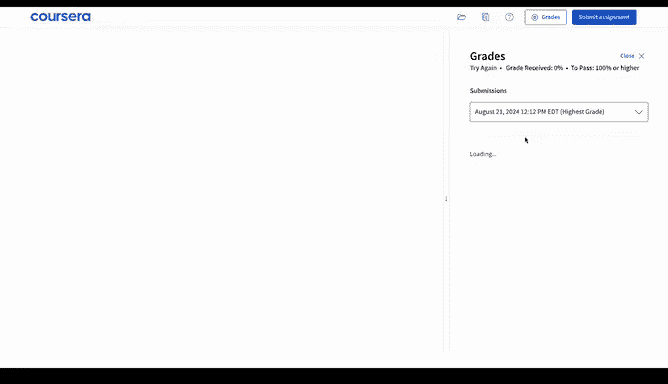

# 密歇根大学《Python3编程（课程1、2）》｜Python 3 Programming（Python for everyone进阶）（中英字幕） - P108：20_01_09_损坏作业笔记本恢复方法.zh_en - GPT中英字幕课程资源 - BV1CM411Z72u

Hello， today I'm going to be showing you how to regenerate a new assignment file or data file that is in your Jupyter workspace。

 particularly an event where you've submitted your assignment and the feedback that you were getting is something like a JSON schema error or。

Old assignment notebook error， something similar that's demonstrating that something is wrong with the notebook itself。

 not your answers。So to start off。You will be going to a programming assignment item or a lab item to be able to navigate to your Jupyter workspace。

So in this case I am in the programming assignment assessment files and CSV item。

 and I can click launchun Lab in order to open up my Jupiter workspace。U。

There are a number of reasons why you might be getting this kind of error or errors that are similar to this。

 usually it means that something has gone wrong with the metadata that's attached to your notebook。

 usually by duplicating existing cells and then changing them in those existing cells that you've duplicated。

Happ to have extra metadata that's specific to the autograder， but you don't necessarily notice it。

And as a result， as you're copying it and then maybe overr some of those cells。

 you submit to the autograder and then the autograder gets confused because it has that extra data in more than one cell than it is expecting。

So in the case here in assignment one。We see quite easily that there are two cells for the first question which is asking you to assign the total number of characters in the fileal to the variable nu in this case I've preemptively duplicated this using the duplication button it copies the selected cells and pastes them below。

 it's quite easy to see and click on in the actual Jupyter interface。

So it's really easy to do if you end up submitting something like this。

 you will usually find some sort of error message like you know like one or more notebooks in the assignment use an old version。

 it's kind of an odd error message for the error that we're getting。

But there are a couple ways to go about it， about fixing this。

The absolute easiest way to go about this， if you can see something like this and you know exactly what you've done。

 you can go in and delete the duplicated cell， you click on the delete button or you right click on the cell and then click delete cells this will get rid of that cell that has the duplicated metadata as well。

 and if you try to resubmit the file。

Then you'll end up seeing that the autograder is able to then understand that oh there's only one cell with that particular metadata in inside of it and it's able to process and understand the assignment itself so it's a really easy fix if you just made that change or it's really easy to tell which ones have been duplicated it's a little bit more complicated though if you've been duplicating other cells and you have been writing in the new ones and then you can't quite tell which ones have the old data and the new data。

And so as we see。Justlet that cell that one that I duplicated totally works and I can now see that I have a zero out of eight and I can see the feedback that I need if you're in the situation where you can't actually tell which ones have been duplicated or it's a little bit more complicated than just having duplicated existing cells with metadata in them。

 you can also go this other route， which is to generate a fresh copy of an assignment。

So an or a data file so you could have。An asset like for example。

 the emotion words that text that could have been corrupted or overwritten or something and you want to get a new fresh copy of it。

 So in order to do both of these kinds of things what you'll end up doing is you want to rename the。

File so in this case I'll be working just with this assignment1 to IPY and B file the easiest way to do it would be to right click on the file in the navigation and to click the rename you can also get to this。

From。The the file drop down and you can click to the rename notebook。

 it'll pop up an option for you to rename it， if you have work that you would like to save。

 rename it to something anything else， assignment one old。

And click rename so this you will see now you have an assignment1 old do IPy and B file you no longer have an assignment1 IPy and B file it's really important that you do not have the name of the file that you want to generate a new version of。

Any other name is totally appropriate to have in there。Um。

 but you need to make sure that it is not there， doing something like a save as， so file。

 save notebook as。呃。You know， new。Old。We'll actually generate a new copy of that file that you had。

But you still have that persistent， the original version of its the assignment1 old。

 so we now have both of those files， so if you have an assignment1 to IPY and B and you use save as to generate a new file。

 that's actually going to cause a problem because you will still have that original assignment1 to IPY and B file afterwards。

So。WeWe've now renamed a existing file and we want to generate a new version or a fresh copy of the original file。

 what you'll do next is you will click on the help button in the upper right hand corner。

 it's the little icon with a question mark in a circle。When you click that。

 it'll pop up this lab help section from there you can click the get latest diversion button it's one of the first buttons on the page。

 what this will do。Rather than prompttu as you click it say are you sure any unsafe progress will be lost so save your files if you need to but click Update Lab What's going to happen in the background for courseursera is that it is going to look through your Jupyter workspace and it'll check the files that you have based on the file name and their location against what they expected you to have so if they expected you to have a file in the resources course2 folder called assignment1 to IPPY and B then it'll say oh there is no file by this name in this location and it will then regenerate a fresh copy of that particular file for you。

So in this case it went through my workspace and it found that there was no assignment 1 to IPY and B file。

 so it went ahead and refreshed my workspace and included that new fresh copy of assignment1 to IPY and B。

So this is totally fresh， totally new， does not look any difference。

Currently the one I had in my assignment 1。old。That's because I wasn't doing any work in this particular file。

 but you have this new fresh copy for you to use。Now what's important though。

 is that if you did have any old work in the old file that you just renamed and still have saved in your workspace。

 you will have to manually move it over to the new assignment1。

 IPY andB file or whatever new file you may be working with。嗯。

So just keep in mind you'll need to manually move things over if you do need to create new cells and you're not quite sure how to do it besides duplicating。

 there are a couple of options， so you can use if you're using the Jupyter notebook interface。

 there's that insert cell above or insert cell below option over each of the cells if you hover over a cell。

 you will be able to see that little either plus sign in a little rectangle or a rectangle and then a plus sign and you can do that。

To add a new cell， this is a totally new cell。 it doesn't contain any of the special metadata that the autograder uses you can also。

Add cells a couple other ways， there is a plus sign in the top header bar insert of cell below。U。

There's a couple other ways to also do it， but generally adding a new cell as opposed to duplicating an existing cell will be a much safer process for you to use。

So you should hopefully be able to generate new versions of your assignments now or generate new copies of your files as needed if you need to do you are allowed to do multiple。

Fileles themselves at a time if you need to。Get fresh copies of a lot of different things。

 feel free to do all of that first either renaming or if you don't need to save an old version of it。

 you can just delete it。But deleting it is permanent， you generally can't really get that back。

 so once you are done either renaming or deleting you can then go and click that help button again。

 click that get latest version and then Coursera will go through all of the files that it expects and checks to see which ones are missing and then refreshes and gives you a new version of all of the files that it finds to be missing。

嗯。Yeah， so that's it， I hope you all have a wonderful time learning and that you enjoy the course。

