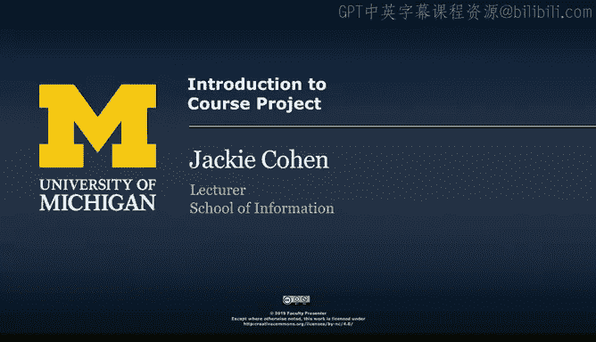

# 密歇根大学《Python3编程（课程3、4、5）》｜Python 3 Programming（Python for everyone进阶）（中英字幕） - P108：51_04_01_引言：最终课程项目.zh_en - GPT中英字幕课程资源 - BV1gj41177yd

Hello and welcome to your Course 4 project。 As you can see in your project instructions。

 you'll be building Wel of Python in this project， like the popular TV game Wheel of Fortune。

 if you've ever seen it。As you approach this project， I have， again。

 a few suggestions for you to think about， to work on it and make sure that you feel successful。

First of all， you should think about what you've got， what we've provided for you。

 and make sure that you understand it。You've been given two Json files。

 You've been given some code supplied for you that builds a lot of this game logic。

You should think specifically about what your task is。

 which is to complete class definitions so that you or someone else could play this game。

 will of Python。You want to consider specifically also why class definitions are useful here and that will be the key to succeeding at this project。

 why are you building what it is you're building， why is this so useful。

 understanding why is going to make completing this code a lot easier， so it's worth your time。

I want to poke a couple of these ideas a little bit more and give you a little bit more detail of things that I think will be useful for you to think about。

 First， you should note that although the class definition for the human player and the class definition for the computer player are different。

 and you have to make them work in some different ways。

 a human player and a computer player of this game。Basically， do the same things。

They get to the results differently。 They accept input a little bit differently。 Of course， you。

 as a human player， are different from a computer player。But still both have to get a move。

 for example， in order to play the game。So thinking about what a human player and a computer player have in common。

 as well as how they're different is a useful thing to think about as you think about building this code into something that will work for the full and complete game。

You can use what you know about class definitions and inheritance to make all of this happen since a lot of the structure is provided for you either in the logic of the game or in the instructions for what code you should write。

Come back again and again to these ideas of what you know about classes and why classes are useful。

 and you'll find that often what you have to write is not a huge amount of code。

 it's just a lot of understanding。Spending time drawing pictures and writing outlines is also definitely worth your time here。

You should remember that a method， for example， in a class can have the same name in multiple subclass and yet do totally different things inside or return similar values。

 If a method has the same name。It will be called at the same time。

 but you can do different things inside it in different subclass。

 I would strongly recommend looking at the material you learned about class inheritance and thinking really carefully about how the examples you've seen apply in this game。

And going through it as calmly as you can so you can think about the success of this particular situation and this particular game。

And that will be almost all you need。It might be really helpful to think about this project as you building a computer game。

 that's what you're doing。 Think about what would a computer game player or a character in the game in this case have to do。

😡，Those are the same things a human player has to do。Now， what does a human player have to input？

So that the player behaves like any old computer character would。Again。

 focus on those instructions and on the little bit of code you have to write to make those things true。

It's also important to think specifically about what all of the instructions for you as a programmer are。

 and what you've got。 So that's going back to the Json files and the code that is provided for tasks like building this game。

 Often the hardest part is understanding what you have to do。 Not writing super complicated code。

 So again， I want to emphasize that thinking about all these things you've studied in this course so far and earlier。

 perhaps in other courses will make you ready to complete this game。

 You know everything you have to know to do this。 You just have to be really careful and systematic about when to write what you're writing and how to try it out to see if it works。

 Good luck。 and have fun。