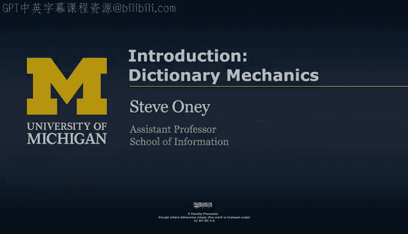

# 密歇根大学《Python3编程（课程1、2）》｜Python 3 Programming（Python for everyone进阶）（中英字幕） - P109：21_02_01_字典机制导论.zh_en - GPT中英字幕课程资源 - BV1CM411Z72u

In this lesson， we're going to cover dictionaries to visualize what a Python dictionary is。

 imagine a dictionary website where you can type in a word and it gives you the definition of that word。

In Python， we can use the term key to refer to the word that we're going to look up and value to refer to its definition。

So a key value pair would be a word and its definition。Except in Python。

 we can use the keys and values to represent and store almost anything。

Python dictionaries are collections of these key value pairs， so like lists and tuples。

 dictionaries and Python store multiple items， but unlike sequences。

 dictionaries are unordered and what that means is that unlike a list where we can look up things like the first or last items。

 there is no such thing as a first item in a dictionary。

 instead we can only look up the value for a specific key。

Dictionaries are one of the most versatile and powerful ways to manage and organize data in our Python programs。

 and by the end of this lesson， you'll be able to better represent and manipulate many kinds of data using dictionaries。

 so let's dive in。