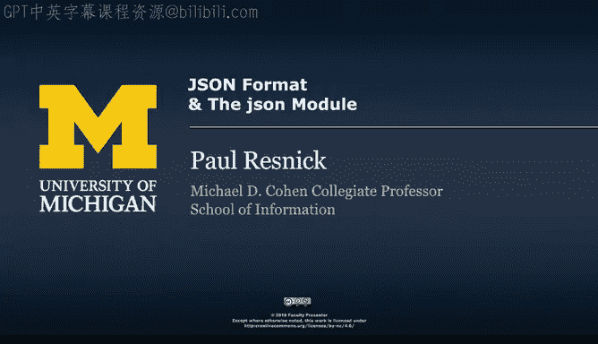
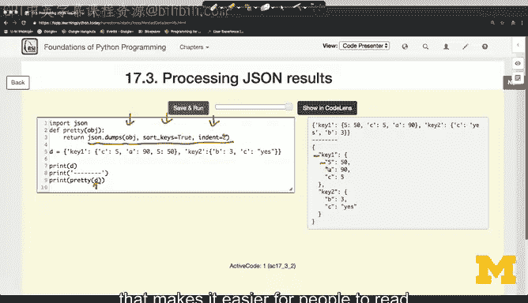

# 密歇根大学《Python3编程（课程3、4、5）》｜Python 3 Programming（Python for everyone进阶）（中英字幕） - P10：09_02_04_JSON格式与json模块.zh_en - GPT中英字幕课程资源 - BV1gj41177yd

Welcome back。Nested lists and dictionaries are very commonly shared between computer systems。

A standard formats been defined that makes it easy to share that data。 It's called Json JSO N。

 which stands for JavaScriptscript Object notation。

It originated with a different programming language， JavaScript。

But Python makes it pretty easy to both read in and write out data in JSON format。In fact。

 JSON format looks almost exactly like the print out of a Python list or a dictionary。In most cases。

 you wouldn't really notice the difference， but there are a couple small differences like the Python value non being represented as the word null and true and false not being capitalized。

We'll use the JSON module to read in and write out data in JSON format。A little warning。

 the Json module that we have in Runestone。Only does a subset of what the full Json module in a full Python environment would do。

 But we have the two most useful functions。Let's take a look at them。 The first one is called Lo S。

 It takes a string as input， and it returns a dictionary or a list。So， here we have。No， code snippet。

We're importing the JSON module。And。And we've got a variable called a string whose value is naturally a string。

That string has some new line characters in it， and then it's got the curly brace。

 which would suggest to you that it's going to be a Python dictionary。It's really just a string。

But once we take that string， and we。A9，3。We pass it as an input。To the load S function。

Which is part of the JsonN module。The load S function in the Json module takes a string as an input。

 and as an output， it produces either a Python list or a Python dictionary。

 depending on what the contents of the string were。

So in this case the string has its first non blank space， its non white space character。

 the first one is the curly brace， so what's going to be output is a dictionary。So on line four。

 we print out the type of D， and it is a dictionary。Since it's a dictionary， we can ask for its keys。

And it has two keys， result count and results。 we can ask for the value associated with result count and its 25。

That's the 25， and you see there in the string。One important thing to keep track of here is when you have a string and when you have a dictionary。

So we start with something that's a character string。And by passing it in to the load S function。

We get a dictionary as an output。If I lost track of that， let's say， and I tried to。Print。

A string square bracket result count。Because a string kind of looks like a dictionary。

And I try to run this。 I'm going to get an error。And it says its string indices must be integers。

Not strings， On line 7。I's saying on line 7， we're trying to treat a string as if it's a dictionary。

 It isn't a dictionary。 It's a string。 We're allowed to ask for a string square bracket 4 to get the fourth character。

 but we can't ask for a string square bracket result count。

We can ask for D square bracket result count。Because D is a dictionary。

The second useful function from the Json module is called Dump S。 It does the opposite of Lodes。

 It takes a Python list or dictionary， even an nested one。

 and converts it into a string that's in the Json format。Once we have a string in the JSON format。

 we can write it to a file or do anything else that we would do with a string。

The Dest function always takes a list or a dictionary， as an input。

But it also can take a couple of other parameters。If you pass sort keys equals true。

Then whenever you have a dictionary， it's going to output those in alphabetic order。

And if you pass the indent parameter。It will。Pretty print the string。

 It'll do some indentation and line breaks。 You can specify how many characters of indentation you want。

So let's see what happens when we run this。Oooops， I got an error。It's telling me that online， too。

Jason is not defined。And the reason is that I forgot。That I need to import the Json module。

 So the dumpas function is in the Json module。And this code snippet。Didn't have。

The Json module imported。T let me。Run it again。Now。

 you can see when I pass D to the pretty function on line 9。That it is。Creating a string。

By calling the JsonN。 Dumpas function。And that string， because I said indent equals 2。Each time。

I descend one level into this next data structure。 It's adding two more levels。Two more spaces。

 That makes it just a lot easier for a person to read when I print out。That string。Now。

 you may have noticed a little funny pronunciation that I've done here。

 Instead of calling this dumps and loads， I've called it dump S and load S。 That's very deliberate。

 It's。 It helps me to remind me that that S is for string。 The S is not for plural。

You still have to remember which of dump ass and low ass reads from a string and which one writes to a string。

Here's how I think of it。The JSO format is a set of conventions for how a string should be structured so that it can be loaded into a Python object。

Thus， load ass means load from a string。Or load a string into an object。

Dump S means dump an object to a string。Dumping from a string wouldn't really make sense。

 so that's how I can keep track of it。 D S， D an object to a string， low S。

Load an object from a string。That's the JSON format folks we'll be seeing a lot more of it when we look at RE APIs that let us fetch data from servers on the internet。

 like from iTunes or OMDB。JsonN Lodes loads from a string into a Python object。

 either a list or a dictionary， and JsonN D S dumps from a Python listster dictionary into a string。

Jason Dumpasse， with the indent parameter， yields a string with indentation that makes it easier for people to read and understand。

See you next time。

