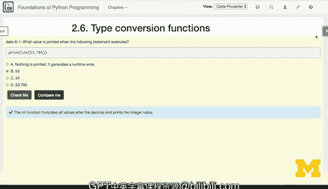

# 密歇根大学《Python3编程（课程1、2）》｜Python 3 Programming（Python for everyone进阶）（中英字幕） - P10：10_01_06_类型转换函数.zh_en - GPT中英字幕课程资源 - BV1CM411Z72u

Welcome back， sometimes it's necessary or convenient to be able to convert values from one type into another in Python。

 and for that， Python has type conversion functions。

So the type conversion functions that we'll learn right now will be int。To convert to an integer。

 float。To convert to a floating point number and string STR to convert to a string。

And each of these type conversion functions expects an argument。

 and usually we want to pass in in arguments that's another type， so for example。

 if we're calling in to convert to an integer， then we'll usually pass in an argument that's something else。

 either a float or a string。So let's look at that in code， so here we print out the value 3。14。

And then we print out the value of int when called with 3。14 as an input。

And the value of this overall expression。Is going to be 3。

14 afloat cast or converted into an integer。So the value of that expression is going to be3。Now。

 when Python converts a float to a string， it always just does that by discarding or kind of cutting off the decimal point and everything after it。

 so 3。14 becomes 3。What that also means is that 3。99999。Also becomes three。

So that's how Python chooses to cast a float to an integer。

So this will make sense sometimes if we do 3。0， but other times it might end up being a little bit strange。

 so casting negative 3。9999 from a foot to an inder ends up being negative 3。

So in addition to converting floats to integers， we can also convert strings to integers。

 which actually comes in handy fairly often。So here we have a string 2345。

 and let's say that we wanted to convert that string into the integer 2，345。

 we do that by calling the int function and using the string 2345 as input。Another note。

 if we take in something that's already an integer and called the int function on it。

 then we're going to get that same value back， so if we call int 17。

 then we just get the integer 17 back。Now we can call in on any string， so for example。

 if we call in on this string。But Python isn't necessarily going to be able to convert every string into an integer。

 so for example， here this string starts out with 23， but it also contains bottles。

 so when Python sees that we're trying to convert this string which isn't quite an integer into an integer。

 then Python gives us an error， so here we're told that on line 8。

 there's an invalid literal for int， so it's telling us that this string。

Can't be converted into an integer。Now， the float function works just like the int function。

 except rather than converting to an integer， it converts it to a float。

So if I call float on the string 123 period 45， then that converts it into a float 123。45。

 and if we print out the type of this expression， float 12345。

 then we're going to get that its type float。So you can see that the value of this expression。

Was the float 123。45 in the value of this expression， which computed the type of this expression。

Is aloat。Now， in addition to int inflow， we can also convert into a string。So for example。

 we might print out what's the value of the string 17？Of string 123。45。

 and then if we print out what's the type of this expression。

 then we're going to get that this is a string， so let's run our code to be sure that this is the case。

So we can see that when we print out string 17， it prints out the string 17。

 it just so happens that the output actually matches up with if we print it out the integer。

 but this is a string。This is also a string because we converted it again using the STR method。

And then the type of this expression is a string。So that's telling us that when we call STR on this number。

 and we get a string back。So one reason that we might want to use casting is when we want to concatenate or combine values。

 so let's suppose that we have an integer v which is set to 55 and we want to print out the value is v。

We get an error saying type error vow must be a stringch not an integer。

 so we have to add a conversion to convert v from an integer to a string by calling the STR function。

 so we print out the value is and then if this is an integer。

 we need to add the STR to convert it to a string， what value is printed when the following statement executes。

So again， when we call the int function to convert or cast this float into an integer。

 Python does that by just cutting off everything that comes after the decimal place。

 and so even though this number rounds up to 54， we're going to instead get 53 as our answer。

 so the answer here is B。That's all for now， Until next time。

