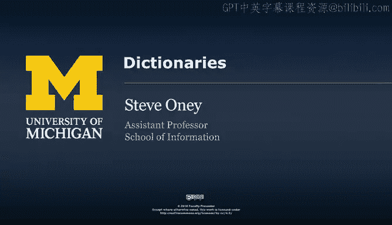
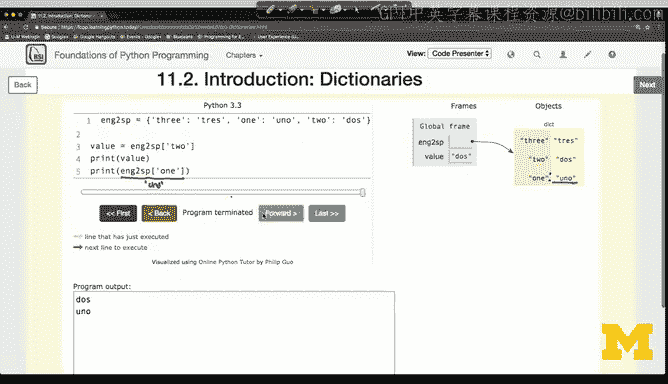
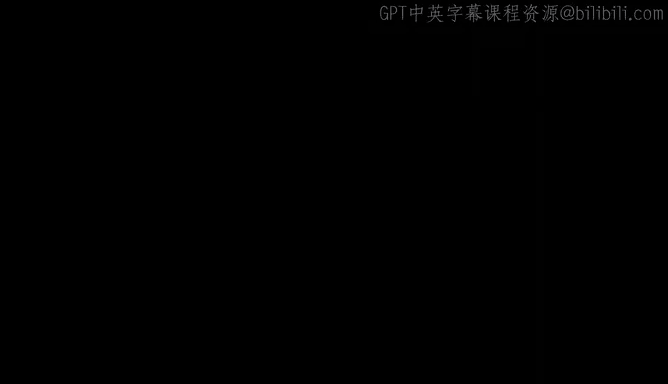

# 密歇根大学《Python3编程（课程1、2）》｜Python 3 Programming（Python for everyone进阶）（中英字幕） - P110：22_02_02_字典数据结构.zh_en - GPT中英字幕课程资源 - BV1CM411Z72u

Welcome back。In this lesson， we're going to learn about a new Python type called dictionaries。

Dictionaries， like strings， lists and tuples， are a collection of items。

 but unlike strings lists or tuples， they're an unordered collection of items。

 meaning that they don't have a first， second or third item。

 they're kind of a bag of key value pairs。In order to create a dictionary， we use curly braces。

So this expression creates an empty dictionary。We assign this empty dictionary to the variable English to Spanish or in2P。

So that's what line 1 does。In order to assign one key value pair to this dictionary。

 then we say in to S P and then specify a key that we want。

 And then we set it equal to whatever value we want。So if I go forward to line2。

 you can see that first Inc2 SP starts out as an empty dictionary， then when we run line 2。

Then we set one key value pair。 So the key here is one。And the value is uno。Unlike lists。

 strings or tuples， dictionaries store key value pairs instead of just items。

 And what that means is that every dictionary has items that contain one key。And one value。

You can think of the key as the thing that you use to actually access the value。 So， for example。

 in a physical dictionary， the keys would be words and values would be their definitions。

In the context of Python dictionaries， values can be any Python object。

 and keys can be almost any Python object， but we'll get to that more in a bit。

So here we have the key one。Associated with the value， unna。

And that's because in this dictionary innc to SP， we're going to associate English words with their Spanish equivalent。

 and we're going to use the English words as the keys and the Spanish equivalent as the value。

So again， in our code， we first created an empty dictionary using curly braces。

And then we assigned the value associated with the key1 to be uno by saying in to S sub1。

 and notice that this is a string because we have quotation marks around it。

 So the key string1 is the value， the string unno。The next line associates the key。

2 with the value dose。And you can see that our key value pair here gets added to the dictionary。

Again， one thing that I mentioned in the introduction was that dictionaries are unordered。

 and that's actually kind of important。 So there's no notion of what's the first item。

 the second item， the third item and so on。 Instead。

 just think of dictionaries as kind of a bag of key value pairs。

 you don't know what order you're going to get them in。 But， you know。

 if you set two to dose in one to unno that these key value pairs will be associated with each other。

 no matter what order they're in。On line4 here we set the value associated with the key three to be trace。

So you can see again， the order kind of changes around in our dictionary。

 but the important thing is that。Every key， so3 is associated with trace。Two is associated with dose。

 and one is associated with uno。Now， when we print out our dictionary。

 then we print out a list of key value pairs。So here you can tell that this is a dictionary because we have curly braces。

And then every key value pair is separated by a comma。 So we have two commas here。

And our key value pairs are3 is associated with trace。

 and we can tell because here we have a colon between the key and the value。2u。

Is associated with dose。And you can tell again， because we have a colon between two and dose and one。

Is associated with uno。So here we always have the key first。And then we have colon。

 and then the value。Every one of these key value pairs is separated out by commas。

And all of this is wrapped in curly braces to specify that it's a dictionary。

You can also set these key value pairs in line。 So whereas in this code。

 we set one to uno on line 2 and 2 to dose on line 3 and so on。 We can also set them all on line 1。

So if we instead declared our dictionary like this。So here， again。

 we can tell that this is a dictionary because we have curly braces。

And then we have a list of key value pairs，Every one of these key value pairs is separated out by a comma。

And then we have the key， so three associated with the value trace。And we specify that using a colon。

 So one colon unno。2 colon dose。So now when we run line 1 and we look at our frames and objects and we'll see that ink2 S is now associated with the dictionary that has three key value pairs。

In order to look up the value associated with the particular key， we use square brackets。So here。

 on line one。We create a dictionary that has three key value pairs， just like before。And on line 3。

We assign value to B into S P， sub2。So in order to get a particular value。

 we first say the name of the dictionary in2 S， then we use square brackets。

And then inside of the square brackets， we put the name of the key that we want to get the value for。

 So here the key is 2。 And if we look at our dictionary。

 we can see the key2 is associated with the value dose。So the value of this overall expression。

 ink2 S sub2。Is going to be the string dose。And what that means is that when we print out value on line 4。

 then we're going to print out dose。So you can see that running line 3 and 4 first on line 3。

 we signed value to be the string dose， which was the value of this expression。

And then when we print out value in our program output， we get dose。So on line 5。

 we print out Ik2 S P sub1， and the value of this expression is the value associated with the key1 in our dictionary Inc to S P。

 So if I look at the dictionary here， I can see that the value associated with the key1 is Unno。

So the value of this expression is the string uno。And that's what gets printed when we print out ink two S P sub one。

That's all for now until next time。

