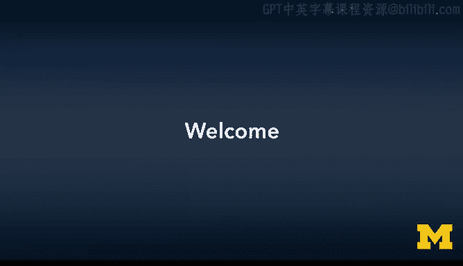
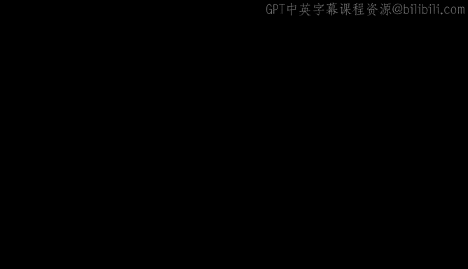
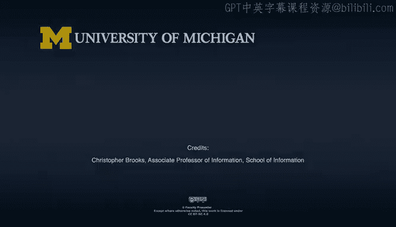

# 密歇根大学《Python3编程（课程3、4、5）》｜Python 3 Programming（Python for everyone进阶）（中英字幕） - P111：03_01_03_欢迎来到Python 3项目课程.zh_en - GPT中英字幕课程资源 - BV1gj41177yd

Welcome to the Python 3 projects course。 This course is a bit different from the rest of the courses in this specialization。

 while I'm going to teach you a number of different topics。

 the core focus is on getting more practice with everything you've learned in the previous courses。

Now， I regularly teach graduate students here at the University of Michigan。

 mostly in the topics of applied data science and applied artificial intelligence。

Many of those students don't have computer science undergraduate degrees。

 and I often get asked by learners how they can become better Python programmers。

While a series like this can give you some base skills and knowledge。

 the best way for most people to become better programmers is to program。 And frankly。

 this can be a bit daunting， especially to new programmers who don't yet have confidence in their skills and might not yet have a career where they're programming regularly。

So the goal in this course is to give you more of an opportunity to practice the Python you've already learned。

But I can't help but to teach some new topics as well。

 So we're going to do all of this work to practice。

 and I'll introduce to you a few new software development concepts at the same time。

In the first module of this course， I'm going to show you how I think about designing software through diagrams。

I'm going to introduce to you the basics of software engineering practices while giving you the opportunity to practice writing object oriented Python code。

I'll walk you through the design of a very small text adventure game。 And at the end of this module。

 you'll have an assignment where you actually write Python code based on a specification and list of constraints。

 which I give you。The assignment is actually an interesting one to me personally as it involves creating a Python program which is able to play a word guessing game called Wordy Pi This game actually is going to be used throughout the course and in the second module of the course。

 I'll teach you how to use new third party Python packages to improve the gameplay program。

Specifically， I'm going to introduce you to the Python Imaging Library。

 an image manipulation and graphics package which allows you to both render and process images in the Jupiter Note。

The final module of the course will tackle the issue of text and images typically referred to as optical character recognition or OCR。

The library I introduce you to here will allow you to examine an image for text strings and process that within Python。

 another example of how to extend the functionality of the Python programming language without having to write all of the code yourself。

Let's get started。

