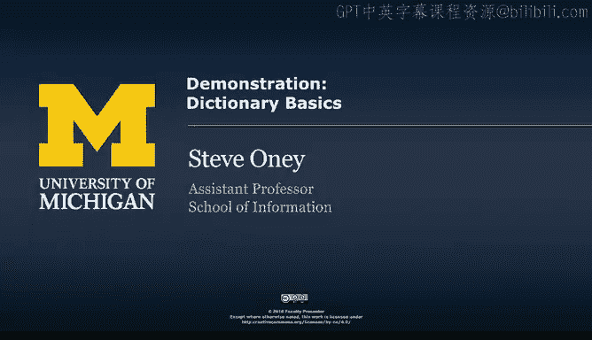
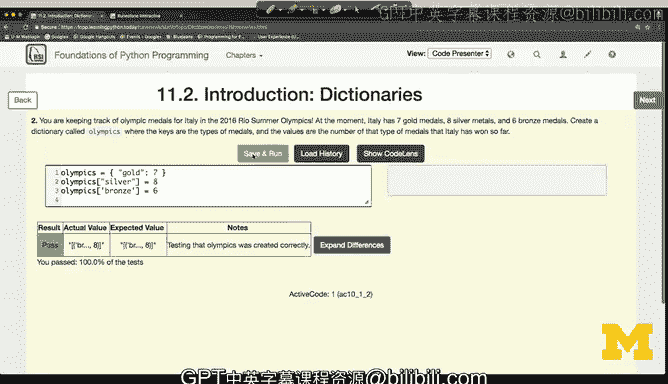

# 密歇根大学《Python3编程（课程1、2）》｜Python 3 Programming（Python for everyone进阶）（中英字幕） - P111：23_02_03_字典基础演示.zh_en - GPT中英字幕课程资源 - BV1CM411Z72u

So let's go over some questions。So this is a true false， Boolean。 So true false。

 a dictionary is an unordered collection of key value pairs。That is absolutely true。

 That is what a dictionary is。Then we have a multiple choice。

 Once printed by the following statement。 So here we declare a dictionary with three key value pairs。

 cat， dog， elephant。And then we print out my dictionary subdog。

So the value of this expression is whatever value is associated with the key dog in my dictionary。

So in order to answer this question， we have to look at what's associated with this key dog。

We find the key value pair for dog here， and we see that the value associated with the key dog is 6。

 and so we should expect6 to be printed out。Then this question asks us to create a dictionary that keeps track of the USA's Olympic medal count。

 Each key of the dictionary should be the type of metal， So gold， silver or bronze。

 and each key's value should be the number of that type of metal that the USA is won。

So currently the US has 33 gold。17 silver。And 12 bronze。So again， the keys here should be gold。

 silver and bronze， and the values associated with those keys should be the number of the metal that the US has won。

Then they want us to create that dictionary and save it in the variable metals。So in the code。

 I'm going to say metals。Equals。A dictionary。 so I'll use curly braces。And first。

 I want to have the key gold associated with the value 33。If I just typed gold  33。

 which is common to do， then I would actually get an error。Because when I say gold。

 it's looking very a variable called gold。 Instead， I want to make this key a string。

 So I want the string gold。To be associated with the value integer 33。Same thing with silver。

 So silver。Is associated with the value 17 and bronze。Is it associated with the value，12。

And so here I just got each of these， so 12， 17， and 33 from the problem statement。

So now when I run my code。And I should see that。 It passes。So this question is very similar here。

 we're told you're keeping track of Olympic medals for Italy in the 2016 Rio Summer Olympics。

 At the moment， Italy has 7 gold。8 silver。And  six bronze medals create a dictionary called Olympics where the keys are the type of medal。

 and the values are the number of that type of medal that Italy has won so far。 So exact same idea。

 I'm going to say Olympics equals。And then we want to assign that to be a dictionary。

 So we use curly braces， and we have three key value pairs。 So we have gold。

Associated with the value 7。Then just for the sake of writing this out slightly differently。

 I'm going to set silver on the next line by saying Olympics。Sub silver。Equals 8。

And so this is going to add a new key value pair associating silver with the value 8。

And then I need to also say， Olympics sub。Bronze。Equals 6。Rightright。

 so here I just did something slightly different。 I could have added three value pairs right in here。

 like I did for the previous problem， but I could also just set the key value pairs using an assignment statement like I did on lines 2 or on lines 3。

And again， the keys are all strings， so here I'm using double quotes to create the string here I'm using single quotes。

 but the effect is that we have three key value pairs。 All the keys are strings so gold。

 silver and bronze， all the values are integers，7，8 and 6。That's all for now， Until next time。

