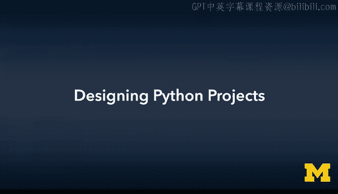
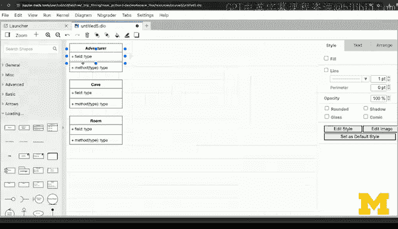
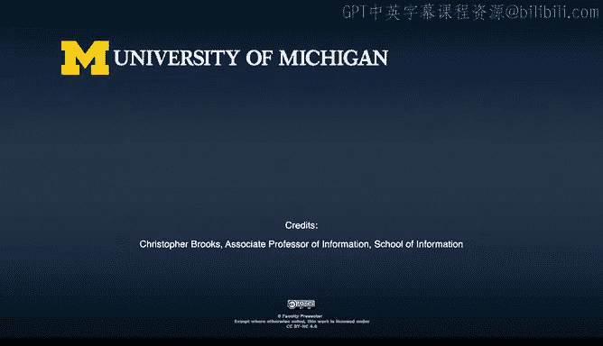

# 密歇根大学《Python3编程（课程3、4、5）》｜Python 3 Programming（Python for everyone进阶）（中英字幕） - P112：04_01_01_Python项目设计.zh_en - GPT中英字幕课程资源 - BV1gj41177yd

While you have spent a lot of time learning how to program in Python and in the Jupiter environment。

 I want to zoom out a bit and talk about how we design。

 develop and communicate to others how our software systems operate。If you walk into any computer。

 science， professor's office or classroom， you're bound to see whiteboards。

 an unconstrained space where we can diagram and draw relationships between pieces。

 often called components of the software systems that we're building。

We refer to this practice broadly as software engineering。

 and while I will be giving you a detailed discussion of all of the methods of software engineering as a discipline。

 I did want to introduce you to one way in which you might diagram out your software solutions。

Even better， we have basic support for this right from within the Jupiter programming environment through the drawing extension。

To create a new diagram， we just go to the file menu and select new and diagram。

 We get a nice grid based editor， and you can see a bunch of shapes on the left hand side。

 including a number of optional packages with shapes which have been installed for us。

For this lecture， we're going to focus on the shapes listed under the header marked UML。

 which stands for Unified modeling languagegu。 UML is a standard notation which software developers often use to describe their systems。

To start with， the first shape I want you to look for is the third one over。

 and this denotes a class。 Let's click on this to add it to our canvas。Actually。

 this makes for a great time to pause and reflect a bit。 You see。

 when I first started my undergraduate degree in computer science。

 objectject oriented programming was just beginning to be introduced。

 It quickly became the dominant programming paradigm， and it still is to day。😊，However。

 it took me a lot longer than I care to actually admit to really understand the nuance between classes and objects。

 especially as it comes to things like class methods。

But you've just finished learning about object oriented programming in Python， so let me ask you。

 what's the difference between a class and an object， as you've learned in the prior courses。

 a class is an abstract representation of a concept that you want to exist in your software。

A class is abstract and that you don't generally create a new class。

 You instead use it as a blueprint or a template for creating new objects。

 An object then has properties which are described by the given class。

 But the specific values for those properties are going to differ between different objects。

Let's design a little game。 And I'm going to design one of my favorite kinds of games called a dungeon crawlwler。

 In this game， the user is an adventurer in a magical land who has stumbled upon the entrance to a cave。

 and they need to explore the cave， slaying the monsters they face while making choices in each cavern they walk into。

😊，Let's begin by creating some classes for the different kinds of game elements that I just spoke about。

 So first， I'm going to create a new class for the adventurer。

 the cave and the individual rooms in the cave。 Each one of these becomes their own box in the diagram。

 You'll see that the box is made up of three sections。 The header。

 which I've changed for each class to indicate the class name。

 And then we have this second section here， which says field。

 And that's going to include a type for every given field。

 And then we have something at the bottom called methods。 And these also have various types。

 And you can see the parameters here。 In this lecture。

 We're not going to do anything with the methods yet。

 And we're instead just going to focus on the class field。 I'll be honest。

 This is often where confusion comes in。 What's a field in Python。😊。

Well， Python doesn't have a concept of a field in the core language and tools like UML are intended to be as general as possible。

In UML， when we speak about a field， we're really talking about the different attributes of a class in Python。

Remember， an attribute of a class in Python is anything that comes after the dot。

 so if we're doing my hero dot。Anyth that comes there is an attribute。

 and there's really two different kinds of attributes， there's data attributes。

 which is really what the field in UML is intended to represent and method attributes。

 which are these invocable attributes like functions and methods。

 and they're intended to go at the bottom of the UML class box。Okay， back to our game。

 I want this game to feel really personalized and compelling。

 so I need to add some fields which capture some of that。 For instance， the adventurer needs a name。

 Let's say that's a type string， which we will do just after the colon。

Now I'm going to add a couple of other common physical characteristics you see in games like this。

 maybe strength and constitution， and I'm going to make those int values。

I also want to include some placeholder for hit points。

 which will determine the ability of this hero to survive in the game。

 and that seems like it should be an in value as well。Finally。

 I want to give the adventurer a bag which has some list of items in it。

Now we've already stumbled and found one of the first benefits of diagramming a software solution。

 it can help us uncover some of the concepts that we're interested in modeling but haven't yet thought about。

For instance， we've got this bag， which is a list。 But what's in a list of。 Well。

 I referred to these as items， but there's no item class and Python。 Are they strings， ints。

 Booleions。 Well， no， I think I want these to be a new class of our own devising the item class。

 which means that we have to add that to our diagram as well。 Now。

 if I think about a dungeon crawler game that I may be played as a kid。

 and maybe I still enjoy it a bit today， items are usually some kinds of weapons or spells that an adventurer might use to defeat a monster。

 And thus， the item has characteristics like a name and a minimum and maximum damage value。 Actually。

 if you're following along with the lecture in Jupiter， why don't you give this a try now。

 Adent item class， which has a name， which is a string and then two int values。

 a min damage and a max damage。😊，Allright， let's keep going。 We have an adventure， an item。

 a cave and a room。 Now， caves and rooms are related。

 So I'm going to model a room as having two fields， a monster field and a treasure field。 Now。

 the treasure is going to be in an item。 And we already have that in our diagram。

 but we need to add another class for monsters。 I'll make it pretty basic with just a monster name。

 a number of hit points and a min and a max damage values。😊，Now， to be honest。

 this will be a pretty boring cave system since the rooms are all in one big sequence。

 but it's good to start somewhere。Okay， this is our first class diagram you can see that through diagramming out the different classes that you might want in your system。

 you start to discover the bounds of the problem that you're trying to solve。In this case。

 we didn't think about modeling items and monsters right away。

 but it came to us as we started to think about the problem and diagram it out for ourselves and for other people。

Now we're going to have to turn all of this into code to actually make a working system。

 but I wanted to show you my process in thinking through the problem first。

And while we haven't really thought through the problem that completely。

 how does the game actually get play， Does the adventurer choose to move throughout rooms。

 Does the monster get to attack first， Can you grab treasure just by coming into the room。

 or must you defeat the monster first。Eventually， we need to think through the sequence of events in our system。

 but let's first see if we can take what we've got and turn it into code and we'll do that in the next lecture。

