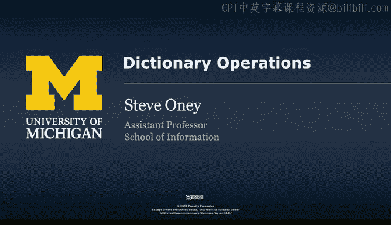
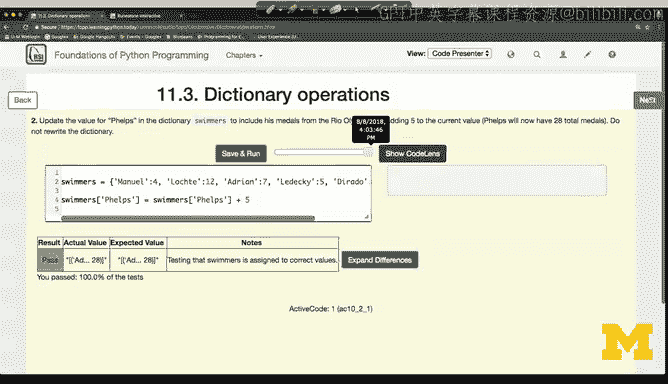

# 密歇根大学《Python3编程（课程1、2）》｜Python 3 Programming（Python for everyone进阶）（中英字幕） - P112：24_02_04_字典操作详解.zh_en - GPT中英字幕课程资源 - BV1CM411Z72u

Welcome back。In this lesson， we're going to learn about some operations that we can use to modify dictionaries。

So here on line one， we create a dictionary in this dictionary， we have four key value pairs。

 so the key pairs is associated with the integer 217， the key the string apples associated with 430。

And so on。So overall， we have four key value pairs。And that's all created online line。Now， on line 2。

 we do an operation called Dell。 So Dell is short for delete and delete deletes a key value pair from our dictionary。

 So when we say Dell， and then we say the name of the dictionary。And then in square brackets。

 the key， whose key value pair we want to delete。 that's going to get rid of that key value pair from our dictionary。

So here we're saying Dell inventory sub pairs。So here。

 our key value pair pairs is associated with the value217 and line 3 says。

 get rid of this key value pair。So when I actually run line 3。

 you'll notice the number of key value pairs will go from4。To3。If instead。

 we created the same dictionary。 So again， we're back to having four key value pairs。

And now on line 3， rather than deleting the value associated with pairs。

 then we're going to set it to 0。So if you remember from when we first introduced dictionaries。

 we can set a key value pair by saying the name of the dictionary， sub。

 and then whatever key we want to set。Equals whatever value we want it to be associated with。

But the difference here is that by the time we run line 3。

 we'll already have a key value pair that associates the key pairs with the different value 217。

So when we say inventory sub pairs now equals 0， that's going to update the value associated with the key pairs。

 So in other words， line 3。Is going to say payers is not 217 anymore。

 It's now associated with the value 0。So here， if we now run line three。

 then you'll see the value pairs is now0。So let's reuse that dictionary in another example。

 So on line 1， we create the same dictionary that has four key value pairs that we saw from the previous examples。

And now online line， too， we're setting that dictionary。

 So inventory sub bananas to inventory sub bananas plus 200。Now， when we look at this。

 this expression is a little confusing because here we're repeating this expression inventory sub bananas。

But remember that when we do an assignment， then what Python does。

 is it first evaluates the value that we're going to be assigning to。

 So the first thing Python does online line， too， is it asks， what's the value of this expression。

 inventory sub bananas plus 200 after it computes this value。

Then it's going to assign whatever that value is to inventory sub bananas。

So in other words to figure out what this is going to do， we first have to ask。

 what's the value of this expression。So to figure out the value of this overall expression。

 let's break it down。 So we add inventory sub bananas to 200。

 So we ask what's the value of inventory sub bananas。To figure that out。

 we look at this dictionary and see that bananas is associated with 312。 So this value is 312。

And then we add 200 to that。To get 5 hundred12。And then Python takes this integer of 512。

 and it makes it the new value associated with the key bananas。

 So this is going to now be 512 when we run line 2。So let's run line2。And we see bananas is now，512。

Now， if you remember the L function from strings or lists or tuples。

 remember that L gives you the number of items in a collection。 So in the case of strings。

 L gives us the number of characters in that string。Len also works with dictionaries。

 so if we pass in the dictionary inventory， then when we call L on it， the value of this expression。

Gives us the number of key value pairs in this dictionary。

So the value of this expression is going to be 1，2，3，4， because there are four key value pairs。

 So we'll see that nu items in our frame right here is going to be assigned to the value the integer 4。

So let's run line 4。 and we see that none items is now4。So let's do some more questions。

In this question， we ask what is printed by the following statements。

 So here we create a dictionary with three key value pairs。

Then we say my dictionary sub mouse equals my dictionary subcat plus my dictionary subdog。

So the value of this expression， my dictionary subcat is 12。The value of this expression。

 my dictionary subdo is 6， meaning that the value of this overall expression。

 my dictionary sub catt plus my dictionary sub dogg is 12 plus 6 or 18。

So then we assign the value 18 to be associated with the key mouse。

 and so by the time we print out my dictionary sub mouse， we're going to print out 18。

 so our answer is C。So this question asks us to update the value for feltelps in the dictionary swimmers to include his medals from the Rio Olympics by adding five to the current value。

So Phelps will now have 28 total medals， and it asks us， do not rewrite the dictionary。

So here on line2， we assign swimmers to be a dictionary that has1，2，3，4，5，6 key value pairs。

 but we want to update the value associated with the key Phelps。

In the way that we want to update it is by adding five to the current value。

So the way that we're going to do that is we're going to say。Swimmers。Sub Phelps。

Is now its previous value。 So swimmers sub beltelps equals swimmers。Sub Phelps。Plus，5。

So whatever it started out with， it's not going to be that plus five。

That's all for now， until next time。