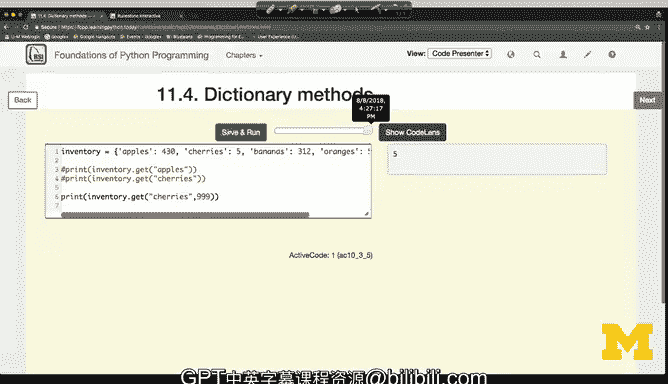

# 密歇根大学《Python3编程（课程1、2）》｜Python 3 Programming（Python for everyone进阶）（中英字幕） - P113：25_02_05_字典方法解析.zh_en - GPT中英字幕课程资源 - BV1CM411Z72u

Welcome back。So we've seen ways to get a value associated with a particular key in a dictionary。 So。

 for example， if we have this dictionary and we assign it to the variable inventory and it has four key value pairs。

 If we wanted the value associated with the key oranges， then we would say something like print。

Inventory。Sub oranges。But sometimes we don't want the value associated with just one key。

 We want the value associated with every key in that dictionary。

 or we want to iterate over every key value pair in that dictionary。In order to do that。

 dictionaries have a set of methods that we'll find useful。

 So the first method that we'll find useful is dot keys。

 So if we want to loop over every key in our dictionary by using a four loop。 So if I say4。Ki。In。

Inventory。Dot keys。And then for now， I'm just going to print out the key。 So I'll say print。He。

When I run this code， then I'll see that I get all of the keys in my dictionary。

Remember that dictionaries aren't ordered， so there are no guarantees what order I'll actually get these keys in。

 The only guarantee is that this for loop is going to run once for every key， regardless of order。

So when I just print out the key， then I can see that there's apples， bananas， oranges。

 and pears are all the four keys in our dictionary。

If I want to get the value associated with that key。I can say。Ki。Has the value。

and then to get the value associated with the key i use inventory，Sub key。Now。

 notice here that I'm not putting key in quotation marks。 In other words。

 what I want is I want the value of the variable key。

 I don't want to look for the value associated with the key。Named key。 So like。

 if this dictionary had a key。Named keyi。Associated with the value 50。

 and I put key in quotation marks。 then I would get 50。But here instead。

 I'm saying I want key the variables value to be the key that I'm fetching。So now， we'll see。

Apples has the value，430。 Bans has the value，312。Oranges has the value，525 and pairs has the value。

217。So in order to actually get that list of keys into a list。

 one thing that I can do is I can just say。Ks。Equals。A list。Of inventory。Da keys。

And if I now print out the value of keys。Then I should get a list of keys in our dictionary inventory。

 But remember again that there is no guarantee about ordering here。

 So these keys could be in any order。 The only guarantee is that I'm going to get a list that has all of the keys in some order。

Now， notice here that when I got the list of keys， I cast it to a list by calling the list function。

And the reason that we'll do that， we're not going to get into too much yet。 But on a high level。

 we always cast to a list because in Python 3， inventory dot keys doesn't actually quite return a list directly。

 It returns something that we can actually iterate over so we can put inventory dot keys in our for loop。

 But in order to actually get a list of keys。 We're always going to have to cast it to a list by calling the list function。

If we wanted to iterate over inventory in a slightly less verbo way。

 we could just say 4K in inventory。 So whereas here we're saying 4K in inventory do keys。Here。

 we're just saying for。I'll just rename this key to be consistent。For every key in inventory。

 when we say that， then Python automatically assumes that we want to iterate over the keys。

So when I run this code。Then I see got key。 and then every key in our dictionary。 again。

 no guarantees about order just that we'll loop through every single key that we have。

Dictionaries have two other methods that are somewhat similar to dot keys。So dot values。

 rather than getting a list of keys gets a list of values。 So 430，312，5，25 and 217。

 So dot values would give us a list that has all of these integers。 But again。

 there are no guarantees about ordering。 So we know that it's going to be a list with these four items。

 We just don't know what order inventory dot values is going to be in。

Inventory dot items instead gives us a list of key value pairs as tuples。

 So inventory dot items is going to give us a list。In the first item might be apples。And430。Again。

 I say might be because we don't know what the ordering is， but the second item might be oranges。

Associated with the value，525。And then we might have bananas。And so on。So that item gives us a list。

Of tuples。Where every tuple is a key value pair。So on line 3。

 we print out the value of inventory values and on line 4。

 we print out the value of inventory do items， so let's see what these two lines output and I'm going to for now comment out lines 6 and 7。

So we can see that when we printed out inventory dot values， then we got all of the values。

And they aren't necessarily going to be in the order that we actually created the dictionary in。

 but in this case， they just happened to be in that order。When we called inventory dot items。

 then you can see that we have a list。Of tuples of key value pairs。 So here。

 this first tuple says that the value of the key apples is 430。

 The value of the key bananas is 312 and so on。We can also use the same in operatortor that we saw on lists and strings on dictionaries。

So if we print out the value of this expression， apples in inventory。

 then the value of this expression is going to be a Boolean。

The value of that Boolean is going to be true。If this is a key in our dictionary， So if apples。

Is a key。In inventory。In false。Otherwise。Now， it's crucial here that I mentioned that it's true only if apples is a key in our dictionary。

 it can't be a value。 It has to be a key。So when we print out the value of apples in inventory。

 then we can see here that we have a key value pair where the key is apples， so this should be true。

If we print out the value of cherries in inventory。Then if we look at our key value pairs， apples。

Bananas， oranges， pears。 We don't see anything that has the key cherries。

 So this is going to be false。So if we comment out this code。And just run lines 2 and 3。

 Then we should see the value of apples in inventory is true。

 The value of cherries in inventory is false。Now， we can also write code that depends on the values of these boolean expressions。

 so we can say if our dictionary has the key bananas by saying if bananas in inventory， again。

 this expression is a boolean that's true if bananas is a key in our dictionary， In this case。

 bananas is a key。 So if that key is in our dictionary， which in this case it is。

 then we print out the value of inventory sub bananas。Otherwise， if bananas is not a key。

 we say we have no bananas。So here we're going to print out 312。

 which is the value associated with bananas。If I modified this key to be something else。

 I'll literally call it something else。Then we would see we have no bananas because bananas is no longer a key in our dictionary。

Another method that we can use on dictionaries is dotge。So dotge works almost just like indexing。

So we can say inventory dot get apples in the value of this expression。

Is going to be the same as the value of inventory。Sub apples。Which in this case is going to be 430。

So if I just run line 3 and comment out lines 4 and6 here。Then I see that。 I get 430。Now， on line 4。

 we say print out inventory dot get cherries。 Now， notice here that cherries is not in our dictionary。

 so we don't have any key。Whose value is cherry？ So when we run this code。

 then we get the value none。This is the difference between dot get and actually indexing。

 because if we indexed here。 So if we said print out inventory。Subcherries。

We would instead get a runtime error， because。Cherries was not a key in our dictionary。

If we instead call dot get， then we get kind of a softer air。

 So instead of actually giving us a runtime error that stops our program。

 dot get says the value is none。That get also takes an optional second argument。

 which is to say that if this key isn't there， then this is what the value of that expression should be。

 So here， when we say inventory dot get cherries。 And then we pass in a second argument of 0。

 then this is going to say if cherries is in our dictionary， That is a key。

 then get the value associated with it。If cherries is not a key in our dictionary。

 then just use this as the value。This isn't going to add a key value pair with cherries。

 It's instead just going to save the value of this overall expression should be 0。

So when we run our code。We see that now， when we call inventory do get cherries with the optional argument0 here。

 we instead get  zero because cherries isn't a key in our dictionary。If we had 999。

Then we would get 999。And if we had a key cherries。In our dictionary。Let say it's 5。

 Then we would instead get 5。That's all for now， until next time。

