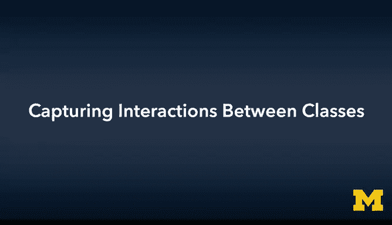
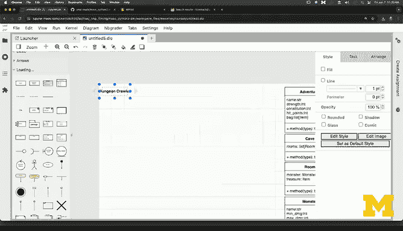

# 密歇根大学《Python3编程（课程3、4、5）》｜Python 3 Programming（Python for everyone进阶）（中英字幕） - P114：06_01_03_捕获类间交互.zh_en - GPT中英字幕课程资源 - BV1gj41177yd

Okay， now that we have our base classes created for our game。

 we want to connect them to one another with methods and functions。In software engineering。

 we often call this wiring up our classes， even though there's actually no physical wires involved。

 so why do we call it wiring up well， it becomes a bit more clear when we go back to diagraming。

 so I'm going to introduce you to a method called sequence diagraming。

Most sequence diagrams start with a person， a human being which is interacting with your application。

In the same UML box we used before， we should be able to find a person with a long line coming below them。

 so I'm going to add a person to my canvas now。Once we have the person out。

 we think about the operations that they're going to do with our system。

I think this is pretty easy to start with， they're going to want to create a new adventurer。

 so let's find the object box with a dotted line below it and drag it out onto our canvas as well。

At the top， you'll see that it has a colon and the word object。

 this is where we get to set our object name and determine which class it is。

This is where you get that first test of object oriented programming again。

 Do you remember what the difference is between an object and a class？Well， thus far in our project。

 we don't have any instances that are objects of our adventurer。

 We have only defined the adventurer class in this diagram。

 I'm going to call this object our hero and indicated as of type adventurer。

You'll notice that by convention， our classes start with an uppercase letter while our variable names start with a lowercase letter。

You might remember from the previous lecture that when we create the adventure。

 we actually need to specify a name as a string。Look in the UML panel for a line with an arrow。

 this indicates a message in UML， and we usually use that to denote function or method calling。

Let's drag that over to indicate that the object is going to be initialized with a new name。

We put on this line the method that we're calling。 In this case。

 it's the special Dunder and knit Dunder method， which is the constructor for Python objects。

We'll put in parentheses the arguments we expect， which is just the name for this adventurer class。

We then add a return message， and this shows up as a dotted line going back to our actor， the human。

All right， now that we've seen the basics， let's increase the complexity and design a more full application。

The user needs a cave to send their hero into。 So we're going to create the cave system as well here。

 Let's add a new object， and I'll name it as cave and make it of type cave。Now， at this point。

 I actually haven't designed out the details of the cave yet。

 I expect that an object of type C is going to create a bunch of room objects。

 so I would diagram this as the user invoking the cave constructor and then the cave invoking a room constructor for maybe five different rooms。

Moodeling the constructors is pretty easy， so let's do that now by adding in a room and then creating some wires first between the user and the cave and then the cave and the room。

You'll notice here when I've added the room that I actually have only included the class。

 So it's colon room。 There's no instance name for it。 I want to create a bunch of these。

 We're going to have to figure out how to do that。 What I call it room 1， room 2， room 3。 Well， no。

 because I actually want to do it inside of a loop。 So we'll get to that in a moment。 right now。

 I'm just creating a new room as an anonymous object and returning it in this diagram。

 The cave and the adventurer， however， both have names。 They both have variable names。

 I've called the adventurer are hero And for the cave， I've just used the word cave in lowercase。

 Great， We've now indicated that a user is going to create an adventurer。

 Then the user is going to create a cave。 and then the cave is actually going to create the room。😊。

But we actually want a bunch of these rooms to be created in a loop in UML。

 we would typically model this using a frame， which we can see in the selection of shapes as a big empty rectangle。

 Let's bring that over and indicate that the calls between the cave instance and the room class will be done five times。

Also， I know a room should hold some monster and treasure。

 so I'm going to update this model and make a call to a separate function called Create Monster and Treasure。

I'm going to call this。Monster。我认是。Coectly and because the diagram can get a little messy。

 you can use this yellow indicator to change where you want that label to show up and you can put it wherever makes it easy for you to read。

 these are really for us as people to try and understand the flow throughout our software systems。

Now that we have our first method call， I'm actually going to update our class diagram on the right as well。

 Just like data attributes， function attributes are added in their own block in this diagram。 Now。

 I personally don't generally model constructors。 In this case。

 that's the Python Dunder and knit Dunder function。

 But there's no reason you can't do so if you want to。

 What I'm going to do here is just delete the methods from all of the objects except for the room。

 and then I'll add the create monster and treasure to the room。😊。

There's our class diagram on the right and our sequence diagram for this one interaction that the user is going to have with the system on the left。

I think we're almost done for this demonstration。 There's a lot of code that actually isn't being shown here。

 I haven't diagrammed out。 For instance， any of the details of what create Mon and treasure actually does。

 This is the beauty of encapsulation in object oriented programming。

I don't have to detail that here if I want to stay at a high level。

 I could just put that in another diagram and just assume right now that the rooms will all be set up with monsters and items for their treasure。

However， I also could add that here if I wanted to， and that might be good practice。

 So why not stop this video and give it a try yourself。

 adding the item and the monster objects within that loop。

 And then you can compare your solution to mine in the next video。

