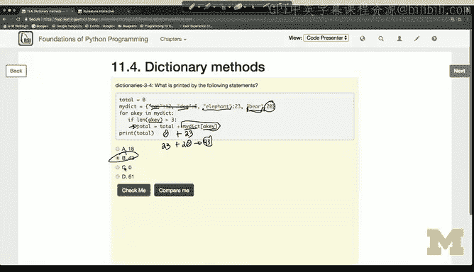
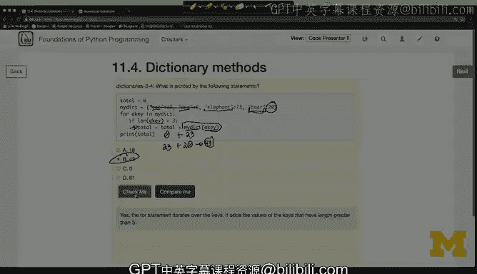

# 密歇根大学《Python3编程（课程1、2）》｜Python 3 Programming（Python for everyone进阶）（中英字幕） - P114：26_02_06_字典方法演示.zh_en - GPT中英字幕课程资源 - BV1CM411Z72u

So in this question， we ask what's printed by the following statements。

 So my diict is a dictionary with four key value pairs， and we print out my diict that get cat。

Divided by myict that get dog here， we're using division without a remainder。

 which just gives us an integer。My diic thatet cat is 12， and my diic thatet dog is 6。

 And so the value of 12 over 6 is going to be 2。 So an。In this question。

 we asked what's printed by the following statement。 So we create that same dictionary。

 And now we print out the value dog in my dit。 So that asks， is dog a key in my dictionary。

 And we can see that it is。 It has the value 6， but all we care about is that it is a key。

Here we create that same dictionary， and we print out the value 23 in my di。

And here we have a key elephant that has the value 23。 But remember that in only asks。

 is this I 23 a key in my dictionary， And in this case， it's not。 Our only key is our cat， dog。

 elephant in bear。 It doesn't matter that it just so happens to be a value。

 The value here of this overall expression is going to be false。

So here we first assign total to be 0， and then we create the same dictionary that we had before。

 and we loop through all of the keys in our dictionary。 So a key is going to be cat， dog。

 elephant and bear， not necessarily in that order。 we say if the length of that key。

 So every one of these keys is a string。 So if that string is longer than three characters。

 then add its value to total。So the first thing I would ask are what are the keys that are longer than three characters。

 and that's just going to be elephant。And bear。And so。For cat and dog。

This statement is not going to run because the key cat is not longer than three characters。

 and same thing for the key dog。So for elephant and bear。

 then we're going to say total equals total plus my dictionary plus that value。

So we're going to first assign total。To be 0 plus， let's suppose that elephant comes before bear。

 So 0 plus my diic sub elephantant， So 0 plus 23。So total gets the value 23。

 And then by the time we get to the key bare， Then we're going to say total equals its old value。

 So 23 plus the value associated with the key bare， which is 20， So 23 plus 20。

Wwhich is going to leave total at forty three，So the answer here is going to be b。

That's all for now， until next time。

