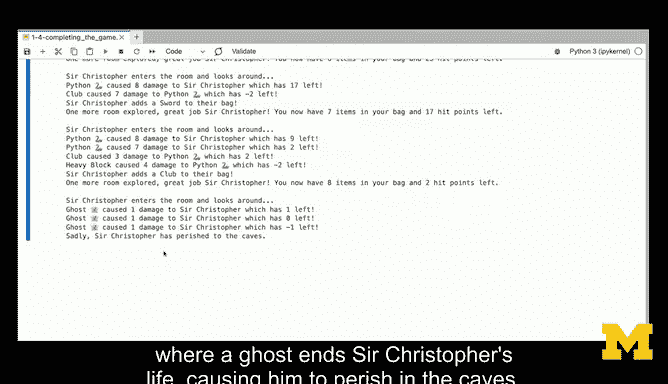

# 密歇根大学《Python3编程（课程3、4、5）》｜Python 3 Programming（Python for everyone进阶）（中英字幕） - P115：07_01_04_完成游戏项目.zh_en - GPT中英字幕课程资源 - BV1gj41177yd

In the previous lectures， I gave a demonstration of how I use diagraming to help think through the classes。

 objects and interactions that I want to see in a software system。

This is part of a larger area of programming called softwareft engineering。

 and I've just given a short overview of two popular diagrams that we use in software engineering。

 the class diagram， which shows our classes along with their attributes and functions and the interaction diagram。

 which shows how classes are instantiated into objects in the system and how those methods bound to those objects are called。

This， of course， is just the tip of the iceberg and there's a lot of thinking that you can do with diagraming such as how do you manage asynchronous calls。

 diagraming network relationships， modeling inheritance relationships。

 and managing or keeping up to date all of the different kinds of diagrams that your project starts to collect。

I'm not going to go into these issues here， I just wanted to give you a little taste of how programmers tend to think in diagrams when building out their software solutions。

I personally believe that you should take a pragmatic approach to diagraming。

 use it when it helps you think about the relationships between objects in your software system and use it as a language to describe your system requirements to other programmers。

But don't feel that you need to restrict yourself based on what's written in your initial diagrams or that your diagrams need to completely encompass your complete project。

Your diagrams should be living documents and should be updated as you add new features or change interaction flows in your software。

For this project， I did do up a final set of diagrams and some code。

 So why don't I walk you through that， You've already seen the adventurer and item classes。

 So let's do it just a quick review。 One of the changes I've made here is tweaking a few of the values。

 For instance， the hit points of the adventure。 I've decided should range between 10 and 30。 plus。

 the adventurer's constitution level。 And I want to start the adventurer off with a small stick in their bag。

So we have our adventure， we have the documentation for our adventure。

 just like the class definition， each method or function associated with a class should have triple quoted string that describes it and the arguments it takes。

So for methods， the first argument' is always going to be self。

 remember that's how you can tell a method from a function。

 a function doesn't have self associated with it。And one of the changes I've made here is that now in the bag。

 instead of starting the bag empty， I'm just putting in a small stick， so I'm creating an item。

 small stick with a zero and a1。Now I haven't actually changed the item class at all。

 but I do want to reiterate how important it is to do error checking on the input values。

 even though I've oted a lot of that here for brevity。

 we can see we pass in the name so that'll be a small stick zero is its minimum damage so that would be unfortunate if you're attacking a monster with a small stick and it does nothing and our maximum damage we can only do one so we're going to have to find some treasure in this cave system let's run this cell。

Okay， so that was a quick review of the adventure and item classes。 Now。

 let's move on to the monster。 If you recall from our diagram， the monster has a name， a min damage。

 a max damage and a set of hit points。 I'm actually going to create a class level function as well。

 called create monster。 Now， before I go on to describe that。

 I just want you to reflect on what I've said here。 I said， I will create a class level function。

 And I didn't say I would create a class method。 So my question to you is this。

 What's the difference between a class function and a class method。Well， in both cases。

 the underlying function being defined is associated with the class， but the method。

 or sometimes called an instance method takes an implicit first parameter of self。From this。

 the method is able to interact with the object it's being called on。 And in the case of a monster。

 this means the method can do things like change the number of hit points which are available。

 or maybe the name of the monster。A class function does not have this first parameter。

 so it's limited to manipulating the input parameters and returning some result。

 It can still create new objects which are un availableilable to the Python interpreter。

 but it cannot change the monster instance that it's associated with。

Class functions are often used to support specific design patterns。

 And I thought I would demonstrate one of these here， the factory pattern。

 So this class appears just as you might expect。 And you see here。

 I've included all the documentation using the Google Doc string style。

 Note that since Python 3 is all unicode based。 you actually don't have to limit yourself to just letters a through Z。

 And you can see here， I've decided to include a bit of flair through the use of emojis。

 So I added to my doc string a few emojis。 So I have different kinds of monsters。

 We're going to have ghosts， nice for emoji for that。 goblins。 And， of course。

 the most dreaded monster of all the Python。So to create a random monster。

 we're going to call this function called C Monster and otherwise I'm encouraging developers and you can see this is all just documentation right so it's just a string to inherit from this class if they want to build their own monsters。

The init method of the monster is intentionally kept really simple。

 Instead of embedding the logic for creating a monster here。

 I've actually put it in a class function， not a method below。

 And sometimes you're going to see this referred to as a factory pattern。

 and the create monster is like a factory that builds different kinds of monsters。

I've also got it to do here。 So things that haven't been done yet are often marked with this to do in code comments in capital letters。

 And this is a reminder that they need to be fixed。 In this case， I've done no input validation。

 such as ensuring there's a display name or that the min damage is greater than zero。

 but less than the max damage and so forth。 while using to do is just a convention。 Its a great one。

 And several tools such as Gitthub allow you to search or create issues based on this string。

 So I really encourage you to put to dos in your code as little ways to remind yourself what you need to do yet。

 So the init here， all it does is takes the parameters that are passed in up here。

And assigns them to the object， and it returns nothing。

So now let's get to the meet here and this is our class function and it's not a method。

 So there's no self here。 and what this function does actually is it creates a random monster。

 So I've just put all of my logic for creating a monster inside of this function。

 I've decided that there's a list of possible monsters so even though this looks nice with these little Uniiccode。

 remember these are all just strings right so it could be a ased。 it could be Chinese characters。

 it could be winds or it could be emojis like this ghost and the goblin and the Python。

And then I'm going to randomly pull out one of those monsters。

 And if it's a ghost that I'm going to create one kind of monster。

 So I'm going to pass in the name of ghost。 The next parameter is going to be between0 and one。

 So that's the minimum damage， Then the maximum damage is going to be between one and 2。

 Some random number in there。 So every ghost is a little different。

 except they all have just two hit points。 Of course， goblins。 I'm going to add those in。

 You can't really have a cave system without goblins。 They're just as weak as ghosts。

 but they have five times the number of hit points。 So there's a little more meaty。 that makes sense。

 if you think about trying to attack a ghost。 There's not a lot of meat there。

 Lots of things just go straight through them。 And then this very last one， of course。

 the most dangerous of all the python。 They're going to have somewhere between 3 and 6 for the minimum damage。

6 and 12 for the maximum damage， but only five hit points， because really。

 they're just a snake in the end。Okay， normally I would show you how this class works。

 but instead of doing it through a video， I want to jump right into using this new monster class with our rooms。

I've decided that when you create a new room object。

 it will initialize itself with a monster and an item through this createreate Mon and treasure function。

 and we've already seen that in our interaction diagrams。

 so I'm going to convert that to code here and it's actually pretty straightforward。

I do want to add a second method， though， called enter。

 And this is actually going to take an adventurer object。

 This method is going to do the heavy lifting of the gameplay。

 And it's a design decision that I made That's worth talking about a little bit。You see。

 there's lots of different ways to model our problem space and write code to solve it。

 and they often require unique trade offs that don't seem to change the functionality to our end users。

In this case， I've decided that a room object knows almost everything it needs to in order to determine whether combat was successful or not。

 Ha the monster， it's got the item， and we can pass in the adventure。Put another way。

 I think that encapsulating the gameplay within the room class creates a readable and reasonable piece of code。

 but it would be completely fine to put the combat resolution in the adventurer class as well。

 For instance， you can have a fight method of the adventure， which takes in a room or even a monster。

 resolve combat and then awards the item to the adventurer。😊，In this case。

 I feel like room is a good place for combat resolution。

 maybe in the future we'll have different kinds of room objects。

 all of which have different ways of resolving combat， for instance。All right。

 let's jump in and write that code。Okay， so for the room object。

 it's going to have a monster in an item when it's created。 Additionally。

 the room's going to have this method called enter， which allows the adventurer to enter the room。

 and then the room class is going to be。The one that actually determines how combat resolution is going to work。

Our constructor is pretty simple and this is another pattern I wanted to show you and it sort of offloads to separate functions。

 your actual creation of the object instead of wrapping it in the inip function。

 and this is a choice that you can make。So here we're going to call this create Mon and treasure and we'll take whatever comes back from that and actually end up returning that if we look at the definition for that method and it is a method because it's got a self we see that there's actually it's not going to return anything so it's going to modify the object but it's not going to return anything here。

I've decided that there's going to be a set list of possible items that we could find in a given room in our cave system。

 so a dagger， a sword， a club and a heavy block I hope I don't get the heavy block that doesn't sound nearly as effective as maybe the daggerer sword and the way I'll do that is I just put them all into a string array and I'm going to choose a random item so out and then I'm going to give it a random amount of min damage and max damage so actually maybe a heavy block won't be bad if it's going to be able to do eight damage。

It's worth it to consider this for a moment。 There are many different possible ways to organize your code。

 and I'm showing you two different ways here with the item and the monster。

 A great exercise should you want it， is to refactor。

 which means to update the item class so that it has a create item class function as well。

 and then update the room to match。So at the end of running the initialization function。

 first it will run the create Monster and treasure， it will set self dot treasure。

 so that's this to an item that it creates and then it will set self dot monster to a monster that's being created through this createate monster。

Now， this is our main method for actually dealing with the combat and playing the game。

 and it's called En。 so it has access to everything the room has。 So a monster and treasure。

 and we're going to pass in here a hero， which it will be our adventurer class。

 and we're going to return a string of some kind。You see here in the documentation。

 I've written that if the hero's hit points drop to zero or less， then we're going to return a win。

 otherwise it's a lose， sorry， we're going to return a lose if they drop to zero or less otherwise a win。

Now， normally， I wouldn't use print statements in game like this as they're pretty inflexible。

 but I want to add a little color commentary and show you how it works。 So I've added them here。

 So when an enter an adventurer enters a room。 We're going to print out their name and we're going to indicate that they enter the room and look around。

 We need to be able to calculate the combat between the hero and the monster and this gives us another great opportunity to introduce some Python concepts。

 duckuck typing。😊，Duck typing is a way of programming where you don't care what the object is。

 you just care that it has the right methods and attributes。In this case。

 I've defined a function called calculateulate damage that takes in two parameters， an attacker。

 and a defender。I don't need to know whether it's a monster attacking an adventurer or an item。

 presumably being wielded by the adventurer， Ating a monster。

 This is because I know that both the item and the monster classes have a min damage and max damage attribute and that the monster and the adventurer classes both have hit points attributes。

This is a very powerful concept in Python， and you see it used all over in the standard library and in many popular packages。

An alternative to this approach is to use inheritance。

 And that would be a common practice in other languages， such as Java。

 although interfaces would likely be used there instead。 So let's take a look at this method here。

 We've got calculate damage。 The first parameter is an attacker。 The second parameter is a defender。

 The attacker either has to be an item or a monster。

 because I need it to have a min and a max damage that we're going to determine how much it's going to hurt the defender。

 The defender needs to have hit points。 So it's got to be either an adventurer or a monster。

 And this is how we can define the types of these parameters using this pipe。

 It's often called or a vertical bar or or symbol。We're going to return a booleion of true。

 If the combats resulted in the death of the defender were false otherwise。 Remember。

 we don't know who the adventurer is。 We just know if the defenders died because of the attacker or not。

The actual guts of the method are pretty simple。 We're going to determine what the damage has been done。

 so we'll take a random integer from the attacker's minimum damage to their maximum damage。

 we'll just simulate a dice roll there and take a random integer and determine that's how much damage has been done。

 and then we'll decrement the hit points of the defender。

And then we'll print out something nice that shows the attacker caused certain amount of damage to the defender and has left them。

 however many hit points they have left。If the defender has perished。

 then their hit points are going to be less than zero and we're going to return true。

 otherwise we're going to return false。Okay， we're almost done the room class now that we have a helper function to calculate damage。

 we can use it to resolve the combat between the hero and the monster。

I'll create a loop here that continues to pit the hero and monster against one another until somebody perishes。

So I'm going to use this combat done， we call these flags usually if it's a Boolean value variable that you're just going to use to determine when you want to end doing something like a loop。

And then while the not combat done。 So while combat done is false。

 I inter randomly pick either the hero or the monster。 So if one， then the hero gets to go first。

 the hero is going to take a random item out of their bag。 Now they start with this small stick。

 But as they go through rooms that are going to get more items。

 So a fun extension here would be to intelligently choose the best item in the bag or to allow items to like break after a certain number of uses。

So that they're going to pull a random item out of the hero's bag。

 and then we're going to calculate the damage the item causes to the monster。

If it's not the hero's turn， then it's the monster's turn。

 And so we're going to pass calculate the damage the monster does to the hero。

 The monster doesn't get to choose between their different items because Pythons can't wield sticks。

If the adventurer is still alive， they won this room and they get the item。

 So if their hip points are greater than or equal to 0， we're going to put in their bag。

 whatever the treasure was in this room and print out something nice that they won。 Otherwise。

 I'm afraid they lose and they perish。 All right， we're almost there。

 We have adventurers who have items in their bag。 Mons， which sit in rooms guarding treasure。

 So now we just need to write the cave class。😊，This class is actually how we're going to start the game。

 If you remember from our class diagram， there's a list of room objects in the cave。

 so we need to create those in the caves in N。We also need to add one more method called Exper。

 which takes in the adventurer object and runs them through our cave system。

This kind of function might be called a game loop if you were in video game development。

 as it just keeps iterating over steps of actions until the game is completed。

So the cave class is not very big， I've decided caves are going to have 10 rooms。

 you could imagine that this could be parameterized， however you would like。

 but we as people tend to have 10 fingers and so10 rooms seemed reasonable。

In the constructor here I'm going to initialize the cave。

 so I'm going to create self dot rooms as an empty list of room objects and then I'm just going to append brand new room objects and so when I create that room object it's going to create the monsters。

 it's going to create the items， it's going to do that through all of the logic that you've seen above and it's just going to add this to the list that the cave has in self dot rooms。

The Exper method is pretty simple， it's going to pass in the adventurer， our hero。

 and it's going to go through every room in order。And just call room dot enter with the hero。

 Remember， the room's going to resolve all of the combat。

 So the result of calling room dot enter is going to be a string， either win or lose。 If it's loose。

 then we're just going to print out a sad message that our hero has perished in the caves and end our game loop。

 and we can just return out of here， which means then this function Explorr will return as well。

Otherwise， we're going to indicate that one more room has been explored。

 congratulate the hero and continue on to our loop if there's more rooms。If we get to the very end。

 if we've gone through and we've not had any of these lose situations which have caused us to exit the explorer function。

 then we're going to congratulate the hero and indicate that they survived through all of the caves。

 Okay， now we're ready to play the game。 It's pretty easy。 We create a new adventurer or hero。

 call them Sir Christopher。 That seems like a good name to me。 We'll create a new cave system。

 we'll just call it cave。 and then we'll pass that hero in and say hero， explore this cave。

 All right， So we see Sir Christopher enters the room and looks around。

 that he then used his small stick and cause zero damage。 That's unfortunate to the goblin。

 which has 10 hit points left。 Then the goblin attacked。 Sir Christopher， thankfully。

 also causing only zero damage， and we see that Sir Christopher is 39 hit points。

 And then we go back and forth between this poor， poor adventurer who just has this small stick wailing away on this。

😊，lin， who also seems to cause very little damage back to Sir Christopher。

 and we can see those hit points reduce Eventually， Sir Christopher wins， adds a club to his bag。

 which is wonderful， gets his congratulations， and off he goes。 he fights a ghost in the second room。

 a ghost in the third room， a ghost in the fourth room。

 and you can see that he actually this ghost was quite weak as you imagine only had zero hit points after getting two damage using that heavy block。

 which is wonderful。Then goes on and fights a goblin and then enters a room and has to fight a python。

 So the Python caused8 damage。 Remember， Pythons。 we've made the very heartiest of our monsters here。

 bringing Christopher to 17 left， but wielding his club。

 Sir Christopher crosses the python and then adds a sword to his bag， goes off to the next room。

 fights another python and then goes off to a final room where a ghost ends。 Sir Christopher's life。

 causing him to perish in the caves。

All right。 That wraps up the very basics of our own little Python Dunngeon crawlwler game。

In the next lecture， I'm going to introduce you to the assignment for this week。

 which uses a lot of the same skills， but is a very different kind of assignment。 I'll see you there。

