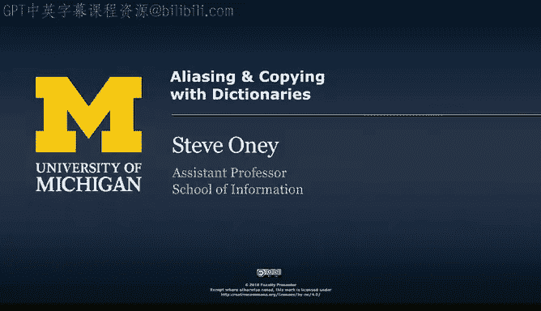
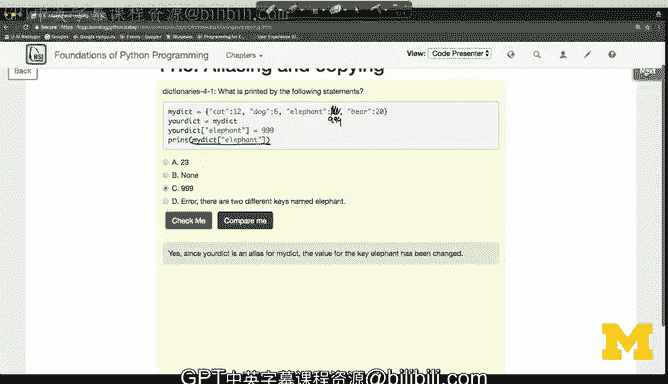

# 密歇根大学《Python3编程（课程1、2）》｜Python 3 Programming（Python for everyone进阶）（中英字幕） - P115：27_02_07_字典别名与复制机制.zh_en - GPT中英字幕课程资源 - BV1CM411Z72u

Welcome back。One more thing to note about dictionaries is aliasing。So on line one。

 we create a dictionary that has three key value pairs。And on line 2。

 we assign a new variable called alias to be that dictionary。 On line 4。

 we print out is alias opposites。 And this is asking， are they pointing to the same object。

So if we run code lens on lines one through four。hen we'll see again。 line one creates a dictionary。

In line 2 assigns alias to point to the exact same object of that dictionary。Now。

 this is important because here， if we say alias sub right equals left。

 reassigning right from its previous value， which was wrong， and then we print out opposite subright。

Then we're actually going to print out left on line 7。

So here we can see line 4 says true because alias is the same object as opposites。 But now。

 when we print out opposites sub right， we now get left。

 And that's despite the fact that we first assigned opposite sub right to be wrong。

And in all of these lines， we never directly changed opposite subright。

But the culprit here is that on line 6， when we changed alias subr to be left。

 then that also changed opposite subright。Again， we can use code lens to see why that is。

So on line  one， we create a dictionary。And then we assign alias to be that exact same dictionary。

And we can see alias is opposite。And now， when we assign alias sub right to now be left。

 then that modifies that dictionary so that right is now left in that change the value associated with the key right to be left for both opposites and alias。

So let's go through a question related to this。So here on the first line。

 we create a dictionary with four key value pairs。And then we assign your dict to be my dictionary。

So your dic is pointing to this same dictionary。And then we say your diict sub elephant equals 999。

Now， remember， your dict and my diict are the same object here。

 So when we assign an elephant to be 999， that erases the value 23 and replaces it with 999 for both of these dictionaries because they're pointing at the same object。

So now when we print out my dictionary subeleant， then we're going to get the value 999。

That's all for now， until next time。

