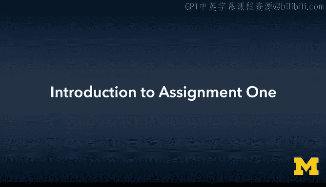
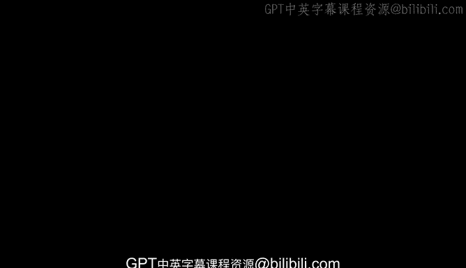
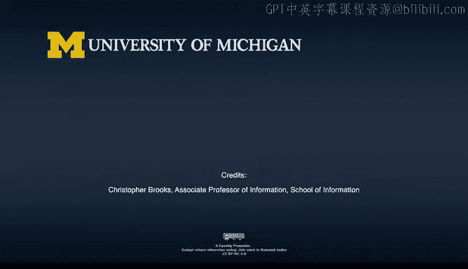

# 密歇根大学《Python3编程（课程3、4、5）》｜Python 3 Programming（Python for everyone进阶）（中英字幕） - P116：08_01_05_作业1介绍.zh_en - GPT中英字幕课程资源 - BV1gj41177yd

As much as I like dungeon crawlers， I also like word games。

 And so that's the topic of the assignment for this course。Assimon 1 is fairly straightforward。

 but requires attention to detail to solve correctly。 Your job is to build a bot。

 an automatic program or maybe computational agent， which is going to play the game wordy pi。

 not so original word guessing game that I made。In the assignment。

 I've given you the rules of the game as well as a class diagram that must be strictly followed in order for your bot to be able to play the game correctly。

Keep in mind with this assignment that you don't have to create a very intelligent bo。

 All you need to be able to do is pass the unit tests。

 which I've created based on the rules and the class diagram given in the assignment。Now。

 I've actually done some of the heavy lifting work here and written the game engine you'll be using。

 It's important that you don't change this or modify other code unless the instructions explicitly ask you to as the autograder uses what I've written to determine whether you've solved the problem correctly or not。

But I've left all of the code there and in the open for you to explore and hope you enjoy tackling this week's assignment。

