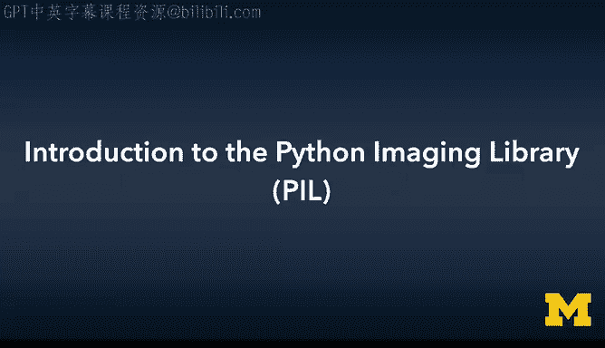
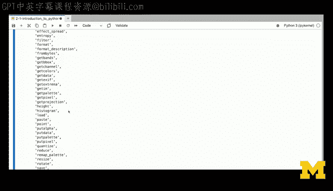

# 密歇根大学《Python3编程（课程3、4、5）》｜Python 3 Programming（Python for everyone进阶）（中英字幕） - P117：09_02_01_Python图像库简介.zh_en - GPT中英字幕课程资源 - BV1gj41177yd

In this week of the course， I'm going to introduce you to a new third party library that extends the functionality of Python to include image manipulation。

 This library called the Python Iaging library， which is often shortened to pill。

 is the main library we're going to use in Python for dealing with image files。

 This library is not included with Python， but we've installed it here in the Coursera system for you to use。

 Let's do a little exploration of this in the Jupiter notebook。 Okay。

 so the first thing I'm going to do here is import the library。Now。

 you've already seen that some norms exist around writing documentation and the beauty of these norms is that you can expect to see them followed by major thirdparty libraries like pill。

 just like individual classes and methods。 modules themselves have doc strings。

 So let's take a look at the doc string here。 and we're going to use help pill to take a look at that。

 All right， so we get quite quite a large dock string。 See， we've got a name。

 we've got a description and then we've got the package contents。 Now。

 let's try and parse all of this output。 we've got the description of the module and we have a section called package contents。

 Each one of the items in this list of contents is actually another file in the pill package。

 These are essentially submods of the pill package， which we can import into our code and use。

 We see that the main module only has a couple of classes and then we can get a version number for the packages as well as a link to the file。

 which is being referenced。 We can actually go find that file and look at the pill source code if we wanted to。

 So you can see here， this is where it's installed on my。

And we could actually just go open that file and see what's in the Python imaging library。 Now。

 let's import a sub module and take a look at the docs。

 I'm going to import the image submod from pill and let's look at those docs。So there's a lot here。

 all of the documentation for the image submodule Now we might just want to see which attributes。

 the methods or classes which are in this submodule exist If so， we can use the DR function。

 so I'm going to do that here。So you could see a bunch of these are classes。

 a bunch of these are different kinds of objects we can instantiate or actual functions themselves or potentially subpackages。

That's all still pretty overwhelming。 But I spied in that dirt command。

 another attribute called image， and that's a class。 So let's take a look at the docs for that class。

 Now， take a look at this help command I'm writing here。 I pass in image dot image。

 Do you understand what' what's going on here， So I'm saying help image and that first image is actually our imported module or our submodule dot image and that second image is actually our class that I want to inspect。

 One of the beautiful things about the Jupiter environment is that you can explore your code a bit。

 So please don't hesitate to do this。 Let's see what our data types are of these different items。

 So for the very first one， I'm going to print out the type of pill。

 and I'm going print out the type of image， then I'm gonna to print out the type of image dot image。

 And before I execute this cell。 Can you guess what the outputs going to be。

 What are you expecting to see the type of pill， the type of image and the type of image dot image to be。

Okay， so we can see here that the packages are actually modules and that the classes are actually types。

So at the top level of this package， we have a module pill。 This， in turn。

 has several sub modules such as image。 That sub moduleule actually has a class in it called I。

 and even though this makes things a little bit confusing。

 it's totally allowed to have a class name and a module name be the same thing。

We can use the help function in Python to quickly check the documentation of a given class， module。

 or function。Now， I have to confess， this isn't what I normally do。

 at least not for learning a new library。 I go to the web page for the library and check out the documentation。

 If the library is popular enough， and this one certainly is， then that's usually good enough for me。

 But where I do use this in line help function is with recalling methods of classes for a library。

 which I use， but not very frequently。 Let's take a look at this in Jupiter。

Let's take a look at what attributes exist on the image class， so I'll just do Drim dot image。

 All right， so we see that there's quite a number。And a lot of them begin with these double underscores。

 and then a whole bunch are just regular words。

Okay， there's a bunch of private methods here denoted by that leading underscore and then there's some public ones as well let's take a look at the one called load。

 so I'm going to say helpim。im。 load and what's that saying is I want to take the module or the submodule image I want to take the class within that called image and then I want to take the attribute in this case it's a function or it could be a method called load and I want more information about that。

So we see that this load function takes no parameters other than self。

 and that it's going to return an image object， either as a pixel access object or a pill dot pi access object。

You'll notice here that the documentation is in a slightly different form from the Google Doc strings we've been using。

 this alternative method is called restructured textex or RST。

 and I would say it's the second most common form of structured documentation in the Python language。

It turns out that creating a new image object in pill follows the factory style pattern I showed you in a previous module。

 it's actually the image module which has a function associated with it。

 and this returns a new image object， let's take a look at the docs for the open function。

So a couple of things to notice here， first， this is a function and not a method。

 as we can see there is no self being passed in in the parameter list。 This gets a little nuanced。

 but in Python functions and methods are objects themselves。

 and in this case the function is associated with a module and not with another class。

We see that there are three different parameters which can be passed in FP mode and formats。

 that mode and formats also have default values and that the result of calling this function is an image object。

 We also get some handy information about the different kinds of exceptions that might occur。

Let's talk about this very first parameter， FP， as it's a very common pattern to see in Python。

The dock string says this is a file name， So maybe a string or an O S dot path like or file object。

 Hopefullyfully， the docs indicate this means that any object with a read。

 seek and tell method should be accepted and used。 Now。

 this is very similar to the Python duct typing that I showed you in the last week of the course with the adventurer and the monster classes each having hit points attributes。

Instead of strictly enforcing that parameters are of a given type。

 the norm in the Python world is to just try and use them as you would want to and throw an exception if they don't adhere to the scheme that you need。

Okay， I've done a lot of talking in this lecture about how to use the Python help functions。

 but we haven't even seen an image yet， let's remedy that and load our first image。

One of the ways we could create a new image object is through the pill dot image。

 open function and this may return a pill dot image object。

 let's try that using a picture of the University of Michigan。

 so I've included a picture here called Northquad。 JPEG and here I'm going to create a new variable called I I'm going to use the open function of the image module and we're just going to print out that。

Okay， we see that this returns as a kind of pill dot JPg image plugin do Jpeg image file。 At first。

 this might seem a bit confusing since because we are told by the docs that we should be expecting a pill dot image dot image object back。

 but this is actually just object oriented inheritance working。 In fact。

 the object return to us is both an image and a Jpeg image file。

Let me show you using some more advanced pieces of the Python standard library。

 including this inspect module， how we can dig into this。

 I'm going to use this function called get M， and it stands for get method order method resolution order。

 and this will show you that the inheritance chain for the object includes both of these。 Okay。

 great， we can see that this is indeed a Jpeg image file， which itself is a subclass of image file。

 which is a subclass of image， which is a subclass of object。 But how do we view the image。

 It turns out that the image object has a show method。 And if you read the documentation for that。

 it sounds quite promising。 So let's try that out。 So I'll do image dot show here。

Now I get a bunch of errors that pop up on my screen when this happens， I can't find a browser。

 these are all different kinds of browsers， unable to open a file in a temporary directory and actually image dot show is meant to work locally。

 but we're sitting here in a Jupiter notebook and so instead we want to actually render this image in the Jupiter notebook and Jupiter has a function which can help with this called display so from i Python dot display。

 we import display， we're going to use this regularly。

 we just call display image it's almost as if we were printing the image and then it should render right into the notebook。

Great， now you should be able to see a picture of my office building， the North Quad A complex。

We covered a lot of ground in this lecture going over the built in help functions in Python。

 the DR function which lets you list the attributes of modules or classes。

 as well as the base introduction to the Python Iaging library or pillll and how to load an image and display it in Jupiter。

I untangled a bit here how you can programmatically see the object inheritance hierarchy using a JPEG image as an example。

With that review in hand， I want to dive into the fundamentals of images in computer systems。

 so let's tackle this in the next lecture。

