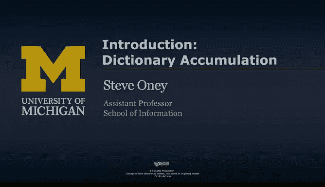

# 密歇根大学《Python3编程（课程1、2）》｜Python 3 Programming（Python for everyone进阶）（中英字幕） - P117：29_02_01_字典累积导论.zh_en - GPT中英字幕课程资源 - BV1CM411Z72u

In this lesson we're going to go over the dictionary accumulation pattern。

 which combines dictionaries and the accumulator pattern to make both even more powerful what we're going to learn is not a new Python type or construct。

 instead it's a technique for solving many kinds of problems by extending the accumulator pattern to be able to use any number of accumulator variables。

As a preview for how we'll do this， we'll use the key value pairers in a dictionary to track any number of accumulator variables we'll learn more about this pattern primarily through examples and problems。

 so let's get started。