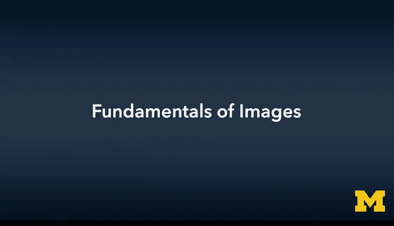
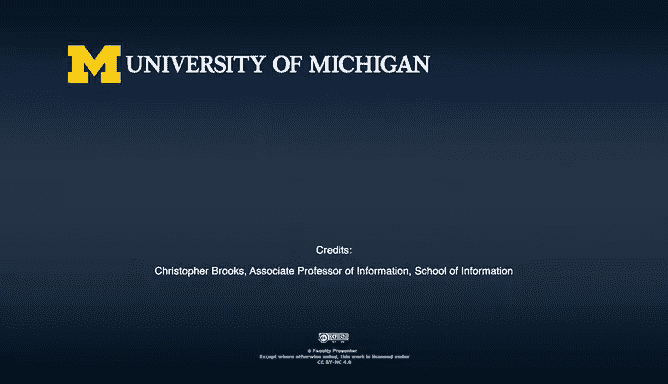

# 密歇根大学《Python3编程（课程3、4、5）》｜Python 3 Programming（Python for everyone进阶）（中英字幕） - P118：10_02_02_图像基础概念.zh_en - GPT中英字幕课程资源 - BV1gj41177yd

Computer graphics and computer vision is a huge field。

 and I won't be able to introduce you to the breadth of the area here in this course。 However。

 I want to take a moment and talk about the fundamentals of how computers store images。

 as this will be important for you， both in your assignment and for anything else you might want to do with images。

I'm going to focus here on a kind of image called a raster or bitm image。

 A raster image is a reductionist approach to representation， and at a high level。

 it segments an image into a two dimensional array， sort of like a grid。In this grid。

 each cell contains information such as color for a single pixel value。

 And the lines of the grid are imaginary and have no width to them。

This means that raster images are rectangular， so they'll have a width and a height and a total number of pixels in a raster image is just the number of rows times the number of columns。

In this course， we're only going to be talking about square pixels。

 but it's possible to have other shapes as well。An alternative method for representing images is a series of vectors。

 drawing primitives， which describe the lines and fills， which make up an image。

Vectctor images are really quite powerful as they can be resized in infinite amount without losing resolution。

 Raster images， on the other hand， are much easier to create。

 especially if they come out of a device which has an imaging sensor， like a camera or a cell phone。

I won't talk any more about vector images in this course。

 but I do want to dive into Raster images and I think that Jupiter notebook is the perfect place to do this。

So the first thing I'm going to do is bring in our Python imaging library and load up the image that we've been playing with。

So remember this can get a little confusing， but image up here is actually a module or a submodule of pill。

 and then it's going to create this variable here will actually be of type image。

 which will be the class。Now， this image is a raster image and would have come out of camera。

 That means it's made up of this grid of pixels。 And we can see how many pixels there are in it by looking at the size attribute。

 And this size attribute's actually going to return a tuple in the format of widtha height。

 So I'm going to print the image object。 that I'm going to print it size。

 then the width and then the height。Okay， we have an image which is 1。

400 pixels wide by about 800 pixels high。But what is a pixel really？Importantly here。

 I printed out the image object on the very first line。

 and this underneath calls the image wrappper method。

 and the developers have included in this description the mode of the image。Now， for this image。

 the mode is set to RGB， which stands for red， green and blue。

 What this means is that a pixel is actually a triple with one value for red。

 one value for green and one value for blue。 And that when we take these and combine them together。

 the computer is going to display a specific shade of color。

We call these different color dimensions of a pixel the color channels。So in this case。

 we have three color channels， a red one， a green one and a blue one。 Now this is pretty common。

 but there are other ways to represent color channels which have their advantages and we'll touch on that in a little bit。

Okay， what is the value of a color channel in most image manipulation software。

 each color channel value is a single byte， a number between 0 and 255。

This means that for a single pixel with three color channels， RGB。

 there exists 256 to the power of three potential combinations。

 meaning that we can represent over 16 million colors for each and every pixel in our image。

Now this sounds like a lot and frankly it is there are three color channels。

 each one's a bitete in size and graphic artists would say that we have a three byte color depth。

Actually， we tend to speak in bits instead of bytes， and since a bite is 8 bits。

 and we have three of them， it means we have a 24 bit color depth for a Jpeg image or 8 bits per pixel per color channel。

Now， I don't want to go in too deep into this， but I really actually love image work。

When you're shopping for your next TV or monitor， pay attention to what the advertised color depth is。

 When I originally filmed this course， the norm was that televisions and monitors had an 8 bit color depth。

 which means each color channel is being given 8 B of information and is represented by a single by。

 Modern TVs， however， or cell phones and monitors have since evolved and it's common to see 10 B color depths。

 This is often called high dynamic range or HDR， because each color channel can now be represented by over 1000 different values。

 significantly increasing the nuance of information， which can be captured and shown in images。

Now let's get a pixel out of this image using the pill library。To get a pixel out of the image。

 we can use the get pixel method。 This method takes in a tuple of the X and Y coordinate of the pixel we want to retrieve。

 The X， Y origin， which is the place we start from， is the top left corner of the image。

 Let's grab a chunk of blue Michigan sky from that image。

 So I'm just going to get pixel at position 1010。 That should give me some sky。Now。

 you might have thought that a blue dot would show up， but remember。

 while Jupiter knows how to render a pill dot image dot image object， when we pull out a pixel。

 we're actually just getting a tuple of the color values。

Let's verify this so first I'm going to print out the type of that pixel so I'm going to do exactly what I did。

 but instead of trying to display it， I'm just going to print out its type。

 but then I'm going to walk through the RGB values in the tuple and print them out here and so I'm just going to enumerate the string RGB and then do a little print and I'll be calling image。

ge pixelixel passing in the index of where we are and printing out its type as well。Okay。

 so the sky pixel that we grabbed at location 1010 has a low red value， 13。

 a moderate green value 93， and a high blue value， 164。When we use the RGB color scheme。

 a value of 000 represents pure black， while a value of 255， 255， 255 represents pure white。Now。

 I think this is probably all you actually need to know in order to do this week's assignment。

 but I want to go a bit further and show you some of the other methods available which might make image manipulation more convenient。

So let's get a single channel for the whole image in this case I'm going to take out that blue channel。

 so the way we can do this is we can take our image object and we say dotge channel and then we can refer to it either by an index its position so this is RGB so that would be position 2 right because it starts 012 or we can just use B to ghetto the blues and I'm going to print out blues and then print out the type of blues as well。

So this is interesting to me when we take out a single color channel。

 what happens underneath is that pill goes pixel by pixel and makes a copy of the image。

 but only copies out the blue channel。So now we have an 8 bit per pixel image instead of a 24 bit per pixel image。

 and it only has the blue values in it。There are two other changes that you might have noticed here。

 First， the image is a pill dot image dot image， not a Jpeg image file。

 as we're dealing with a copy in internal memory。Second， the color mode is set to L。 Now。

 an image of mode L is a black and white image。 The L stands for luminosity。

 and pillil believes that the single byte channel represents a gray scale value between 0 and 255。

If we render this image in Jupiter， we'll be looking at a grayscale image which is only made up of the blue color channel。

 let's check that out。So let's render the blue channel and because we've saved this into the variable blues。

 we should just be able to do display blues。That's not bad at all。

 we've compressed this image by just keeping one color channel， the blue one。

 and it's still recognizable。Now， if you've used tools like Adobe Photoshop。

 there are plenty of different ways you can create black and white photos from color ones。

In this one， it's tough to see the nuance of the foliage because we've dropped that green color channel。

 which has all of this information in it。 Let's do one more little demo and take a look at an image。

 which is just the green color channel。Take a minute to look at these two images and note how they're different。

 I see a lot more nuance in the trees and the foliage in the second image， where in the first image。

 they just appeared black and without detail。 And sometimes that's called clipping。

Look at the sign in front of the building。 The background of this is blue and shows up as a moderate gray in the first image and quite a dark gray in the second。

The block am on that sign， which is yellow， or， as we say in Michigan， maze。

 shows up lightly colored in the second image， but almost black in the very first one。

By converting our image to black and white using single color channels。

 we get very different interpretations of what's being shown。Okay。

 one more quick demo getting into the dirty details。

While using high level objects like get pixelixel is great。

 Sometimes you want to deal only with the actual pixel values For this。

 we can convert the image into an array of values。 So I'm going to say contents is equal to image dot 2 Btes。

 and then I'm going to print out the very first pixel in this image。

 and then I'm going to print out the first 10 Btes of the image and the total length of it。😊。

Interesting， so we can see that the bytes object returned by the two bytes function is just one giant sequence of numbers with the each pixel's RG and B values being put in order。

It's important to note that the bytes are a fundamental type in Python。

 This isn't a list of bytes or a byte array。 It's instead of byte's object。

 and this object is one dimensional and immutable， meaning that it can't be changed or updated。

To zoom back out to the big picture in this lecture。

 we've covered the fundamental data structure of a raster or bitmap image。At a high level。

 it's a two dimensional grid of values with each value representing a single pixel in a rectangular image。

The values for a pixel change based on the mode of the image。 For instance， an image in mode RGB。

 we would expect to see three entries in each value cell， with each entry being an integer。

 indicating how much of a given color should be displayed。We call these color channels。

 and RGB is a very common mode for images。However， it's also possible to have single color channel images with luminance being represented instead。

 and this essentially makes black and white images。Now。

 this is just the start of a really complex and interesting field。

 which has a really interesting set of roots in analog television。For instance。

 black and white television from the 1940s was essentially black and white because only luminance was being broadcast。

 And that actually made a lot of sense。 The human eye is much more sensitive to luminance。

 The amount of reflected light than it is to different colors， individual wavelengths of light。

Now I really want to dive in more to this world with you。

 but I think we should instead look at this Python library and ground our investigation in how to actually manipulate images and we'll tackle that in the next lecture。

