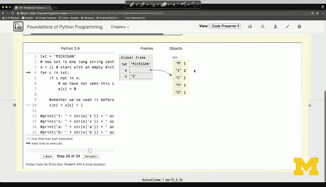

# 密歇根大学《Python3编程（课程1、2）》｜Python 3 Programming（Python for everyone进阶）（中英字幕） - P118：30_02_02_字典累积技术.zh_en - GPT中英字幕课程资源 - BV1CM411Z72u

Welcome back， So we've already gone over the accumulation pattern where you iterate over a sequence and update an accumulator variable as you iterate through every item in that sequence。

In this lesson， we're going to go over the dictionary accumulation pattern， which is the same idea。

 except our accumulator variable is going to be a dictionary that has multiple key value pairs。

So let's start out with the standard accumulation pattern example。 So on line one here。

 we open a file named Scarlet。 Txt， and we open it to read it。And then we say text is F。 read。

 so in other words， Txt is a variable which is a string， and it's the contents of the file， Scarlet。

 TxT。So suppose Scarlet。txt represents the text of the book， the Scarlet Letter。

So let's say that we want to keep track of how many Ts are in Slet。txt。

The way that we do that is with the accumulation pattern。 So here。

 T count is our accumulator variable。We initialize it to be0 at first to say that we've seen zero Ts so far。

 and then we iterate through every character in our text file。

And we say if that character is the letter T， then say t count equals t count plus1。 In other words。

 we just saw one more character T。So by the time we're on line 8 and we're done with our four loop。

 if we print out the value of T count， then we should have the number of Ts in Scarlet。 TXt。

So if I run my code。then i'll see that here there are 7 thousand five hundred and eighty four occurrences of the character t in scarlet do t x t。

So that's great， that's the standard accumulation pattern。

 but let's suppose that we wanted to count more letters than just the letter T。

So suppose that we also wanted to keep track of how many ss are in Slet。txt。Well。

 we could do that in almost the same way， so here we open up Slet。txt again。And then， we read it。

Except now on liness 4 and 5， we create two different accumulator variables。

 We have T count to keep track of the number of T's， and we initialize that to0。

 and then we have S count to keep track of the number of Ss。Like before。

 we still iterate over every character in TXT， but now we say if that character is a T。

 then t count is t count plus 1。If the character is in S， then we instead update S count。

So by the end of our for loop T count is going to be the number of T's and S count is going to be the number of ss。

So you could imagine doing this for any number of characters。

 but for every character that we would want to accumulate。

 we would have to create a new accumulator variable here， so we might have a count， then B count。

 then C count and so on。 And you can imagine that if we wanted to count every character in the alphabet。

 initializing 26 accumulator variables might be just a little bit lengthy codewise。

So one alternative way to do this。 and it's going to seem a little bit weird at first。

 but I'm going to get to why we want to do this is by instead using a dictionary。

 So like the code before we open up the file， Scarlet dot T X T。And then we read it in。

And now I'm going to have one accumulator variable， which is a dictionary。

So I say x equals an empty dictionary。Inside of that dictionary。

 we're going to have multiple key value pairs。 so if we wanted to still only count T's and s's。

 then rather than saying t count equals 0， I'm going to say x sub t equals 0。

And rather than saying S count equals0， I'm going to say x sub S equals 0。Now。

 these are just different key value pairs in this same dictionary X。

So now what we can do is we can loop through every character in our file once again。 and again。

 we say if that character is a T。Then our dictionary x sub T equals its previous value。Plus  one。

If that character isn't S。Then， x sub S。Gets incremented by one instead。And again。

 by the time our for loop is done， then we're going to have x sub t as the number of T's in our dictionary。

 and x sub S is going to be the number of ss in Slet do Txt。So when we run our code。

 then we can see the number of T's and the number of ss。

So I'm going to make one really small change to our code。So here on line9。

This statement is inside of if c equals the character T。

So what we can do is we can replace x sub T here so we can replace the hard coded T with the variable C。

 We know that this is going to be the same because here we only run this code if C is the character T。

So we can say x subc equals x subc plus 1。And here we can say x sub C。Equals x sub C plus1。

 because this line is inside of this Llf C equals equals the character S。 So in other words。

 what we're going to just do in the next piece of code is we're going to replace a hard coded S and hard coded T with the value of the variable C。

So。we do that。We get something that looks like this。 So we say if the character C is T。

 then say x sub C equals its previous value plus1。Now， because again。

 this is inside of an if statement， we know that C is going to be T here。

 but we'll get to why we actually want to make this change in a little bit。Same thing with this LF。

 so we know that C is going to be the character S here。

 but we just replaced the hard coded S with the value of the variable C。If we run our code。

 we're going to get the exact same result as before。

So now I want to go into why we actually wanted to replace that hard coded T and hard coded S with the value of the variable C。

So let's suppose that rather than just counting the number of T's and the number of s's in Scarlet do T X T。

 we wanted to count the number of every single character So the number of A's， B's， C's。Ss and Ts。

 spaces， exclamation points， and so on。So we could do that by replacing line4 with a whole bunch of aumative variables。

 So A count， B count， C count， exclamation point count， etc ceter。

 but then our code would get really long and really repetitive because we would need to initialize a separate accumative variable for every single character that might be in Scarlet do TxT。

Instead， what we're going to do is the dictionary accumulation pattern。

 so we're going to have one accumulator variable， which is a dictionary。So on line 4。

 we say x equals an empty dictionary。And then like before， we looped through every character in TXT。

And what we do is we have an if statement to say if the character C is not in our accumulator dictionary。

 so if C is not in x， so in other words， if we haven't encountered this new character C yet。

 then we initialize x sub C to be 0。What that means is that the first time we see the character a。

 then we're going to initialize x sub a。To be0。The first time we see the character T。

 then we initialize x sub T to be 0。And so on。Now， here on line 11， still inside of this for loop。

 we say x sub C。Equals x sub C plus 1。In other words。

 we add one to its previous value for whatever this character see is。So in other words。

 if the character C is the letter A， then we say x sub a equals x sub a plus 1。

 and that says that we saw one more a。If the character is the letter T。

 then we say x sub t equals its previous value plus 1 and so on。So here on line 13。

 we just print out the number of characters T and the number of characters S on line 14。

So what we should find is that we actually get the exact same value for T and S as before。

 So if I run my code。Then we will see that we get the correct number of T's and s's。

But what's great here is that we have more than just T's and S's collected。

 We can print out the number of any character we want， so I can print out the number of A's。

Just by saying number of A's is x sub a。And the number of bs is x sub B。

You'll see that our dictionary is keeping track of every single letter that might occur in Slet。 txt。

So to illustrate how this works， I'm going to go with just a slightly simpler example。

 so rather than assigning TxT to be the value in Slet。 TxT。

 I'm just going to say TXT equals the string Michigan。

And I'm going to leave the rest of the code the same。

 except I'm going to comment lines 12 through 15。Now I'm going to run my code in code lens。

So you can see line1 initializes TXT to be Michigan。

Line3 initializes our aumulator variable x to start out as an empty dictionary。

And then we're going to loop through every character inside of our string Michigan。

So C is first assigned to the character M because that's the first character。

 And we say is C in our dictionary already， In our case， it's not。

 So we assign x sub C or x sub M to B 0。And now on line 10。

 we immediately increment the value associated with X sub M。So we say we've seen 1 m so far。

With the character I， then we see that I is not in our dictionary， So we initialize x sub I to B 0。

And we set its value to its previous value plus 1。With C， it's not in our dictionary。

 So we initialize it to 0 and then increment it。With each。we said it to zero。And then， increment it。

So you can see that our dictionary keeps building up the number of times that we've seen every given letter。

So at this point， we've seen M IC H， and so far none of these characters were in our dictionary。

 and so our dictionary was just adding a new key value pair for every letter that we saw。Now。

 the next character is going to be this letter I。So you can see C is the character I。 Now。

 the key point here is that I is already in our dictionary。So here this if。

Is not going to execute because I is in our dictionary。 And so rather than setting x sub I to be 0。

 we just increment it on line 10。 So you'll see x sub I go from 1 to 2 to say that we've seen two eyes so far。

In the case of G。It's not in our dictionary。 So we add a new key value pair。And increment its value。

 and so on。So by the time our for loop is done， then we end up with the dictionary。

Where every key is a character in our text T X T and every value is the number of times that we've actually seen that letter。

So we'll see dictionary accumulation a lot。 and really I find that it just takes a lot of practice to get used to。

 It's a little bit counterintuitive at first， but we're going to go through more examples with dictionary accumulation。

 and I think it's going to make more and more sense with more practice。

That's all for now， until next time。