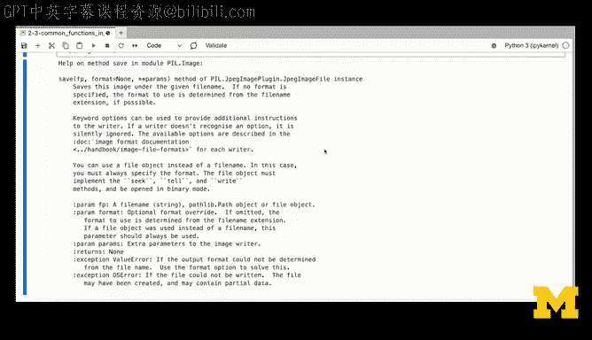

# 密歇根大学《Python3编程（课程3、4、5）》｜Python 3 Programming（Python for everyone进阶）（中英字幕） - P119：11_02_03_Python图像库常用函数.zh_en - GPT中英字幕课程资源 - BV1gj41177yd

In this lecture， I'm going to show you a few more functions of the Python imagingaging library。 Now。

 I'm not going to go into much detail about how they work。

 but instead give you an overview of the things you can do with this library。

So first let's import the Pll module and the image submodule。

 and then I'm also going to bring in the i Python display functionality and just open and load this North quad image and display it like we did in the previous lecture。

Okay， so there's our image。Now， first， let's take a look at how we save images using the save method。

 so I'm going to do help Iage。t saveve。You'll notice here in my help。

 this is actually the image object and then this is the method or function。

 but I'm not invoking that method， I'm actually just passing it as a parameter to help to try and get this documentation and we could see that documentation here。

Now the save method has a couple of parameters that are interesting。

 The first one called FP is the file name that we want to save the object to。

 The second format is also interesting。 It allows us to change the type of the image but the docs tell us that this should be done automatically for us just by looking at the file extension So let's give it a try。

 This file was originally a Jpeg image file， but I bet if we save it in a do Png format and read it in again。

 we'll get a different kind of file， So Pngs are pretty common now they're called portable network graphics So I'm going to save this as North quad do Png and then I'm just going to overwrite our local variable image and load this from the Png file and then I'll use this inspect do getm method resolution order in order to see what the inheritance hierarchy looks like。

 Indeed this is created a new file and we can see that this new object is actually a ping image file object which itself is a subclass。

Of image file， a subclass of image and further on a subclass of object for the purposes of this class。

 the difference in image formats isn't so important。

 but it's nice to know that you can explore how a library works to understand a little bit more about what's going on under the hood。

The pill library also has some nice image filters to add some effects to our images。

 It does this through a function called filter。 This function takes in a filter object。

 and all of the filters， which are available to us， are actually stored in this image filter object。

Now I recommend you explore the documentation a bit here and you can either use the web or the builtilt in help function in Python。

 but let me just show you a couple of filters to get you started。

So I'm going to import the image filter module and then I'm going to use the image dot filter method and I'm going to apply a blur to the image and so you can see here that I pass that as the parameter。

 the image filter dot blur， and then I'm just going to display this and we're making a copy of the image here as we do it。

when that renders， you can see that indeed it's a blurry picture of my office building。

I encourage you to pause this video here， jump into the notebooks and start experimenting with some of the other filters。

 The emboss and sharpened filters， for instance， are interesting， Or for a challenge。

 check out the box blur or median filter functions and look at how their parameters work in order to get an idea about how you can use them。

😊，Now I'm not going to talk any more about these filters in this class。

 so this is an opportunity for you to play a bit before we move on。

As youve seen previously behind each image object， the pill library holds a grid of pixel values。

 A pixel value describes the color of a single dot in our image。

 And thus an image that has a width and a height， we can start when the origin。

 the upper left hand corner or 0 comma 0。One of the things we can do is take a portion of the image out just by cropping it。

 so let's take a look at the documentation for the crop method。

So cropping is pretty common and if we look here， we can look at the documentation for help on cropping。

So we can see here that to crop an image we actually pass in a box。

 and this is a common concept called a bounding box。

 and that's going to be passed in as a tuple with four values， the left upper pixel。

 the right lower pixel。 The crop method then returns a new image object representing the cropped image。

So for instance， if we wanted to get that Michigan logo out of this image。

 we might start with the top left position at like。570655 and put the bottom right at 62698。

 let's take a look at that。So there's a couple of things we should talk about here。 First。

 the bounding box is a very common pattern used in image manipulation and recognition to indicate regions of interest in a picture。

 Another common pattern is the immutability of an image that the operations like this cropping of the image generally don't change the image。

 but instead return a copy of the image with changes made。Now， this is not always true。

 but many libraries use this practice， so it's one to be out on the look for。

But let's talk about these pixel values for the bounding box。 Did I just eyeball it。Well。

 sort of it took me a few tries， but instead of cropping the image over and over again。

 I actually rendered the bounding box on top of the image to see where it laid。

 Let me show you how I did that。So strategy I like to try and do is draw the bounding box directly on the image when I'm trying to line up things like this。

Now we could draw in images using the image draw module I'm not going to go into detail and how to use this module。

 but I want to give you a quick example， so I'm going to import the image draw module then the image draw module can create for us these new draw objects so we have to initialize them somehow and so I'm going to get this drawing object here and I just call image draw do draw it's going create this new object for me。

 I pass in the image in that constructor for draw that we want to work on and I get that drawing object back。

Now， we could draw various shapes， but let's start with a rectangle。

 The rectangle method takes a list of four values。 Again。

 the upper left and the right lower pixel are defined in those four values。

 We're going to draw a red rectangle around the Michigan logo。 And you can see here。

 I've set it for this rectangle that there's no fill。

 So we'll be able to see the inside that the outline is red and that the width of the lines that are actually being drawn are five pixels big。

And we can see here that indeed， we get a nice red。Rectangle， almost a square around that block in。

That's just the briefest introduction of how to use the image draw module。 Now。

 this module has the ability to change individual pixel values， Draw complex polygons。

 do different fill levels or even add text。 I find it handy with exactly this kind of task。

 What I want to highlight the area of an image， and I need to draw a few bounding boxes to do that as a demonstration。

I encourage you to explore the image draw module， especially since you can do it right here in Jupiter。

In the next lecture though， we're going to talk about how to handle multiple images and operations among them using the Python Iaging library。

