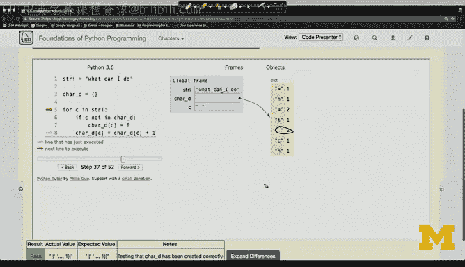

# 密歇根大学《Python3编程（课程1、2）》｜Python 3 Programming（Python for everyone进阶）（中英字幕） - P119：31_02_03_字典累积演示.zh_en - GPT中英字幕课程资源 - BV1CM411Z72u

Welcome back。 So let's go over some questions that use dictionary accumulation。In this question。

 were provided a string sentence。And the question asks us to split the string into a list of words and then to create a dictionary that contains each word in the number of times it occurs。

 and that dictionary should be named word counts。So the first thing that I'm going to do。

As I'm going to split our sentence into words。 We can do that by calling the split method on string。

 I'll say words。Equals sentence dot split。And so words is going to be a list of strings。

 The first item is going to be the。 the second item is going to be dog。

 The third item is going to be chased， and so on。So then we want to use dictionary accumulation and in this question。

 we're told to use the dictionary word counts， so I'm going to name my aumulator variable。

 word counts。And I'm going to initialize it as an empty dictionary。

Then we need to loop through all of the words， So say for every word。In words。

And we want to say if that word isn't in our dictionary so far。 So if word is not in word counts。

And if it's not there， we initialize its value to 0。 So word counts sub word。Equals0。

And then still inside of our for loop。 But outside of the if statement。

 we're going to increment the value of word counts sub word。 So word counts sub word。

Equals word counts sub word。Plus， one。So let's run our code and we can see that it produces the correct value。

But I actually print out the value of word counts。So if I say print word counts。

Then we can see that the word the with a capital T appeared one time。

 the word the with the lowercase T appeared three times into appeared once。Rabbit appeared twice。

 and so on。This question， we' asked to create a dictionary called Car D from the string S T R I。

 so that the key is a character and its value is how many times that character occurred。 So this is。

 again， a straightforward application of the dictionary accum pattern。

 So I'm going to name my dictionary aumulator。 Car D。Then I loop through every character in ST I。

 So I'll say4 C in S I。And if I haven't seen that character before。 So if C is not in car D。Then。

 car D。Sub c equals 0。And then inside of the4， but outside of the if。

 I say car D sub C equals its previous value。Plus， one。So when I run my code。

 then I can see that it worked correctly， but let me run this code in code lens just to see again what's going on here。

So on line one we initialize s i to be the string what can i do，On line 3。

 we initialize our accumulator variable， our accumulator dictionary to be an empty dictionary。

Then we loop through every character in S I。 So we first say。

C is the character W or the first character。And then we say if she is not in Car D。Which it is not。

 So we assign Car D， sub C or Car D sub W to be 0。 and then we increment it。

Same thing with the letter H， so H isn't in our dictionary， so we're going to add it。

And initialize its value to one。Same thing with a。The character A was not in our dictionary。

 so we initialized it to one。Same thing with T。Same thing with the character space。Inxi。

So at this point， we're at this a。And we're going to see that a is in our dictionary。

We're going to skip this， if。And we're going to say car D sub a equals its previous value plus one。

 So we'll see this update to be2。And then we keep adding characters as we go on。

The second time we get to a space。 So at this point， we at this space， then we'll see。

this value increment by one，And so on。 That's all for now， until next time。

