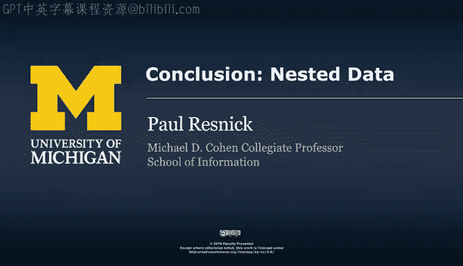

# 密歇根大学《Python3编程（课程3、4、5）》｜Python 3 Programming（Python for everyone进阶）（中英字幕） - P11：10_02_05_嵌套数据总结.zh_en - GPT中英字幕课程资源 - BV1gj41177yd

Welcome back。You've now seen some multiply nested data structures with inner lists and dictionaries。

 inside outer lists and dictionaries。You've picked up some vocabulary about outer and inner elements。

And you've seen that we just have to use square brackets multiple times to descend into these nested data structures。

If there's a list of numbers inside a list。Inside a list， three levels of nesting。

 then we'll have to use three square brackets to pull out one of the numbers。

We can do that all on one line， or as several steps each with its own line of code。

But you'll need three square bracket operations somewhere in the code。

You've also learned about the JSson format。 Remember JsonN load S to load from a string creating a Python list or dictionary。

JsonN。Dumps to dump to a string so you can save the string in a file or pretty print it with nice indentation and line breaks。

As a reward for your perseverance， a few punny jokes about birds， birds。 Why birds。

Because we've been talking about nested data。It's almost wintertime here in Ann Arbor。

 as I record this， what do you call a bird in the winter？A bird。

Why do birds fly south for the winter。Cause it's too far to walk。

And did you hear the joke about the broken egg。Yeah， that one cracked me up， too。See you next time。

