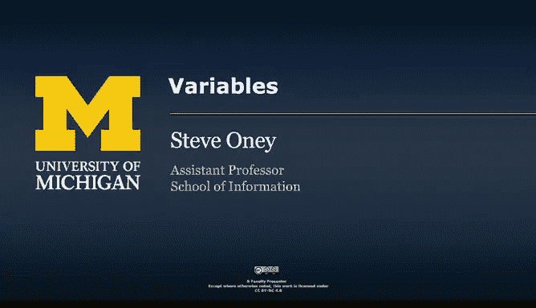
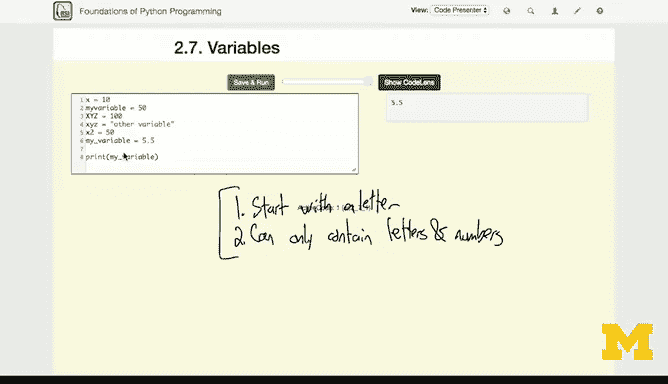

# 密歇根大学《Python3编程（课程1、2）》｜Python 3 Programming（Python for everyone进阶）（中英字幕） - P11：11_01_07_变量.zh_en - GPT中英字幕课程资源 - BV1CM411Z72u

Welcome back。 If you write an expression in compute value。

 then you probably want to store that value somewhere。Variables are useful because one。

 they allow us to store the values of expressions to be used later on in our programs， and two。

 because they allow us to give us human readable names for values that we can then reuse later on。

So for example， in math class， if you ever have done geometry， then you might be familiar with pi。

 and when you use pi， you usually don't write out 3。14159 etc， instead you just use the symbol pi。

So PI is almost like a variable， it has a name and a value。

 and Python has an equivalent to variables in its programming language。

So every variable has a name and a value。So in this program we create three variables。

 The first variable is called message。And it's created on line one。

So message has the value What's up doc， which is a string。

And then we create a second variable whose name is n。And whose value is 17。

And then we create a third variable whose name is pi and whose value is 3。14159。Now。

 the first three lines are setting variables。And then we reference or use those variables in the last three lines。

So if I run my code， then you'll see that I get three things printed out from lines5，6 and7。

So when we print out message， then we print out what's up doc。 When we print out n。

 then we print out 17。 When we print out pi， then we print out the value3。1415 nine。

Now it's useful to be able to kind of simulate the execution of programs like this in your head and in order to do that。

 we have what's called a variables values diagram or a reference diagram。Now。

 to draw a reference diagram， what we do。Is we go line by line from top to bottom。

 so we start at the top line one and then go down and for every line we're going to say what variable is set to what value。

A reference diagram has two columns。 It has variables。In values。

So what we do is we go line by line from the top of the program to the bottom。

 and we're going to say what variable is set to what value。So in this program， on line1。

 then we set the variable message to the value， the string Whats up doc。

So in our variables values diagram， we say the variable message。Is set to the value。What's up， Doc？

Online 2。We set the variable N。to the value7，Online 3， we set the variable pi。To the value，3。14159。

And now， by the time we get to line 5， when we say print out message， then this expression。I。

An expression whose value evaluates to whatever message is pointing to。

 So when Python says print message， it looks at this， and it says this is an expression。

 specifically it's an expression that references the variable message。

 And so the Python interpreter looks in this variable values diagram， and it asks。

 what's the value of message。 We see message here。And we see that message value is Whats up Doc。

And so what that means is that when we print out message， then we print out what's up doc。

And same thing for when we actually look up the value of n。So when we say print out the value of n。

Then Python is going to first look in this variables values diagram。

 and it sees that the value of n is 17。So what that means is that when we print out the value of n we print out 17。

And same thing for when we print out the value of pi。 So Python looks in this reference diagram。

 sees that pi is 3。14159， and when we print out pi， then we print out 3。14159。Make this。Green。

 just to be slightly clear。So you might ask what happens if we actually overwrite the value of a variable。

 so what happens if we actually have a variable that I'll just call x？And we said it to5。

And then i'll say print x。And then I'm going to later on reset x to be 10。And I'll say。

 print X again。So in order to determine what's going to happen here。

 then I'm going to write out my variables values diagram。

So line one sets the value of the variable x。To the value 5。And then on line two。

 when we print out the value of x， then we're going to print out five。On line4。

 we set the value of x to 10。 and so what that does is it says x no longer points25。

 so I'm going to erase this line。And I'm going to cross out 5 x now instead points to 10。

And so x now points to 10。In here， when we print out X。

 then we actually are going to print out 10 rather than 5。

 and you can see this if we run our program。 So again here。

 the first line or the first print statement prints out 5， the second print statement prints out 10。

So every variable has a name and a value。Even though the value of a variable can be anything。

 the name has some restrictions。So every variable name has to start out with a letter。

Invariable names can only contain letters and numbers。So for example。

 x is a valid variable name because it starts out with the letter and only contains letters and numbers。

Same thing with my variable。I can also have capital letters， so I can say。X， Y， Z， capital X， Y。

z equals from 100。And these are all valid variable names。 So if I print out the value of。X， Y， Z。

Then it prints out 100。One thing to note is that Python is what's called case sensitive。

 and what that means is that the variable name X， Y。

 z in all capitals is different from the variable name X， Y， z in lower case。

so if i print out x y z in all capitals then i get one hundred if i print out lower case x y z。

Then I get this other variable value。If I print out x capital yz。

 then there's no variable that's called x capital yz。

 and so I get an error saying that this variable is not defined。

So variable names have to follow these two rules， start with a letter。

 and it can only contain letters and numbers。 and what that means is that a variable name that starts out with a number。

 so if I say 2 x equals 50。This is not a valid variable name because it starts with a number rather than starting with a letter。

And if I try to save and run my program， then I'm going to get a syntax error because I have a bad variable name here。

I can have a variable called x2。Because that starts with a letter。

But I can't have a variable name 2 x。One thing to note here is that Python also treats underscores like characters。

 So what that means is that I can have a variable， my variable。And I can send it to her。5。5。

and if i print out the value of my variable then i'll get five point five。

So because Python treats this underscore character as a letter。

 people often use underscores as a substitute for spaces in their variable names。

So variables are a useful tool that well use to one remember in expressions value to use later on。

 and two to give a nice name to the value of an expression so that it's more human readable until next time。

