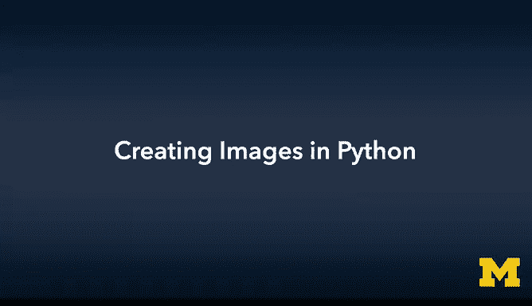
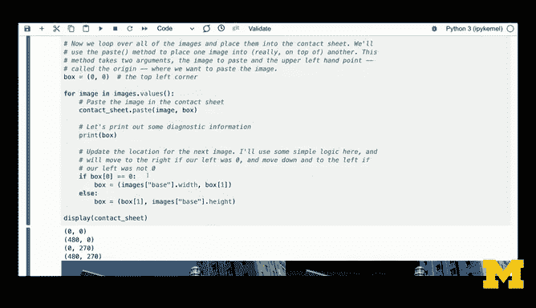
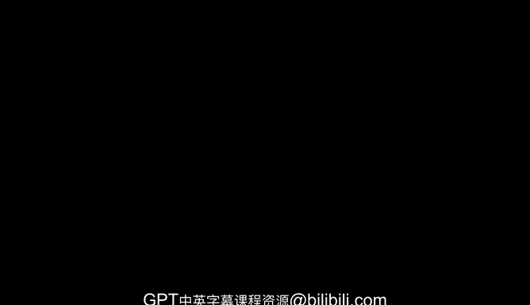
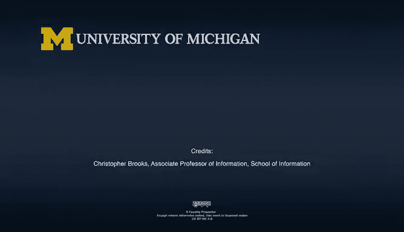

# 密歇根大学《Python3编程（课程3、4、5）》｜Python 3 Programming（Python for everyone进阶）（中英字幕） - P120：12_02_04_在Python中创建图像.zh_en - GPT中英字幕课程资源 - BV1gj41177yd

For this week's assignment， you actually don't have to create any new images yourself。

 I'll do that for you。 Your job is to use the Python Imaging library to detect elements of the image。

 usually based on color。 However， I think it's important that you know how images were just a bit more。

 So this lecture is going to focus on creating and manipulating images using the Python image library。

So first， I'm going to bring in a number of the different libraries we need。

 and then I'm going to load the image that we were working with last time this north quad image。 Now。

 for this lecture， I need a smaller image。 So let's resize this one。

 And there's really two different functions we can use resize and thumbnail。

 They differ in subtle ways。 thumbnail takes a single argument as a tuple width and height。

 and it modifies the image in place and preserves the aspect ratio。 resize， on the other hand。

 returns a new image and you have complete control over whether you want to preserve the aspect ratio or not。

 If we want to preserve the aspect ratio and use the resize method。

 then we want to divide the original by the width and height。

 and you'll see me doing this quite a bit throughout this lecture and the next one。 Great。

 We have a small version of our image now and our original image is untouched in a previous lecture。

 I showed you how you can take an image and change it from the RGB color space to the L or lumin。

Co space effectively creating a black and white image from a color1。 Now。

 we're going to do this again。 But this time， we're going to make what's called a contact sheet。

 A contact sheet is sort of an old school method of developing film where you develop every exposure in a small thumbnail on a single piece of photo paper。

 This gives you a single sheet that you can use to see all the photos that you're working with。😊。

In this example， I want to create a contact sheet that shows the original image as well as three different grayscale images using the red。

 green and blue channels as appropriate。Now there's a few ways that we can do this。

 but I'm going to start by creating the four images。

 We already have that base color image done and we know from the previous lecture how to create the others。

 so I'm going to put them all into a dictionary here called images I'll just call our base one or color one and I'll put it straight straight in there And then here I'm going to go by the color bands and I'm going to convert them。

 Now it's useful to know that sometimes color channels and color bands。

 these are really the same things。 but even within a library like pill here。

 you see that they use the two interchangeably and this can kind of make things a little harder for people who are new to image recognition or image manipulation。

Now I'm just going to display some diagnostic information and then loop through all of those images in that dictionary and display them here in the notebook。

All right， so we see our dictionary keys have base， R G and B， and then here we have them R。

 G and B at the bottom。Okay， so this looks good， let's make sure we label these images though。

 so no one gets confused and let's put them together into one larger image in this two by two grid。

To put the images together into one larger image I'll first create a new image and I'm going to call it the contact sheet and this has to be big enough to hold all of the smaller images。

 so we do this with the image new function it requires us to provide a mode I'm just going to use RGB from the base image as well as a width and a height so here I'll create a new image I'm going to tell it I want the same mode as the base image so RGB and then I'm going to give it the dimensions of the image here。

Allright， now that we have that， we can loop over all of the images and place them into that contact tree。

 We'll use the paste method to place one image into， and it's really on top of the other。

 This method takes two arguments， the image to paste and the upper left hand point called the origin where we want to paste the image We don't have to give a width and a height dimension herell pill will just pull that automatically from the image we're pasting for us。

So I'm going to start with my box at the origin in the top left of the image remember and that's a little different if you're used to like mathematics and the origin is right in the center and then you kind of build out from there but not in images in the images it's in the top left hand corner then for each image in our dictionary I'm going to paste it。

 I'm going to print the box and then I'm going to update the location for our next image I'm just using some simple logic here and I'm going to move to the right if our left was already a zero and move down and to the left if our left was not zero。

And then last of all， I'm going to display that contact sheet。

Here's a good little exercise for you。 Take a look at our logic here。

 it works fine if we're creating this two by two image。

 but what would we need to change to have it work with an arbitrary number of images。For instance。

 let's say we wanted to have this as a three by three image。

 so a total of eight variations and one original， how would you modify the code， But again。

 instead of guessing， why not try it， put a few more images into the dictionary and see if you can create a three by three contact sheet。

Okay， now let's briefly talk about text。 The Python imagingaging library allows you to render text onto an image as well。

 and this is where the difference between Ra images and vector images becomes really apparent。

In a vector image， the text is sort is stored as a set of drawing primitives。

 such as a location on the image， the size and the font of the text and the words to render。

 This is then turned into a series of shapes。 And when you resize the image。

 the text remains legible and clear。In a raster or bitm image， the text is converted into pixels。

 This means that when it's resized， there isn't much that the machine can do to ensure that it remains legible。

 and you're often going to get that pixelated look to text in images which have been reized。

The best approach when working with Ratrographs in text is to add your text after you've finished the rest of the image manipulation。

Since we already have the contact sheet created， I'm going to use it as our base image and put the text on top of it。

 Like other drawing functions， text drawing is done in the image Dr module。

 but we also need to include the image font for loading system fonts。

So I'm going to bring both of those in。Now when we've created a font object for drawing。

 we need to indicate which font we want to use。 I've arbitrarily chosen to use this Robboto bold。

 which is a true type font and we'll need to indicate the size we want that font to be so when we load a new font object in pill we first give a location for where that font is coming from。

 which file it should be， at least in the case of a true type font and then here I'm saying I want it to be 25 points big。

The pattern I'm going to use is similar to the previous example。

 I'm going iterate through the series of images， but instead of using them directly。

 I'll just write the text information to the contact sheet。 So again。

 I'm going to start my box in the upper left corner and then I'm going to iterate through all of the different labels。

 I'm going to write the text on an image with a black background with the width of the image being the size of our individual images and the height being 30 pixels tall because I'm writing in 25 point font。

 So the first thing I have to do is create a new base image and I'm creating this is RGB you see that it's got the size of the width is actually just the size of one of our images so it's that kind of fourth if you will。

 and then I've got it 30 pixels high because I'm going to write 25 pixels of text and then I've decided that that's going to be black。

Then I get a handle to draw on the image and we've seen how the image draw module works。Now。

 when we draw our text， there's two required parameters。

 the first parameter being the anchor position， indicating where the text will start and the second parameter being the text itself。

There are numerous optional parameters such as size and font。

 but let's take a look at this anchor parameter。 This is a two character string which indicates where the text should be anchored。

 The pill documentation on this is great， especially if you're a bit of a font geek like me and you like to talk about like sizes and kning and so forth。

But in short， MMM means that the text will appear in the middle of the anchor location and that the text will thus the text will be centered both vertically and horizontally around this point。

Because of this， we put our first anchor point right in the middle of the block。

 so you can see this is the place that we want our text to be anchored。

 and that's right in the middle of the block。Then we have the text that I actually want there。

 I've indicated the size here so you can override the size if you want here， this is superfluous。

 we could get rid of it， and then I indicate that my text is being anchored MM。

 so in the middle horizontally and vertically with respect to the very first parameter that we've passed in。

 which is in the middle of the block， and then I indicate which font I want to use。

The pill documentation is great if you want to see it for more information about the text anchors in particular。

Alright， then the last step is just to paste this into the contact sheet。

 update our location and display， so let's run this。Al right， that's looking pretty good。

 A contact sheet that shows our four different options and tells us which color channel they've come from。

 We've created a handy function if you just want to quickly make an image black and white and want to see some of the variants that could be formed from it。

Now I could end the lecture here， but I want to show you one more thing。

 remember that our base image had this color mode of RGB， red， green and blue。

 and that each of our grayscale images have a color mode of L for luminosity。

When you paste those images across into the contact sheet， the mode is changed to RGB。

So what does this actually look like under the hood， let's take a look。

So let's look at a chunk of the blue grayscale image so we can do this by finding the image center and then subtracting the height of the bar which holds the label。

 So here I'm going to take the width and height divided by 2 and a regular width and height and just crop out a bunch of this and then I want to print out just a couple of pixels so I need to move down enough so that I'm under that black bar that says it's a B and so I'm going to print out four pixels 0 comma 31 comma 30。

031 and one comma 31 and we can take a look at these so what happens underneath is that pill modifies the image from a single channel to three channels but does so by repeating the pixel value across all channels。

This creates an RGB based image that looks black and white because when an RGB pixel has equal values in each channel。

 it's a shade of gray。Okay， as you can see I love image work and sadly I don't get to do much of this anymore when I was a doctoral student however。

 I did a lot of hobby work with grayscale images， including high dynamic range photography and composite photography。

 which at the time we called gigapixel imagery。It's rewarding to be able to look at a scene through the lens of a camera and then snap a photo and then look at the photo on your monitor and peep at the individual pixels。

Hopefully you found this series of lectures on the Python Iaging Library interesting and are ready to tackle this week's assignment。

