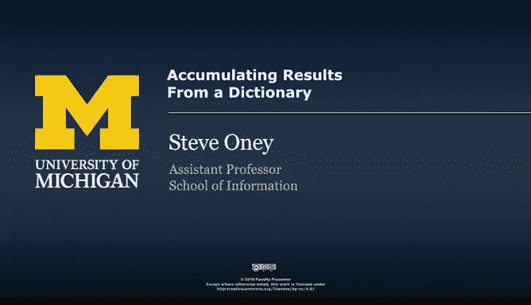
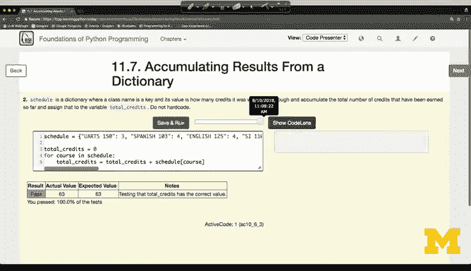

# 密歇根大学《Python3编程（课程1、2）》｜Python 3 Programming（Python for everyone进阶）（中英字幕） - P120：32_02_04_字典结果累积.zh_en - GPT中英字幕课程资源 - BV1CM411Z72u

Welcome back。 So we'd learned how to do the dictionary accumulation pattern。

 but now we want to learn some things that we might want to do with our accumulated dictionary。

 So rarely do we just want to do something like accumulate the number of every character in a dictionary。

 We typically want to actually do something with that data。So here we have the same code as before。

 so we open up the file Scarlet。 Txt， load its contents into the variable TXT。

And initialize our accumulator variable letter count to be an empty dictionary。Then。

 through this for loop。We associate every key in letter counts。

Which is going to be a character with the number of times that character appears in Scarlet dot T X T。

So in other words， by the time we get to line 12。Then letter counts is going to be a dictionary where every key is going to be a character such as T。

And every value is going to be the number of times that character appeared， so in the case of T。

It's 17584。So in our code before， we just printed out the number of T's by printing out there R。

 and then something like letter count， sub T。Ts in scarlet dot Txt。

We can do the same thing with other characters， of course。So we can say that there are this many A's。

In bees， and so on。But suppose that we wanted to print out the number of every single character in letter counts。

Well， we could do that by using a for loop so we could say4。Every character。 So for every。

 I'll just call my iterator variable Y。In letter counts。And then inside of our for loop。

 we can just say。There are， and then letter counts sub y。

And we can say that there are that many of the character， why。

So what this code is going to do is it's going to loop through all of the keys in letter counts。

 And for every key， y is going to be the value of that key。

 And then we're going to get the number of times that character y appears by printing out letter count sub y。

 And then we say there are that many。And then whatever that character y is。So when we run our code。

We can see that there are this many T's， this many Ss， this many spaces。

 this many capital Ts and so on。And you can see that there are quite a few characters in Slet do T x t。

So let's suppose that we had called our dictionary X instead of letter counts in this question we asked。

 which of the following will print out true if there are more occurrences of the character E than the character T in the text to study in Scarlet and false if T occurred more frequently。

So this is assuming that our previous code has run。

 except our dictionary is called X instead of letter accounts。

So we want to write an expression that's going to be true if there are more ease。Then tease。

So the way that we do that， we get the number of the character E by saying x sub E。

This is going to get the value associated with the character E in the dictionary X。

And then we get the number of T's。By saying X sub。Ti。

If we want to know if there are more E's than T's， then we can write the expression。

 x sub E is greater than x sub T。 So in other words， the answer here is going to be B。

So if you've ever played the game Scrabble， then you know that different letters in Scrabble have different scores。

 So letters that are more rare have a higher score than letters that are more common。

So let's suppose that we want to open up Scarlet 2 dot Txt。

 and we want to figure out what's the quote unquote Scrabble score for this。 So in other words。

 for every character， suppose that we want to note not just how many times that character appeared。

 but what the scrabble score for that character would be。So from minds 1 through 11。

 we have the dictionary accumulation pattern， and it accumulates the frequency of every character in Scarlet 2 Dxt into this dictionary X。

And then on line 13， we have a different dictionary which represents the scrabble letter value of every character。

So an a， which is a really common letter， only has a score of1， whereas a Z。

 which is a lot less common， has a scrabble value of 10。

So if we wanted to get the Scrabble score in Scarlet 2 dot T X T。

 the note we could do is we could loop through every character inside of the dictionary letter values。

So， I'll say。4。Every character， I'll call it Y in x。

And then because not every character has a scrabble score。 So， for instance。

 numbers or exclamation points don't have scrabble scores， but they're in our dictionary。

 We want to first check to see， is that character Y in letter values。 So I'll say if。

Why is in letter values。And we want to keep track of what's our letter value so far。

 So the way that we do that is with the standard accumulation pattern。

 So I'm going to initialize an accumulator variable， I'll call it Scrabble。Score。

We initialize it to0。And then， we say。If this character， Y has a letter value， then Scrabble score。

Equals its previous score。 So scrabble score equals scraling。Score。Plus。

And then we want to add the score for that letter。 So in other words， you know， A has value 1。

 B has value 3， C has value 3 and so on。 So we get that score by saying letter values。Subwayi。

a y is going to be a b c d e f g and so on，And then we want to multiply that by the number of times that that character appears。

 So I'll say letter values sub y times。X， sub y。X is， again。

 our dictionary accumulator variable from the previous problem。So in other words。

 we're saying the score is the previous score。Plus。The value of that letter。

Times the number of times that that letter appeared。

So this is using the standard accumulation pattern here。 our accumulator variable is Scrabble score。

And we update it by saying Scrabble score equals Scrabble score plus letter value sub y times x sub y。

So if I print out the scrabble score at the end of this four loop。

Then I should expect it to be the actual Scrabble score of scarlet 2。 Txt。

So you can see that this has a pretty high scrabble score overall。

Let's do some more questions that involve dictionary accumulation and doing something after we accumulate the results from the dictionary。

So in this question， we're told the dictionary travel contains the number of countries within each continent that Jackie has traveled to and we're asked to find the total number of countries that Jackie has spent to。

 In other words， our result is going to be 2 plus 8 plus 3 plus 4 and so on。

And we're asked to save that into the variable named total。And so in this question。

 we're given a dictionary。And it doesn't matter how we arrived at this dictionary。

 So we might have 20 lines before this that compute this dictionary's value。 Or in this case。

 we're just given the dictionary as a literal object。 But regardless of how we get that dictionary。

 What we want to do is we want to accumulate the sum of every value associated with every key in that dictionary。

So we can do that with the standard accumulation pattern。

 So I'm going to first initialize an accumulator variable total to B 0。So this is initializing。

Our accumulator。Vable。then we want to loop through every single continent。

 so I'll say four continent。In travel。So continent is going to be North America， Europe。

 South America， Asia， Africa， etc cea。So for every continent in travel。

We get the number of countries within that continent that Jackie has been to by saying travel。

Subcontent。And we want to say total。Equals total plus。Travel subcontinent。 So this is us updating。

Our ad variable。So again， what we're doing is we're looping through every key in our dictionary。

And we're getting the value associated with that key。 So 2，8，3， and so on。

 in adding that value to our previous total。And by the time we're done with our for loop。

 we should have the total number of countries that jackie has been to。In this question。

 we're told that schedule is a dictionary where a class name is the key and its values how many credits it's worth。

 whereas to go through and accumulate the total number of credits that have been earned so far and assign that to the variable total credits。

So this is the same idea with just a slightly different dictionary。

 So our accumulator variable is going to be named total credits。We're going to initialize it to 0。

Then we want to loop through every course in our schedule， so I'll say four course in schedule。

So again， here， course is going to be U art 150， Spanish 103， English，125 and so on。

We get the number of credits for that course by saying schedule。Sub course。

And we add that to the total number of credits by saying total credits equals total credits。Plus。

 schedule sub course。

That's all for now， until next time。