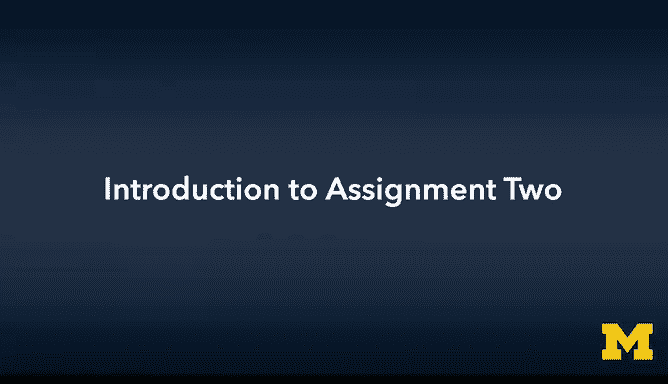

# 密歇根大学《Python3编程（课程3、4、5）》｜Python 3 Programming（Python for everyone进阶）（中英字幕） - P121：13_02_05_作业2介绍.zh_en - GPT中英字幕课程资源 - BV1gj41177yd

We learned a lot about image processing this week， and now it's time for you to bring some of those skills into wordy pie。

 While there are a number of different things for you to address in this assignment and the architecture diagram that I've given you will outline those things。

 I've also updated the game engine to not return objects to you， but to return images。 That's right。

 from the image you need to detect whether a letter was in the correct place or not。 And， of course。

 all of my work is open to you。 and you can learn how I wrote the wordy Pi game engine from my code。

Keep in mind that you must pass the unit tests in order to pass the assignment。

 so submit your word to the autograder once you think you're ready。

We're getting closer to writing a fully functional game and game playing agent。

 I hope you're as excited as I am to start diving in and rendering some wordy pie images。😊。

