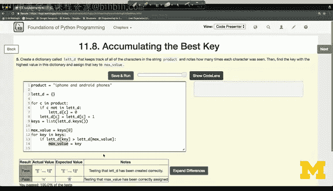

# 密歇根大学《Python3编程（课程1、2）》｜Python 3 Programming（Python for everyone进阶）（中英字幕） - P121：33_02_05_最优键值累积.zh_en - GPT中英字幕课程资源 - BV1CM411Z72u

Welcome back。In this question， we're asked to create a dictionary called D that keeps track of all of the characters in the string placement and notes how many times each character was seen。

So in order to do this， we're going to kind of use the standard dictionary accumulation pattern。

But this isn't all that this question asks us to do。

 It says then find the key with the lowest value in the dictionary and assign that key to be min value。

And in order to do this part of the question， then we're going to use the standard accumulation pattern。

More specifically， actually， we're going to use Min max value accumulation。

So let's do this first part， which involves dictionary accumulation first。

So I'm going to create a dictionary， D。Initialize it to an empty dictionary。

 Now loop through every character in placement。 So I'll say 4 every character C in placement。

If that character is not in our dictionary， So if C is not in D。Then initialize d sub C to be 0。

And then regardless， we're going to say D sub C equals its previous value。Plus one。And now。

 by the time we get to line 9 here， we've accomplished this first part of the question。

 So we have a dictionary D where every character is associated with the number of times that that character appears in placement。

Now， let's do the second part where we want to find the key with the lowest value in the dictionary and assign that key to be min value。

So the first thing that I'm going to do is I'm actually just going to get a list of keys。

 So I'm going to say。Keys。Equals list of D dot keys。So keys is going to be a list。

And every item in that list is going to be a character， so we might have one item as the character A。

One item is the character E。 One item is the character C， one might be a space， and so on。

So keys is a list of the characters in placement or a list of all of the keys in our Dictionary D。

And now we want to get the key that has the lowest value in our dictionary D。So。

We're going to use max value accumulation。 In this case。

 we actually are searching for the minimum value， but it's the same concept。

 So I'm going to initialize min value。To B keys sub 0。

 I'm just going to do this arbitrarily to give us a starting point。 So in other words。

 min value is going to start out as the first key in our list of keys。

 So it might start out as something like the character a。

And then we're going to search for any key that has a lower value associated with it。

 So I'll say for every key in keys。And I'll ask， is the value associated with this key， So if。

D subki。Is less than the value associated with min value。

 So if D sub key is less than D sub min value。Then we say our new lowest key is this new key。

 Sal say min。Value equals key。So again， we kind of have two parts in this question。

The code from line 3 through 8 addresses the first part where we create a dictionary with character frequencies。

In then。Lines 10 through 15 address the second part of finding the key with the lowest value。

We use information from this first part， in other words， we use this dictionary D in the second part。

 but we kind of apply the accumulation pattern two different times to solve this problem。

So when I save and run my code， I can see that I get the correct values。

So in this question we're asked to create a dictionary called Let D that keeps track of all of the characters in the string product and notes how many times each character was seen。

And then we find the key with the highest value in that dictionary and assign that to be max value。

So again， here we have kind of two different parts。 The first part uses dictionary accumulation。

The second part。Uses max value。Accumulation。So to do the first part。

 we're going to create a dictionary， let。Underscored D。Initialize it to an empty dictionary。

 Then we're going to loop through every character。In product。

 and we're going to say gift that character is not in。Right第。Then， let。D sub C is initialized at 0。

Then we say let D sub C equals its previous value。Plus， one。

So if I print out the value of let D at this point。

 then I should get a dictionary where keys are associated with the number of times that that character appears。

 Now， we want to find the key with the highest value in this dictionary。 So in this case。

 it's going to be N。So I'm going to get a list of keys。 I'll say keys equals list of let D dot keys。

And for every key。In keys。Actually， first， I'm going to say max value equals the first key。

And for every key keys。If the value associated with that key， So if let。D sub key。

Is greater than let D sub max value。Then I've seen a new largest value。 Ssy max value equals key。Now。

 when I run this code， I should see that I pass every test and max value ends up being n。

 which was the correct answer。

That's all for now， until next time。